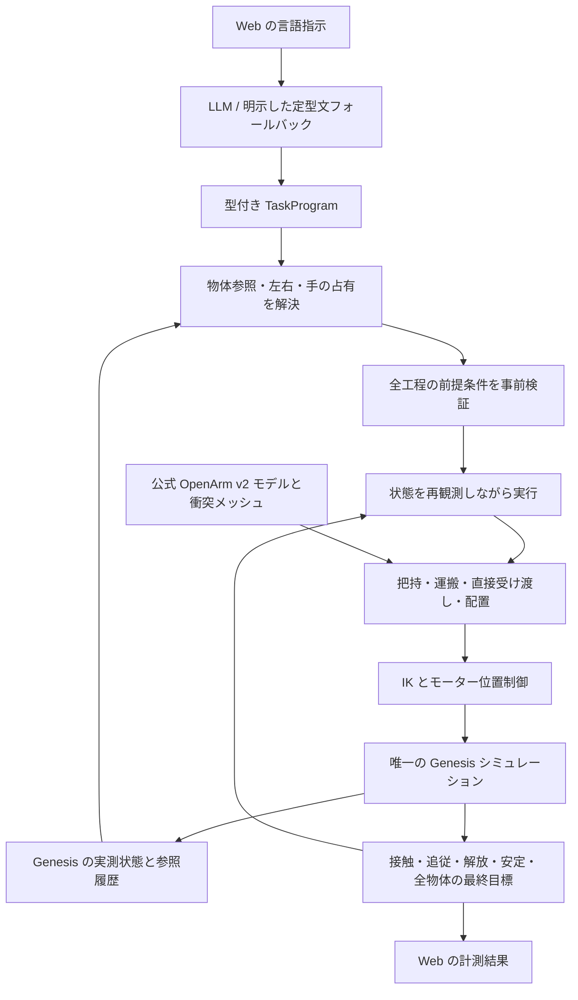

# OpenArm v2 — 言葉で作業する Genesis エージェント

公式の OpenArm v2 Cell と Genesis World に限定した、ファインチューニング不要の操作エージェントです。
日本語・英語・混在する指示を、物体と左右の手を区別した作業列に変換します。Web は指示入力と計測結果の表示、
実際のシミュレーションは独立した Genesis ネイティブビューアーが担当します。

```text
右手がBlue Cubeを取って左手に渡した後に置いて、
その左手にあるRED CUBEを掴んで右手がそれを取って右手のところに置く
```

この指示は「青を右で取る → 左に渡す → 左側に置く → 赤を左で取る → 右に渡す → 右側に置く」に分解されます。
左右の手が同じキューブを接触で保持し、受け手の把持を確認してから渡し手を開く、直接の受け渡しです。

## 起動

Python 3.12 または 3.13 と `uv` を使用します。プロジェクトのルートで実行してください。

```bash
uv sync
./run_genesis_gui.sh
```

[http://127.0.0.1:8000/simple](http://127.0.0.1:8000/simple) を開いて指示を送ります。
`/` でも同じ入力画面を表示します。Genesis のウィンドウで実際の動作を確認できます。

ローカルの Ollama に `qwen3-vl:4b` がインストール済みであれば、ランチャーが自動選択します。
既存の `AI_AND_API_KEY`、`AI_AND_BASE_URL`、`AI_AND_MODEL` がすべて設定されていれば、OpenAI 互換のプロバイダーを使います。
設定は `.env` に置き、Git に追加しないでください。モデルを再学習したり、重みを変更したりする処理はありません。

```bash
# ローカルモデルを明示して起動する場合
OPENARM_LOCAL_PLANNER=1 OPENARM_OLLAMA_MODEL=qwen3-vl:4b ./run_genesis_gui.sh

# 言語モデルを使わず、対応する定型文だけで操作する場合
OPENARM_LOCAL_PLANNER=0 ./run_genesis_gui.sh
```

モデルを利用できない場合は `deterministic_fallback` と表示します。理解できない指示を、勝手な赤キューブの移動に置き換えることはありません。
インポートされた Qwen3-VL の Ollama テンプレートが `{{ .Prompt }}` だけの場合は、モデルのアーキテクチャを確認してから
会話の区切りと非推論の出力開始形式を補います。ほかのモデルのテンプレートや、Ollama に保存されたモデル自体は変更しません。

## 指示の例

```text
右手で青いキューブを掴んで
それを左手に渡して左側に置く

青いやつを右で拾って、空いてるほうの手にパスして、そっちの端に置いといて。
そのあと赤い方を左でつまんで右に受け取ってもらって右側に置いといて

Pick the blue cube with the right hand, then pass it to the left hand,
then place it on the left side.

赤を青いゾーンに置いて、青を緑のゾーンに置いて
右アームを右に10cm動かして
グリッパーを開いてください
```

「取る」だけなら保持します。「置く」まで指定した場合は解放と安定を確認します。
手を省略した場合は現在持っている手、または実測位置に近い手を選びます。
置く場所を省略した場合は保持している手の側に置き、その解釈を画面に表示します。
「それ」は指示内の直前の物体、続く指示では直前に扱った物体を参照します。
シーンの初期化で参照履歴も初期化します。

画面には解釈した全工程、実行中の工程、プロバイダー、手が持っている物体、失敗理由、最終状態の判定が表示されます。
停止はキュー待ちの指示を取り除き、実行中はコントローラーまで伝わります。途中の物体をリセットして成功を作る処理はありません。

## 構成



言語モデルの仕事は意図の分解です。関節角、自由な Python、物体の座標書き換えを生成させません。
1つの手が2つのキューブを持つ計画、受け手が塞がった受け渡し、未知の物体、範囲外の相対移動は事前に拒否します。
無効なモデル回答は検証理由を添えて1回修正し、それでも無効なら理解できた定型文へ戻るか、理由を示して失敗します。

受け渡しでは、公式メッシュに基づいて両腕とキューブの姿勢を一緒に解きます。受け手は物体の外側から直線で接近し、
両指の接触を確認してから渡し手を開いて後退します。その後、受け手だけで3cm持ち上げ、物体の追従と接触を確認します。
運搬も短い直線経路に分けます。IK が解けただけで動作を成功扱いせず、実際の到達位置と姿勢を測ります。

詳細は [docs/ARCHITECTURE.md](docs/ARCHITECTURE.md) を参照してください。

## 検証の再実行

```bash
uv run pytest -q
uv run python scripts/measure_grasp_geometry.py --check

# ユーザーの例を、定型文コンパイラーから実際の物理実行まで検証
uv run python scripts/verify_language_tasks.py --case example

# 同じ例の初期位置を変更
uv run python scripts/verify_language_tasks.py --case example --randomize

# ローカルモデルで日英・言い換え・複数指示を実際に実行
uv run python scripts/verify_language_tasks.py --case all --provider local

# 既存の、初期位置9通りの把持・配置チェック
uv run python scripts/verify_pick_place_genesis.py
```

`outputs/language_tasks_local.json`、`outputs/language_tasks_fallback.json` などに、
解釈した作業列、各動作の計測値、両指の接触、受け渡し後の持ち上げ、最終配置の誤差を保存します。
これらの JSON は Git 管理外です。検証スクリプトは、要求された数の実際の受け渡しと全目標の確認が揃った場合だけ終了コード0を返します。

## このマシンでの検証結果（2026-10-20）

- `uv run pytest -q`: 68件成功。IKが実際のシーンへ候補姿勢を書き込まないこと、左右の腕とリフターの運動学が一致することも確認。
- ローカルモデル有効時の言語タスク: 7シナリオ・8指示がすべて成功。直接受け渡し9回を含みます。
- 上記8指示のうち、7指示は `local_ollama`、単純な「掴んで」の1指示は明示された定型文コンパイラーです。
- 初期位置を変更した、ユーザーの2回受け渡しの例も成功。
- 既存の初期位置9通りの把持・配置も9/9成功し、水平誤差は2.4–2.8mm。
- IKを計算用データへ分離した後も、Webからネイティブビューアーへ送った同じ長い例が成功。全14工程を各1回、再試行0回で完了し、最終配置の水平誤差は青3.55mm、赤3.57mm、実行は約119秒でした。

これらはこのシーンで実行した具体的なケースの結果です。任意の指示全般の成功率を示すものではありません。
生成された `outputs/validation_summary.json`、`outputs/motion_replay_fix_validation.json` と各実行JSONに、判定と計測値を保存しています。
検証時の [ネイティブ画面](outputs/motion-replay-fix-native.png) と [Webの完了表示](outputs/motion-replay-fix-ui.png) も保存しています。

## 対応範囲

- 現在の公式 OpenArm v2 Cell、2つの剛体キューブ、青・緑のゾーンと左右・中央の配置場所が対象です。
- 言語モデルを利用すれば言い換えを扱えますが、任意の日本語・英語を常に正しく解釈する保証はありません。
- このシーンの操作スキルの組み合わせに限定しています。未知の物体、柔軟物、積み重ね、同時に別々の物体を交換する動作は実装対象に含みません。
- 受け手の手が塞がっている場合は、先に置く指示が必要です。目標に別のキューブがある場合も、意図せず積み重ねることを避けて停止します。
- 物理の失敗は現在の状態を残して報告します。限定したテーブル上の把持の再試行は行いますが、シーンを途中で初期化する回復は行いません。
- 配置判定は水平40mm以内、垂直50mm以内、指からの解放、低速かつ100msの安定を要求します。実際の誤差も別途表示します。

## 公式モデルとライセンス

[OpenArm の公式モデル](https://github.com/enactic/openarm_mujoco)を、インストール済み `openarm-mujoco` から参照して添付します。
ロボットをコピーして別モデルに置き換えることはありません。
[Genesis World](https://github.com/Genesis-Embodied-AI/genesis-world) が物理状態の唯一の正です。
MuJoCo のコンパイラーと運動学関数は公式 MJCF の名前、関節範囲、形状、候補姿勢の読み取りに使い、物理実行は行いません。
各プロジェクトの Apache-2.0 ライセンスに従います。
