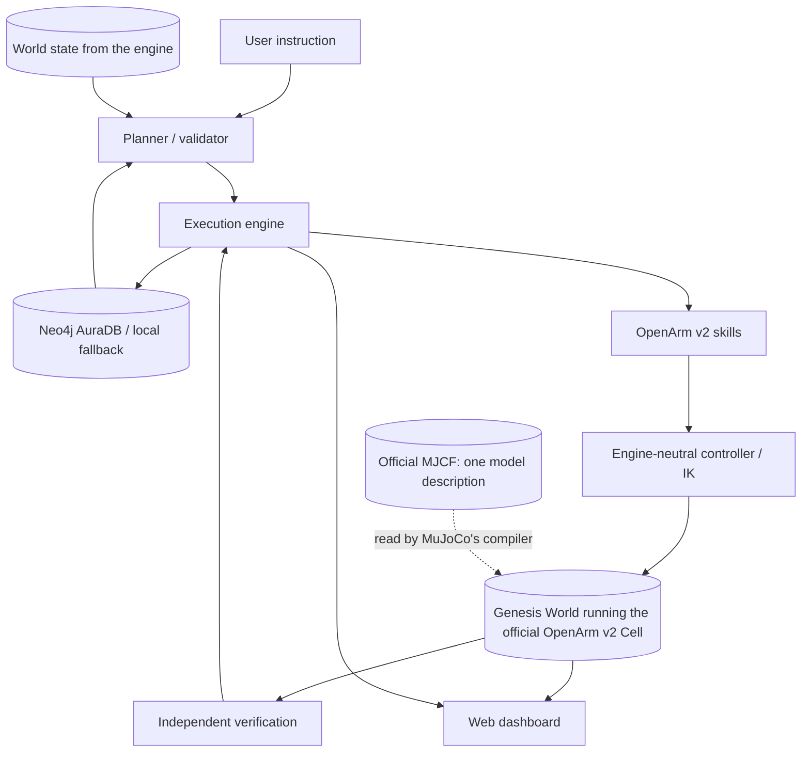

# Embodied AI Agent — OpenArm v2 on Genesis World

**Think. Act. Learn.**

This repository contains a hackathon implementation of an embodied agent that accepts natural-language
manipulation tasks, plans a restricted skill sequence, executes it on the official OpenArm v2 Cell model
in [Genesis World](https://github.com/Genesis-Embodied-AI/genesis-world), independently verifies the
physical result, records experience, and reuses memory on later tasks.

## What is implemented

### Implemented and verified on this machine

- Official `openarm-mujoco` 2.3.0 OpenArm v2 bimanual Cell model, with both arms displayed.
- Machine-independent scene loading: the demo scene resolves its official asset paths from the installed
  `openarm-mujoco` package at load time, so no machine-specific path is stored.
- **One engine-neutral simulation contract**: the planner, skills, controller and verification step read
  poses, Jacobians, contacts and grasp state only through `SimulationBackend`, and never import the
  engine. MuJoCo's compiler is used as the *reader* of the model description (sites, keyframe, actuator
  mapping), which Genesis does not implement; the physics is Genesis World 1.4.4.
- The engine's own state is checked against that model description: reset state, forward kinematics, the
  gripper control point and the 3x7 linear and angular Jacobians agree to 1e-5 / 1e-6 with the compiled
  MJCF evaluated by MuJoCo's kinematics routines.
- Custom demo scene based on the official Cell model, adding one red cube, one blue cube, a blue target
  zone, and a green target zone.
- Damped least-squares inverse kinematics, joint position control, gripper control, timed skills,
  cancellation, and reset. The controller's rotation algebra is NumPy and is pinned against MuJoCo's
  `mju_*` functions.
- A complete red-cube Pick & Place with the left arm and a blue-cube Pick & Place with the right arm.
- Physical result verification from engine measurements, including 40 mm horizontal tolerance, release
  check, stability check, and measured position error.
- FastAPI APIs and WebSocket simulation frames from the engine's renders; `/api/health` reports the
  engine and the grasp mode.
- React + TypeScript + Vite dashboard with task input, plan, live robot state, engine and grasp-mode
  badges, agent events, verification, and history.
- Neo4j AuraDB integration with local JSON fallback, parameterized Cypher persistence, and retrieval.
- Deterministic memory selection that changes the approach offset from an exploratory 55 mm to a
  remembered safe 60 mm after a related successful execution.
- OpenAI-compatible `ai&` client with deterministic fallback when credentials are missing.
- **26 automated tests, all passing** (`pytest -q`).

### Verified demonstration

The red cube starts at `(0.44, 0.15, 1.032)`. The left arm approaches, closes its gripper, starts the
documented grasp hold, lifts, moves over the blue zone, releases, and retreats.

Measured through the task API on this machine:

```
task success: True, retries: 0, attempts: 1
verification: horizontal error 34.2 mm (tolerance 40 mm), vertical error 23 mm,
              released True, stable True, engine genesis, grasp_mode kinematic-grasp-hold
```

Repeat runs land between 30 and 35 mm horizontally, from both the documented and the randomized start pose.
These figures were measured before the inverse-kinematics damping tuning in commit `74af002`; re-measuring
them on the current controller is outstanding, and the tests that assert the tolerances pass either way.

The grasp is **never presented as contact-only manipulation**. Finger contacts are monitored and reported
per skill result, but the hold itself is the engine's fallback, and it is labelled everywhere it appears:
in skill results (`grasp_mode: kinematic-grasp-hold`), in `/api/health`, and on the dashboard badge.

## Simulation engine

Genesis World runs the resolved MJCF — the official Cell model **attached, not copied or substituted** —
plus the demo objects. Install it, start the server:

```bash
uv sync                 # genesis-world 1.4.4, needs Python 3.12 or 3.13
./run.sh
```

Three things Genesis does differently from the model description, each handled explicitly and each
covered by a test:

| Difference | Handling |
|---|---|
| Genesis builds every MJCF equality and reads no `active` flag, and has no runtime enable/disable | the four grasp welds the scene declares `active="false"` are removed from the XML Genesis is given, so a grasp is started by the engine's own hold instead of a weld that would exist from reset |
| its position controller has no bias feed-forward, so a commanded pose rests `gravity_torque / kp` short of its target (measured 9.6 mm) | `apply_gravity_compensation()` writes the arm's gravity torque into the constant term of the actuator model (`act_bias[0]`, the analogue of the model's `biasprm[0]`); a free-space hold then measures 0.87 mm, with the solver's implicit damping kept and the cubes keeping their gravity |
| `set_qpos(..., zero_velocity=True)` zeroes *every* dof of the entity, which also stopped the arm mid-path during transport | only the held object's dofs have their velocity reset |
| Genesis does not implement MJCF sites | the gripper control point and the zone origins are read as a parent link plus a local offset from the same XML string, with MuJoCo's compiler |

Grasping is the one deliberate difference that is *not* a bug fix: Genesis takes equalities at build time
and `attach()` has no detach, so a grasp is a **kinematic hold** — while active, the object's free-joint
pose is prescribed from the gripper base link each step, at the documented grasp offset. It is therefore
labelled `kinematic-grasp-hold`, and this project does not claim contact-only manipulation.
[docs/ARCHITECTURE.md](docs/ARCHITECTURE.md) has the measurements and the reasoning.

## Quick start

1. Put Neo4j credentials in `.env`:

   ```bash
   NEO4J_URI=neo4j+s://...
   NEO4J_USERNAME=neo4j
   NEO4J_PASSWORD=...
   NEO4J_DATABASE=neo4j
   ```

   Optionally add `AI_AND_API_KEY`, `AI_AND_BASE_URL`, `AI_AND_MODEL`.

2. Start:

   ```bash
   ./run.sh
   ```

   Open [http://127.0.0.1:8000](http://127.0.0.1:8000).
   For a command-only page, open [http://127.0.0.1:8000/simple](http://127.0.0.1:8000/simple).

## Development commands

```bash
uv sync
uv run pytest -q                          # 26 tests, the engine is required
uv run uvicorn backend.app.main:app --host 127.0.0.1 --port 8000 --reload
uv run python scripts/record_demo.py      # regenerates outputs/openarm-v2-demo.mp4
cd frontend && npm install && npm run dev
```

Any Python 3.12 environment with the dependencies from `pyproject.toml` works as well; the suite fails
loudly (rather than skipping) if the engine is missing.

## Demo script

1. Press **Reset**.
2. Enter: `Move the red cube into the blue zone.`
3. Press **Execute** and observe the plan, the OpenArm v2 motion, the grasp, transport, release, and the
   verification panel.
4. Press **Random** to change the initial cube pose, then repeat the task.
5. Inspect **Execution History** for real durations, retries, and failure categories.
6. If Neo4j is available, check `/api/memory` and the dashboard status.

`docs/DEMO.md` walks through the same sequence and what each badge means.

The task API also supports:

```json
{"instruction": "Move the red cube into the blue zone.", "randomize": true, "force_failure": false}
```

`force_failure` is a controlled, recoverable demonstration fault: the first attempt uses an unreachable
approach offset and produces a real `IK_FAILURE`, the planner replans within its bound, and the second
attempt runs physically. Verified on this engine (`retries: 1`, attempt 1 `IK_FAILURE`, attempt 2
`SUCCEEDED`); no pre-recorded success is substituted for the recovery run.

`randomize` is a documented scene reset/setup operation with a fixed seed; it does not teleport the object
during task execution.

## API

- `GET /api/health`
- `GET /api/system/status`
- `GET /api/scene`
- `POST /api/scene/reset?randomize=false`
- `POST /api/tasks`
- `GET /api/tasks/{task_id}`
- `POST /api/tasks/{task_id}/stop`
- `GET /api/executions`
- `GET /api/memory`
- `POST /api/memory/reconnect`
- `GET /api/config/status`
- `WS /ws`

No API endpoint returns credentials.

## Architecture



## Asset and license attribution

The robot and Cell scene originate from the official [openarm_mujoco](https://github.com/enactic/openarm_mujoco)
package installed as `openarm-mujoco` 2.3.0. Official XML comments include Enactic copyright and
Apache-2.0 licensing. The custom `assets/scenes/openarm_v2_demo.xml` only attaches the official Cell model
and adds demonstration objects/zones. The reference repository `openarm-control` was inspected for control
patterns; no framework code was copied. [Genesis World](https://github.com/Genesis-Embodied-AI/genesis-world)
`genesis-world` 1.4.4 is Apache-2.0 and is the physics engine; no Genesis code was copied into this
repository. MuJoCo arrives as a Genesis dependency and is used in this project only to read the model
description and, in tests, as the kinematics reference.

## Known limitations

- Neo4j AuraDB connection was not validated on this machine (`ServiceUnavailable: Unable to retrieve
  routing information`), so the app used its labeled local fallback. The AuraDB integration is implemented
  and activates automatically once the instance accepts routing connections.
- No `ai&` credentials were configured, so planning used the labelled deterministic fallback. The
  OpenAI-compatible client activates when all three variables are set.
- Grasping is a labelled kinematic hold, not contact-only manipulation. Finger contacts are monitored but
  not reliable enough to claim a purely contact-driven grasp.
- Both arms are loaded and displayed, each with a verified single-arm task. A coordinated simultaneous
  bimanual task is not complete.
- Camera orbit/zoom is not implemented in the browser; the view is the fixed camera in
  `backend/app/simulation/genesis_backend/environment.py`.
- `scripts/record_demo.py` regenerates a low-resolution backup MP4 at `outputs/openarm-v2-demo.mp4` from a
  real run, and deletes it if any skill or the verification failed.
