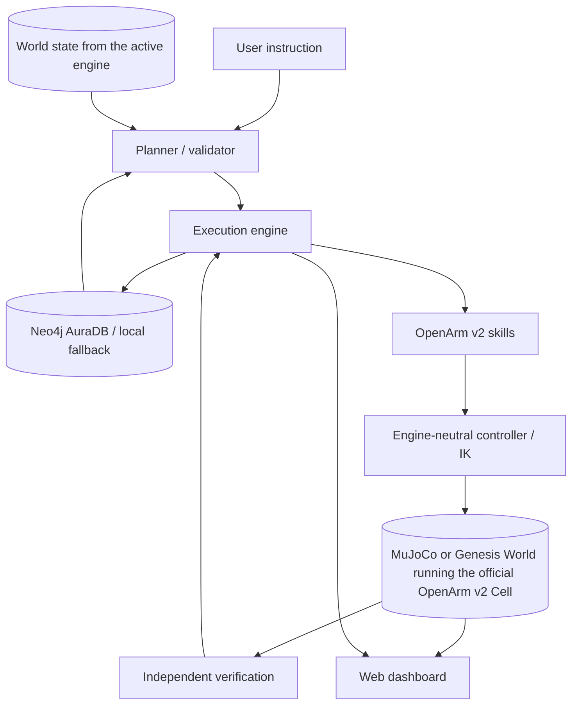

# Embodied AI Agent — OpenArm v2

**Think. Act. Learn.**

This repository contains a hackathon implementation of an embodied agent that accepts natural-language manipulation tasks, plans a restricted skill sequence, executes it on an official OpenArm v2 Cell model in MuJoCo, independently verifies the physical result, records experience, and reuses memory on later tasks.

## What is implemented

### Implemented and verified locally

- Official `openarm-mujoco` 2.3.0 OpenArm v2 bimanual Cell model, with both arms displayed.
- Machine-independent scene loading: the demo scene resolves its official asset paths from the installed `openarm-mujoco` package at load time.
- **Two simulation engines behind one contract**: MuJoCo (default, authoritative) and Genesis World (opt-in, `SIM_BACKEND=genesis`). Both compile the same resolved MJCF, and their reset state, forward kinematics, gripper control point and Jacobians agree to 1e-6.
- Custom demo scene based on the official Cell model, adding one red cube, one blue cube, a blue target zone, and a green target zone.
- Damped least-squares inverse kinematics, joint position control, gripper control, timed skills, cancellation, and reset. The controller and its rotation algebra are engine-neutral and pinned against MuJoCo's `mju_*` functions.
- A complete red-cube Pick & Place with the left arm and left gripper.
- Physical result verification from engine measurements, including 40 mm horizontal tolerance, release check, stability check, and measured position error.
- FastAPI APIs and WebSocket simulation frames encoded from the active engine's renders; `/api/health` and `/api/backends` report which engine served the task.
- React + TypeScript + Vite dashboard with task input, plan, live robot state, engine and grasp-mode badges, agent events, verification, and history.
- Neo4j AuraDB integration with local JSON fallback, parameterized Cypher persistence, and retrieval.
- Deterministic memory selection that changes the approach offset from an exploratory 55 mm to a remembered safe 60 mm after a related successful execution.
- OpenAI-compatible `ai&` client with deterministic fallback when credentials are missing.
- 31 automated tests, all passing on both engines (MuJoCo alone: 11 tests plus 20 parametrized Genesis cases skipped unless `SIM_AGENT_TEST_GENESIS=1`).

### Verified demonstration

The red cube starts near `(0.44, 0.15, 1.032)`. The left arm approaches, closes its gripper, activates a documented contact-assisted weld, lifts, moves to the blue zone, releases, and retreats. Measured horizontal error: 8.3 mm in the original macOS validation run and 10.8 mm in the Linux re-validation, against a 40 mm tolerance.

The initial grasp mode is **not presented as contact-only manipulation**. MuJoCo contacts are monitored, but the current stable execution uses an explicit MuJoCo weld fallback after gripper closure. This is shown in the UI as a grasp badge and recorded in skill results as `grasp_mode: contact-assisted-weld`.

## Simulation engines

MuJoCo is the default engine and remains the authoritative source of robot and object state.
[Genesis World](https://github.com/Genesis-Embodied-AI/genesis-world) can run the identical scene as a
second, independent physics implementation:

```bash
uv sync --extra genesis            # Genesis World needs Python <3.14 and its own PyTorch build
SIM_BACKEND=genesis ./run.sh       # MuJoCo stays the default
```

On the Genesis engine the grasp hold is a **labelled kinematic fallback** (`grasp_mode:
kinematic-grasp-hold`): Genesis takes its MJCF equality constraints at build time and offers no runtime
enable/disable for them, so the held object's pose is prescribed from the gripper base link on every
step. Finger contacts are still monitored and reported, but neither engine claims contact-only
manipulation.

Verified on both engines (`SIM_AGENT_TEST_GENESIS=1 uv run pytest -q`, 31 passed): the official model
loads with the same link and joint names, `reset()` and `reset(randomize=True)` produce the same initial
state to 1e-5, forward kinematics and the 3x7 linear/angular Jacobians agree to 1e-6, the same IK target
solves to the same joint solution, and both arms' pick & place pass the same independent verification.

Three engine differences had to be handled explicitly, each covered by those tests: Genesis ignores
MuJoCo's `active` flag on equalities, has no bias feed-forward in its position controller, and zeroes
every dof velocity on `set_qpos(zero_velocity=True)`. They are described in
[docs/ARCHITECTURE.md](docs/ARCHITECTURE.md#genesis-world-engine-status).


## Quick start

1. Put Neo4j credentials in `.env`:

   ```bash
   NEO4J_URI=neo4j+s://...
   NEO4J_USERNAME=neo4j
   NEO4J_PASSWORD=...
   NEO4J_DATABASE=neo4j
   ```

   Optionally add:

   ```bash
   AI_AND_API_KEY=...
   AI_AND_BASE_URL=...
   AI_AND_MODEL=...
   ```

2. Start:

   ```bash
   ./run.sh
   ```

   Open [http://127.0.0.1:8000](http://127.0.0.1:8000).

## Development commands

`uv` is used in the commands below; any Python 3.12+ environment with the dependencies from
`pyproject.toml` works as well.

```bash
uv sync
uv run pytest -q                          # MuJoCo only (default)
SIM_AGENT_TEST_GENESIS=1 uv run pytest -q # adds the optional Genesis World parity tests
uv run uvicorn backend.app.main:app --host 127.0.0.1 --port 8000 --reload
cd frontend
npm install
npm run dev
npm run build
```

During development the Vite server is at [http://127.0.0.1:5173](http://127.0.0.1:5173).

## Demo script

1. Press **Reset**.
2. Enter: `Move the red cube into the blue zone.`
3. Press **Execute** and observe the generated plan, OpenArm v2 motion, grasp, transport, release, and verification.
4. Press **Random** to change the initial cube pose, then repeat the task.
5. Inspect **Execution History** for real durations, retries, and failure categories.
6. If Neo4j is available, check `/api/memory` and the dashboard status.

The task API also supports:

```json
{"instruction": "Move the red cube into the blue zone.", "randomize": true, "force_failure": false}
```

`force_failure` is a controlled, recoverable demonstration fault. The first attempt uses an unreachable approach offset, produces a real `IK_FAILURE`, triggers bounded replanning, and the second attempt uses the valid approach. No pre-recorded success is substituted for the recovery run.

`randomize` is a documented scene reset/setup operation; it does not teleport the object during task execution.

## API

- `GET /api/health`
- `GET /api/system/status`
- `GET /api/backends`
- `GET /api/scene`
- `POST /api/scene/reset?randomize=false`
- `POST /api/tasks`
- `GET /api/tasks/{task_id}`
- `POST /api/tasks/{task_id}/stop`
- `GET /api/executions`
- `GET /api/memory`
- `POST /api/memory/reconnect`
- `GET /api/config/status`
- `WS /ws`

No API endpoint returns credentials.

## Architecture



## Asset and license attribution

The robot and Cell scene originate from the official [openarm_mujoco](https://github.com/enactic/openarm_mujoco) package installed as `openarm-mujoco` 2.3.0. Official XML comments include Enactic copyright and Apache-2.0 licensing. The custom `assets/scenes/openarm_v2_demo.xml` only attaches the official Cell model and adds demonstration objects/zones. The reference repository `openarm-control` was inspected for control patterns; no framework code was copied. [Genesis World](https://github.com/Genesis-Embodied-AI/genesis-world) `genesis-world` 1.4.4 is Apache-2.0 and is used as an optional second physics engine; no Genesis code was copied into this repository.

## Known limitations

- Neo4j AuraDB connection was not yet available during the initial validation run (`ServiceUnavailable: Unable to retrieve routing information`), so the app correctly used the labeled local fallback. The AuraDB integration remains implemented and will activate automatically once the instance accepts routing connections.
- No `ai&` credentials were configured, so planning used the labeled deterministic fallback. The OpenAI-compatible client is implemented and will activate automatically when all three variables are set.
- Grasping is never presented as contact-only: MuJoCo uses the documented weld fallback after gripper closure (`contact-assisted-weld`) and Genesis uses a documented kinematic hold (`kinematic-grasp-hold`). Physical contacts are monitored on both, but not yet reliable enough to claim contact-only manipulation.
- Both arms are loaded and displayed. The left arm has a verified red-cube task and the right arm has a verified blue-cube task. A coordinated simultaneous bimanual task is not complete.
- Camera orbit/zoom is not yet implemented in the browser.
- `scripts/record_demo.py` can regenerate a low-resolution backup MP4 at `outputs/openarm-v2-demo.mp4`; the output is generated from the same real MuJoCo run and is not a substitute for live execution.
