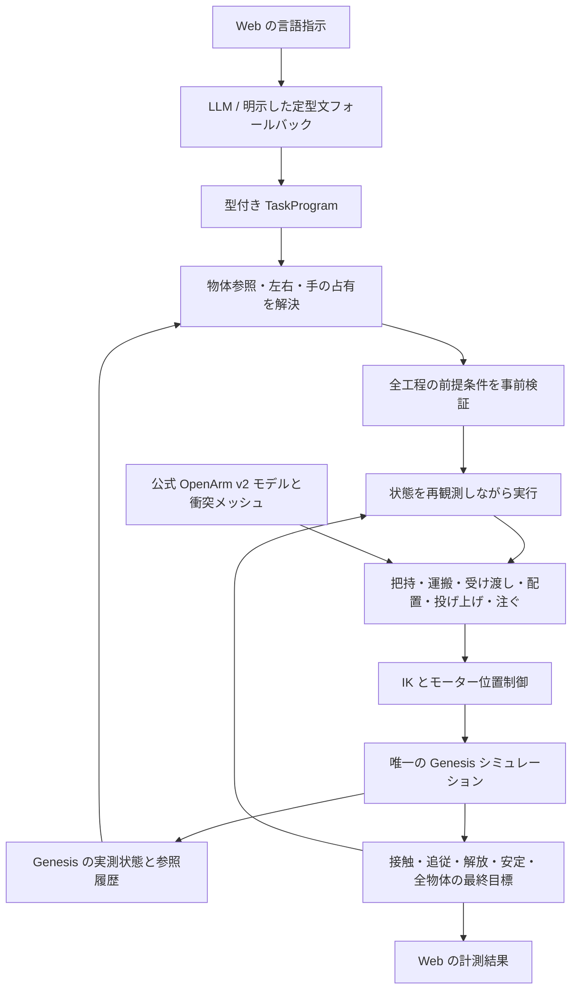

# OpenArm v2 — 言葉で作業する Genesis エージェント

公式の OpenArm v2 Cell と Genesis World に限定した、ファインチューニング不要の操作エージェントです。
日本語・英語・混在する指示を、物体と左右の手を区別した作業列に変換します。Web は指示入力と計測結果の表示、
実際のシミュレーションは独立した Genesis ネイティブビューアーが担当します。

```text
右手がBlue Cubeを取って左手に渡した後に置いて、
その左手にあるRED CUBEを掴んで右手がそれを取って右手のところに置く
```

この指示は「青を右で取る → 左に渡す → 左側に置く → 赤を左で取る → 右に渡す → 右側に置く」に分解されます。
左右の手が同じキューブを接触で保持し、受け手の把持を確認してから渡し手を開く、直接の受け渡しです。

## 起動

Python 3.12 または 3.13 と `uv` を使用します。プロジェクトのルートで実行してください。

```bash
uv sync
./run_genesis_gui.sh
```

[http://127.0.0.1:8000/simple](http://127.0.0.1:8000/simple) を開いて指示を送ります。
`/` でも同じ入力画面を表示します。Genesis のウィンドウで実際の動作を確認できます。

ローカルの Ollama に `qwen3-vl:4b` がインストール済みであれば、ランチャーが自動選択します。
既存の `AI_AND_API_KEY`、`AI_AND_BASE_URL`、`AI_AND_MODEL` がすべて設定されていれば、OpenAI 互換のプロバイダーを使います。
設定は `.env` に置き、Git に追加しないでください。モデルを再学習したり、重みを変更したりする処理はありません。

```bash
# ローカルモデルを明示して起動する場合
OPENARM_LOCAL_PLANNER=1 OPENARM_OLLAMA_MODEL=qwen3-vl:4b ./run_genesis_gui.sh

# 言語モデルを使わず、対応する定型文だけで操作する場合
OPENARM_LOCAL_PLANNER=0 ./run_genesis_gui.sh
```

モデルを利用できない場合は `deterministic_fallback` と表示します。理解できない指示を、勝手な赤キューブの移動に置き換えることはありません。
インポートされた Qwen3-VL の Ollama テンプレートが `{{ .Prompt }}` だけの場合は、モデルのアーキテクチャを確認してから
会話の区切りと非推論の出力開始形式を補います。ほかのモデルのテンプレートや、Ollama に保存されたモデル自体は変更しません。

## 実行速度

**アームの物理的な移動時間**は `OPENARM_MOTION_SPEED` で指定します（標準6）。
取りに行く接近動作と、掴んでA→Bへ運ぶ動作で、途中の点ごとの停止をなくし、位置と速度が連続する軌道を追従させます。
Genesisの位置＋速度PD制御を使い、関節慣性に応じた減衰を設定します。公式モデルの関節制限、モーターの力上限、
指のモーター設定は維持します。把持は両指の物理接触と持ち上げ追従で確認します。

表示を等倍に保って、アームの移動そのものを6倍設定にする例です。

```bash
OPENARM_MOTION_SPEED=6 OPENARM_SIM_SPEED=1 ./run_genesis_gui.sh
```

表示の倍率を固定した実測（Genesis CPU、シミュレーション時間）では、同じ初期位置と目標に対して、
キューブへの接近が3.326秒→0.600秒（5.54倍）、把持したキューブの12cm運搬が2.902秒→0.520秒（5.58倍）でした。
指を閉じて持ち上げる把持検証は1.248秒→0.541秒（2.31倍）で、指の物理応答と接触確認も含みます。
記録は `outputs/arm_motion_cubes_baseline.json` と `outputs/arm_motion_cubes_verified.json` です。
変更後の初期位置9通りでも、両指の接触・持ち上げ・運搬・解放・静止が9/9成功しました。

液体入りボトルも、ネイティブビューアーを等倍にして検証しました。接近は3.324秒→0.570秒（5.83倍）、
掴んで持ち上げる検証は1.450秒→0.584秒（2.48倍）、直立したまま前へ運ぶ動作は1.480秒→0.480秒（3.08倍）でした。
運搬には終点での揺れの収束と注ぎ口の補正1回を含みます。運搬後の位置誤差は約1.66mm、両指の接触を保ち、
45mL・3,600粒子を保存しました。50msごとの採取と終点での観測では、こぼれ・空中分とも0mLでした。
比較元は以前の全工程記録 `outputs/native_wine_surface_final.json`、今回の記録は `outputs/arm_motion_wine_verified.json` です。
これは取り上げと直立運搬の検証です。高速化後の注入から置き戻しまでの全工程は再検証していません。

```bash
uv run python scripts/verify_arm_motion.py --scene cubes --speed 1 --json outputs/arm_baseline.json
uv run python scripts/verify_arm_motion.py --scene cubes --speed 6 --baseline outputs/arm_baseline.json --json outputs/arm_fast.json
uv run python scripts/verify_arm_motion.py --scene wine --speed 6 --native --json outputs/arm_wine.json
```

液体を注ぐ角度・流量の制御と、投げる瞬間の解放時刻は、検証済みの物理時間と制御応答を使います。
ボトルの取り上げ・直立運搬と、投げる前の移動には高速な移動軌道を使います。
設定値は指定軌道の短縮倍率であり、タスク全体の実測倍率ではありません。

更新したネイティブアプリ（表示等倍・アーム6倍設定）でも、2回の受け渡しを含む例の指示が
全14工程・再試行0回で成功し、実行時間は21.64秒でした。左右の投げ上げも自由飛行が約43.41mm／41.53mm、
鉛直加速度が約−9.81m/s²で成功しました。動作途中の停止後は速度指令を解除し、リセット後のシーンで待機します。
記録は `outputs/native_arm_motion_verified.json` です。

**実時間の計算・表示ペーシング**は別の `OPENARM_SIM_SPEED` で指定します（標準1倍）。
通常起動でもアーム6倍・表示等倍です。計算待ちの削減は維持しています。
起動時に `OPENARM_SIM_SPEED=4` または `8` を指定して調整できます。すでに起動しているビューアーには再起動後に反映します。

```bash
OPENARM_SIM_SPEED=8 ./run_genesis_gui.sh
```

この値は画面と物理計算を進める実時間の目標倍率です。Genesisの刻み幅、重力、モーターの力上限、
把持・受け渡し・投げ上げの物理時間を一括で縮める設定ではありません。計算が追いつかない場合、実測速度は目標倍率を下回ります。
言語モデルの推論やシーン初回構築の待ち時間にもこの倍率は掛かりません。

共通の重力補償は、Genesisから読んだ実際の関節位置と公式モデルの質量・重心から計算します。
CPUでもリンクごとのJacobian読み出しを繰り返さず、左右の補償値をまとめて更新します。
関節制限も初回に読み取り、移動ごとの無移動区間の待ちを除きました。関節経路のモーター指令は最大4ms間隔ですが、
物理計算は全ステップを実行します。明示した注ぐ動作の時間、両指の接触、持ち上げ追従、解放・静止の検証は維持しています。

速度の実測と把持・配置を同時に確認するには、次を実行します。初回構築とカーネルコンパイルを計測から除き、
実際のネイティブウィンドウで左右9通りの把持・配置を検証します。

```bash
uv run python scripts/verify_execution_speed.py --native --all-positions --json outputs/execution_speed.json
```

同じコマンドで変更前に保存したJSONがあれば、`--compare <変更前のJSON>`で同じ腕・初期位置の実測倍率を記録できます。
`/api/scene` の `requested_realtime_factor` は設定した目標値です。測定した倍率とは区別してください。

標準ランチャーでは `OPENARM_FAST_LANGUAGE=1` も有効です。全文を既存の文法で解釈し、現場の物体・左右の手に
結び付けられた指示は `deterministic_fallback` と明示して即座に実行計画へ変換します。
全文を解釈できなければ、これまでどおりOllamaなどのモデルで解釈・検証します。
モデルにも複数工程を確認させる従来の経路は `OPENARM_FAST_LANGUAGE=0 ./run_genesis_gui.sh` で選べます。
モデルを使わなかった計画の `model` は `null` です。

アーム軌道の高速化前に、計算待ちと表示ペーシングを改善したときのネイティブ把持・配置の比較では、左が16.1秒→3.72秒（4.33倍）、
右が15.0秒→3.36秒（4.46倍）でした。左右9初期位置すべてで、両指の接触・持ち上げ追従・解放・静止を確認しました。
記録は `outputs/speed_before.json` と `outputs/execution_speed_verified.json` です。
2回の直接受け渡しを含む14工程も、動作時間27.79秒、再試行0回、配置誤差は左右とも約3.60mmで成功しました。
この定型文の計画変換は約0.003秒でした。定型文で解釈できない `take the azure one please` はOllamaへ渡し、
約6.06秒で解釈し、青いキューブを物理的に把持しました。記録は `outputs/native_speed_fast_language.json` です。
左右の投げ上げは動作時間3.30秒／3.55秒で、自由上昇は約43.95mm／41.39mm、加速度は約−9.81m/s²でした。
これらの動作時間は言語モデルの解釈を含みません。

**流体計算自体の4〜8倍高速化は未達です。** 同じ液体のCPU並列化、別の圧力解法、粗い解像度、
連成対象以外の形状の処理省略も診断しましたが、速度または静止時の安定性の条件を満たす改善には至らず、
標準設定には採用していません。現行の2.5mm・32サブステップを保っています。

## 指示の例

```text
右手で青いキューブを掴んで
それを左手に渡して左側に置く

青いやつを右で拾って、空いてるほうの手にパスして、そっちの端に置いといて。
そのあと赤い方を左でつまんで右に受け取ってもらって右側に置いといて

Pick the blue cube with the right hand, then pass it to the left hand,
then place it on the left side.

赤を青いゾーンに置いて、青を緑のゾーンに置いて
右アームを右に10cm動かして
グリッパーを開いてください

右手で青いキューブを上に投げて
青いやつを右の手でひょいっと上に放って
ワインをグラスに20ml注いで
赤ワインを10ml、そこのグラスにお願い。終わったらボトルを戻しておいて
Pour 10 ml of wine into the glass
```

「取る」だけなら保持します。「置く」まで指定した場合は解放と安定を確認します。
手を省略した場合は現在持っている手、または実測位置に近い手を選びます。
置く場所を省略した場合は保持している手の側に置き、その解釈を画面に表示します。
「それ」は指示内の直前の物体、続く指示では直前に扱った物体を参照します。
シーンの初期化で参照履歴も初期化します。

画面には解釈した全工程、実行中の工程、プロバイダー、手が持っている物体、失敗理由、最終状態の判定が表示されます。
停止はキュー待ちの指示を取り除き、実行中は物理の各ステップ間でも確認します。
流体計算中の長いグリッパー待ちでも、接続更新と停止確認を継続します。途中の物体をリセットして成功を作る処理はありません。

## 投げ上げとワイン

キューブの投げ上げでは、実際に指で保持し、腕を上向きに加速してから指を開きます。
解放後の接触のない上昇、最高点、速度変化を Genesis から計測します。既定の要求は「解放点から3cm以上の上昇」です。
物体への初速の書き込みは行いません。

ワインの指示を送ると、同じ公式 OpenArm を使うワイン用シーンへ切り替えます。
ボトル内には45mL相当の赤い SPH 流体があり、左手でボトルを把持して注ぎ、流れを止めてから元の場所へ立てて戻します。
受け側のグラスは作業台に固定しています。グラス内・ボトル内・空中・こぼれた液体を粒子から計測します。
完了時には空中分が0であることを要求し、こぼれは既存分を含む合計で表示します。
0.0125mLの1粒分も表示し、小さなこぼれを「0.0mL」に丸めません。
既定は20mL、5–35mLの単位付き指定も受け付けます。量の判定許容差は `max(3mL, 指定量の25%)`、
こぼれの上限は、把持・運搬中も含めて0.1mLです。粒子間隔2.5mm・3,600粒子で計算し、実機の計量精度を表すものではありません。
体積はGenesisの実際のSPH粒子体積（間隔の3乗の0.8倍）で換算し、流体の連成はボトル・グラス・作業台を対象にしています。

シーン切り替えは手が空の場合に行い、物体の初期位置と参照履歴を初期化します。
ワイン用シーンの準備中は画面に表示します。Macでは利用可能ならMetal、CUDA環境ではGPUを使い、
`GENESIS_USE_GPU=0` でCPUを明示できます。初回はカーネルのコンパイルがあり、流体を含む動作は剛体キューブより計算に時間がかかります。

無料のボトル・グラスは [Innerscene の CC0 モデル](assets/wine/LICENSE.md)です。
オリジナル GLB、入手元、SHA-256、再生成スクリプトを同梱します。栓を外した表示形状と、
内側が空洞の衝突形状へ加工しています。再配布・改変・商用利用が可能な素材を使用しています。
表示用メッシュと計算用メッシュを分け、透明な容器の面が重なって三角模様になる問題を修正しています。
赤い流体はSPH粒子から滑らかな表面を再構成して表示します。計算点を球として並べる表示は使用しません。
透明な容器はラスター描画です。光学的な屈折は扱いません。
SPHの粒子間隔・粘性係数・内部時間刻みは連動して設定し、Genesisの粘性安定条件を超える設定は起動時に拒否します。
流体用の2msステップは32分割して計算します。固定容器の試験に加え、動くボトルを台に置いた状態でも液体の静止を検査します。
注ぎ口はグラスの縁から18mm上へ向け、ボトルの首とグラスの壁が交差しないことも幾何形状から検査します。

## 構成



言語モデルの仕事は意図の分解です。関節角、自由な Python、物体の座標書き換えを生成させません。
1つの手が2つのキューブを持つ計画、受け手が塞がった受け渡し、未知の物体、範囲外の相対移動は事前に拒否します。
無効なモデル回答は検証理由を添えて1回修正し、それでも無効なら理解できた定型文へ戻るか、理由を示して失敗します。

受け渡しでは、公式メッシュに基づいて両腕とキューブの姿勢を一緒に解きます。受け手は物体の外側から直線で接近し、
両指の接触を確認してから渡し手を開いて後退します。その後、受け手だけで3cm持ち上げ、物体の追従と接触を確認します。
運搬も短い直線経路に分けます。IK が解けただけで動作を成功扱いせず、実際の到達位置と姿勢を測ります。

詳細は [docs/ARCHITECTURE.md](docs/ARCHITECTURE.md) を参照してください。

## 検証の再実行

```bash
uv run pytest -q
uv run python scripts/measure_grasp_geometry.py --check

# ユーザーの例を、定型文コンパイラーから実際の物理実行まで検証
uv run python scripts/verify_language_tasks.py --case example

# 同じ例の初期位置を変更
uv run python scripts/verify_language_tasks.py --case example --randomize

# ローカルモデルで日英・言い換え・複数指示を実際に実行
uv run python scripts/verify_language_tasks.py --case all --provider local

# 投げ上げとSPH流体の注入を、同じ実行経路で計測
uv run python scripts/verify_dynamic_tasks.py --case all
uv run python scripts/verify_dynamic_tasks.py --case pour_10 --record --json outputs/wine_task_recording.json

# 流体だけの静止・流れ・こぼれを検証（ロボット把持の検証とは別）
uv run python scripts/verify_wine_fluid.py --record
uv run python scripts/verify_wine_fluid.py --free-hold-only --json outputs/wine_free_hold.json

# CC0オリジナルから形状を再生成（既存ファイルはSHA-256を照合）
uv run python scripts/prepare_wine_assets.py

# 既存の、初期位置9通りの把持・配置チェック
uv run python scripts/verify_pick_place_genesis.py
```

`outputs/language_tasks_local.json`、`outputs/language_tasks_fallback.json` などに、
解釈した作業列、各動作の計測値、両指の接触、受け渡し後の持ち上げ、最終配置の誤差を保存します。
これらの JSON は Git 管理外です。検証スクリプトは、要求された数の実際の受け渡しと全目標の確認が揃った場合だけ終了コード0を返します。

## このマシンでの検証結果（2026-10-20–21）

- `uv run pytest -q`: 93件成功（アーム軌道・応答の修正後13.24秒）。IKが実際のシーンへ候補姿勢を書き込まないこと、左右の腕とリフターの運動学が一致すること、定型文の即時変換と自由な言い回しのモデル利用の振り分けに加え、力上限・指の設定の維持、注ぐ動作の物理時間、途中停止時の速度指令解除も確認。
- 現行のワイン設定（2.5mm・32サブステップ）: ネイティブ経路で20mLを指示し、実測19.4875mL、こぼれ0mL、完了時の空中分0mL。3,600粒子・45mLの保存、両指の接触、持ち上げ、解放、元の位置での直立・静止を確認。ボトルの戻り誤差は約1.44mm。
- ボトルとグラスの各動作終点で測った隙間は最小約3.35mm。固定容器同士の貫通に依存する結果は除外しています。
- 完了後さらに1.31秒のシミュレーションを進めても、液体の内訳とボトル位置は変わらず、こぼれ・空中分とも0mLでした。
- 更新後のネイティブ経路で、長いグリッパー待ち中の停止を約0.31秒で確認。
- 追加した投げ上げ: 左右とも両指の把持から解放後の自由飛行まで成功。解放点からの上昇は右43.87mm、左41.37mm、鉛直加速度は約−9.81m/s²。
- ローカルモデル有効時の言語タスク: 7シナリオ・8指示がすべて成功。直接受け渡し9回を含みます。
- 上記8指示のうち、7指示は `local_ollama`、単純な「掴んで」の1指示は明示された定型文コンパイラーです。
- 初期位置を変更した、ユーザーの2回受け渡しの例も成功。
- 既存の初期位置9通りの把持・配置も9/9成功し、水平誤差は2.4–2.8mm。
- IKを計算用データへ分離した後も、Webからネイティブビューアーへ送った同じ長い例が成功。全14工程を各1回、再試行0回で完了し、最終配置の水平誤差は青3.55mm、赤3.57mm、実行は約119秒でした。

これらはこのシーンで実行した具体的なケースの結果です。任意の指示全般の成功率を示すものではありません。
生成された `outputs/validation_summary.json`、`outputs/motion_replay_fix_validation.json` と各実行JSONに、判定と計測値を保存しています。
検証時の [ネイティブ画面](outputs/motion-replay-fix-native.png) と [Webの完了表示](outputs/motion-replay-fix-ui.png) も保存しています。

現行のワイン実行結果は `outputs/native_wine_surface_final.json`、厳しい条件での照合結果は `outputs/native_wine_surface_audit.json` へ保存しました。
この20mL実行は速度修正前の記録です。流体の設定は維持していますが、速度修正後の全工程の注入は再検証していません。
[ネイティブでの注入から置き戻しまでの録画](outputs/native-wine-pour-20ml.mp4)は、シミュレーション時間で再生します。
実際の実行時間はこのMacで約51分（3,085.5秒）でした。実用速度には課題が残り、リアルタイム動作を確認した結果ではありません。
固定容器だけの流体検証は `outputs/wine_fluid_current_validation.json`、CPU/Metalの静止診断は `outputs/wine_*_hold.json` です。
`outputs/dynamic_tasks.json` には以前の流体設定によるケースも含まれます。
`outputs/pour_final.json`、`outputs/native_wine_pour_final.json` は以前の4.5mm粒子・緩いこぼれ許容値での結果です。
これらは現在の2.5mm粒子・0.1mL上限での成功の根拠には使用しません。
このMacでは流体付きの動作は実時間より遅く進みます。

## 対応範囲

- 公式 OpenArm v2 Cell に限定し、キューブ用シーンとワイン用シーンを切り替えて使用します。
- 言語モデルを利用すれば言い換えを扱えますが、任意の日本語・英語を常に正しく解釈する保証はありません。
- このシーンの操作スキルの組み合わせに限定しています。未知の物体、柔軟物、積み重ね、ボトルの受け渡し、同時に別々の物体を交換する動作は実装対象に含みません。
- 受け手の手が塞がっている場合は、先に置く指示が必要です。目標に別のキューブがある場合も、意図せず積み重ねることを避けて停止します。
- 物理の失敗は現在の状態を残して報告します。限定したテーブル上の把持の再試行は行いますが、シーンを途中で初期化する回復は行いません。
- 配置判定は水平40mm以内、垂直50mm以内、指からの解放、低速かつ100msの安定を要求します。実際の誤差も別途表示します。

## 公式モデルとライセンス

[OpenArm の公式モデル](https://github.com/enactic/openarm_mujoco)を、インストール済み `openarm-mujoco` から参照して添付します。
ロボットをコピーして別モデルに置き換えることはありません。
[Genesis World](https://github.com/Genesis-Embodied-AI/genesis-world) が物理状態の唯一の正です。
MuJoCo のコンパイラーと運動学関数は公式 MJCF の名前、関節範囲、形状、候補姿勢の読み取りに使い、物理実行は行いません。
各プロジェクトの Apache-2.0 ライセンスに従います。
