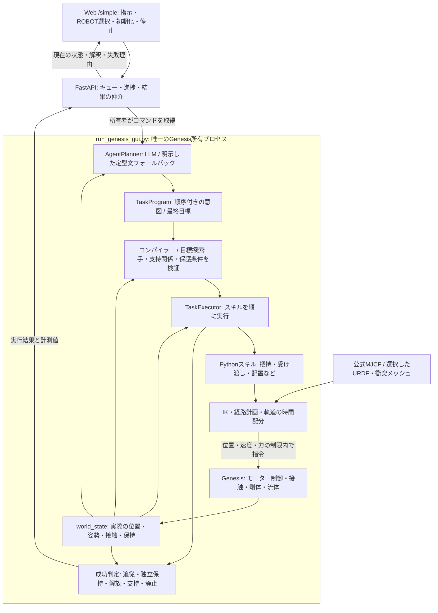

# Sim-Agent — 言葉で作業する Genesis エージェント

公式の OpenArm v2 Cell を標準にした、Genesis World のファインチューニング不要の操作エージェントです。
別のURDFを選ぶと、そのロボットと机を使う独立したシーンを生成します。
日本語・英語・混在する指示を、物体と左右の手を区別した作業列に変換します。Web は指示入力と計測結果の表示、
実際のシミュレーションは独立した Genesis ネイティブビューアーが担当します。

```text
右手がBlue Cubeを取って左手に渡した後に置いて、
その左手にあるRED CUBEを掴んで右手がそれを取って右手のところに置く
```

この指示は「青を右で取る → 左に渡す → 左側に置く → 赤を左で取る → 右に渡す → 右側に置く」に分解されます。
左右の手が同じキューブを接触で保持し、受け手の把持を確認してから渡し手を開く、直接の受け渡しです。

現在の構成は、**言語解釈 → 順序付きの作業または最終目標 → 前提条件の検証・必要な手順の探索 → IK・経路計画 → Genesisのモーター制御 → 実測による成否判定**です。
LLMの重みは変更しません。物体情報はGenesisから取得し、通常の言語モデル呼び出しには画像を渡していません。
対応する操作を言い換え・組み合わせて実行できますが、未知の動作の制御コードを自動生成する構成にはまだなっていません。
このREADMEは、現在のコードにある処理と、未実装・未検証の部分を分けて説明します。

- [起動](#起動)
- [アーキテクチャーと処理の流れ](#アーキテクチャーと処理の流れ)
- [ROBOT選択とURDFの追加](#robot選択とurdfの追加)
- [配置のランダム化と再現](#配置のランダム化と再現)
- [実行速度](#実行速度)
- [指示の例](#指示の例)
- [投げ上げとワイン](#投げ上げとワイン)
- [検証の再実行](#検証の再実行)・[実行済みの結果](#このマシンでの検証結果2026-10-23更新)
- [対応範囲と未実装の部分](#対応範囲と未実装の部分)

## 起動

Python 3.12 または 3.13 と `uv` を使用します。プロジェクトのルートで実行してください。

```bash
uv sync
./run_genesis_gui.sh
```

[http://127.0.0.1:8000/simple](http://127.0.0.1:8000/simple) を開いて指示を送ります。
`/` でも同じ入力画面を表示します。Genesis のウィンドウで実際の動作を確認できます。

ローカルの Ollama に `qwen3-vl:4b` がインストール済みであれば、ランチャーが自動選択します。
既存の `AI_AND_API_KEY`、`AI_AND_BASE_URL`、`AI_AND_MODEL` がすべて設定されていれば、OpenAI 互換のプロバイダーを使います。
設定は `.env` に置き、Git に追加しないでください。モデルを再学習したり、重みを変更したりする処理はありません。
この経路ではQwen3-VLを言語解釈に利用し、物体位置・境界・接触はGenesisから読み取ります。
画像から物体の位置を推定したという検証ではありません。

```bash
# ローカルモデルを明示して起動する場合
OPENARM_LOCAL_PLANNER=1 OPENARM_OLLAMA_MODEL=qwen3-vl:4b ./run_genesis_gui.sh

# Ollamaを使わない場合（外部プロバイダーの設定もなければ定型文のみ）
OPENARM_LOCAL_PLANNER=0 ./run_genesis_gui.sh
```

モデルを利用できない場合は `deterministic_fallback` と表示します。理解できない指示を、勝手な赤キューブの移動に置き換えることはありません。
インポートされた Qwen3-VL の Ollama テンプレートが `{{ .Prompt }}` だけの場合は、モデルのアーキテクチャを確認してから
会話の区切りと非推論の出力開始形式を補います。ほかのモデルのテンプレートや、Ollama に保存されたモデル自体は変更しません。

## アーキテクチャーと処理の流れ

### プロセス構成と世界の所有者



`./run_genesis_gui.sh` はFastAPIの仲介サーバーと、ネイティブビューアーを起動します。
サーバーはGenesisの世界を作らず、`POST /api/tasks` などから受けたコマンドをキューへ入れます。
ネイティブ側がコマンドを取り出し、唯一の世界を動かして状態と結果を返します。
ロボットやシーンの切り替えもこの所有者が処理し、前の世界を閉じてから次を作ります。

所有者は[プロセス間ロック](backend/app/simulation/runtime_owner.py)とサーバーへの登録で管理します。
同時に別のビューアーや物理検証を起動し、別々の状態を「現在の世界」とする構成は許しません。
`GET /api/genesis/next` はキューを消費する内部APIなので、状態確認には `GET /api/scene`、
`GET /api/executions`、`GET /api/tasks/{task_id}` を使ってください。

言語解釈だけをワーカースレッドに渡します。Genesisの参照・操作、モーター指令、macOSの描画はメインスレッドで行います。
言語モデルを待つ間も描画と停止要求の確認を続け、停止後に届いたモデル回答を動作へ流しません。
通常の起動経路は[run_genesis_gui.py](run_genesis_gui.py)です。
[ExecutionEngine](backend/app/execution/engine.py) という非同期ラッパーも残っていますが、
通常のFastAPIサーバーはそれを生成せず、シミュレーションも所有しません。

### オブジェクトをどう認識しているか

[build_world_state](backend/app/agent/world_state.py) が、Genesisに登録されたエンティティから現在の状態を組み立てます。

- `id` は `red_cube`、`blue_cube`、ワイン用シーンの `wine_bottle`、`wine_glass` など、シーン構築時の既知の名前です。
- 位置・姿勢・速度・衝突境界・接触は、その時点のGenesisの物体から取得します。初期座標を言語モデルに覚えさせて動かす方式ではありません。
- 色は現在 `red_cube` などの名前から、種類は既知のIDから与えます。画像の画素を分類しているわけではありません。
- 手が何を持っているかは、各物体に対する指の接触と `pinch_established` から求めます。モデルの「持っているはず」という回答を採用しません。
- 「上にある」は[支持関係](backend/app/agent/scene_relations.py)、衝突AABB、実接触から判定します。左右・近さ・ゾーンとの関係も現在の座標から作ります。
- 利用できる腕・関節・グリッパー・スキルを `capabilities` とロボット情報へ入れ、選択したロボットにない機能を計画から除きます。

座標の単位はm、世界座標の `+Y` が左、`-Y` が右、`+X` が前方です。
「左側のキューブ」の解決にも現在の位置を使います。ランダム配置後には、その配置を観測してから計画します。
手の指定がない場合は現在の保持者を使い、未把持なら配置時のIK検査で確認した手を優先します。
この `admitted_grasp_arm` は物体が配置検査の座標から5mm未満の間だけ公開し、移動後には使いません。
その情報がなければ、検出されたグリッパー・利用できる腕・物体の左右位置から選びます。
相対配置で手を省略した場合には、参照物の側の手を選び、必要なら受け渡しを補う処理もあります。

**通常の実行には、画像から未知の物体を検出・追跡するVLMの観測系は接続されていません。**
`qwen3-vl:4b` というモデル名でも、送っているのは指示と状態のテキストJSONです。
外見の色だけを変えてIDを変えなければ、現在のコードはIDに由来する色として扱います。
登録されていない物体の発見、RGB/depthからの姿勢推定、遮蔽後の再識別は別途実装が必要です。
URDF・EEメッシュから指や工具位置を推定する幾何解析も、この画像認識とは別の処理です。
そのため、現在のランダム配置試験は位置変化に対する計画と物理実行の検証で、カメラからの認識精度を測る試験ではありません。

### タスクプランナーとOllamaの役割

[AgentPlanner](backend/app/planning/agent_planner.py) の担当は、自然文を型付きの意図列へ翻訳することです。
「どの物体を、どちらの手で、どこへ、どの順序で操作するか」を決めます。
モデルへ関節角や任意のPythonを直接生成させる処理はありません。
最終状態だけを指定する指示には、必要な準備動作をモデルに列挙させず、満たす目標条件を返させる経路もあります。
未知の文は、動作レシピを見せない短い `InstructionMeaning` の文脈で、最終状態を求めているか、順序付きの操作を求めているか先に解釈します。
最終状態なら目標を直接検証し、手順の指定なら `ActionProposal` の `mode` と1つの動作 `items` 配列へ制約して具体的な動作を解釈します。
どちらも検証してからコンパイラー用の `TaskProgram` に変換します。
動作の配列と目標の配列を同時に埋める小型モデルの誤回答を、そのまま実行へ渡しません。
明示された物体と最終保持者の対応は [goal_language.py](backend/app/planning/goal_language.py) でも照合します。
現在の保持者を要求された保持者へ取り違えた場合の補正は `planning_evidence.semantic_binding_repairs` へ記録します。

プロバイダーは次の優先順位で決まります。

1. `AI_AND_API_KEY`・`AI_AND_BASE_URL`・`AI_AND_MODEL` がすべて有効なら、外部のOpenAI互換エンドポイント。計画の `provider` は `ai&` です。
2. `OPENARM_LOCAL_PLANNER=1` ならローカルOllama。モデルは `OPENARM_OLLAMA_MODEL`、既定は `qwen3-vl:4b`、`provider` は `local_ollama` です。
3. モデルを設定していない場合、またはモデル回答を採用できず全文を定型文で解釈できた場合は、明示した `deterministic_fallback` です。

ただし、通常ランチャーは `OPENARM_FAST_LANGUAGE=1` にします。
[language_fallback.py](backend/app/planning/language_fallback.py) の文法で**全文**を解釈し、
現在の物体と手へ結び付けられた指示は、モデルへの問い合わせを省いて `deterministic_fallback` として返します。
この場合、`plan.model` は `null` です。「Ollamaが起動している」ことと「その指示の解釈にOllamaを使った」ことは同じではありません。
採用した経路はWebの解釈表示と実行結果の `plan.provider`、`plan.model`、`plan.provider_error` で確認できます。

```bash
# 全文を定型文で解釈できる複数工程も、モデルで確認する経路を選ぶ
OPENARM_FAST_LANGUAGE=0 OPENARM_LOCAL_PLANNER=1 ./run_genesis_gui.sh
```

`OPENARM_FAST_LANGUAGE=0` でも、対応する単一の直接操作はモデルを省く場合があります。
定型文で解釈できない言い換えには、設定したモデルを使います。
モデルにも定型文にも解釈できなければ、全文を実行可能な計画にできなかった理由を返します。

モデルへの入力には、指示、現在の物体と左右の手、空間関係、参照履歴、ロボットの能力、出力JSONスキーマを入れます。
「赤を動かさず」「赤の上に」などの保持条件・参照物は、モデル生成と独立した
[references.py](backend/app/planning/references.py)・[spatial_language.py](backend/app/planning/spatial_language.py) の処理でも照合します。
定型文で全文を解釈できている場合は、その指示の物体・手・順序・行き先をモデルが勝手に変えた計画を採用しません。
無効な回答には検証理由を渡して修正を求めます。既知の順序付き指示の確認は最大2回、未知の文の意味抽出と動作解釈を合わせて最大3回です。
文法で覆えていない複数の作業には、未解釈の節だけを独立に調べる追加の意味検査が入る場合があります。
最終状態の回答で、後続の未対応作業を落とすことも検査対象です。すべての自然文の完全な検査を保証するものではありません。
それでも解けなければ、全文を解釈できた定型文へ戻るか、エラーにします。

ローカルOllamaは `http://127.0.0.1:11434` を使い、JSONスキーマによる出力制約と `temperature=0` を指定します。
通常は `/api/chat`、`think=false` です。`/api/show` で `qwen3vl` かつテンプレートが `{{ .Prompt }}` だけだと確認した場合に限り、
会話区切りと閉じたthinking開始部を付けた `/api/generate` の `raw=true` を使います。
この補正は入力形式の調整で、重みの学習やOllamaのモデル保存内容の変更はしません。

### 意図の中間表現とタスクコンパイラー

[TaskProgram / TaskAction](backend/app/planning/task_program.py) はLLMと制御処理の間の共通形式です。
現在の操作は次の11種類です。選択したロボットの `capabilities.skills` によって、実際に使える範囲は狭くなります。

- `pick`: 掴んで保持する。
- `handover`: 指定した渡し手から受け手へ渡す。
- `place`: 机の領域・ゾーン・別のキューブとの相対位置へ置く。
- `approach`: 物体へ接近する。
- `move`: 手先を指定方向へ1〜30cm動かす。対象物を指定した場合は先に取得する。
- `open`・`close`・`home`: 指を開く・閉じる、腕を初期姿勢へ戻す。
- `throw`: キューブを上向きに投げる。指定できる自由上昇量は1〜10cm。
- `pour`: ボトルからグラスへ5〜35mL注ぎ、ボトルを元の場所へ立てて戻す。
- `joint`: インポートした既知の回転関節を、URDF範囲内の指定角度へ動かす。

物体間の配置関係は `on`・`left_of`・`right_of`・`front_of`・`behind`・`near` です。
1指示は最大24の意図、展開後は最大144スキルです。スキーマにない引数や任意のコードは受け付けません。

例えば次の指示を送ります。

```text
右手で青いキューブを取って左手に渡して左側の赤いキューブの上に乗せて
```

両手が空で2つのキューブがある場合、意味は次の3つになります。以下は主要な引数だけの表示です。

```json
{
  "actions": [
    {"op": "pick", "object": "blue_cube", "arm": "right"},
    {"op": "handover", "object": "blue_cube", "arm": "right", "receiver": "left"},
    {"op": "place", "object": "blue_cube", "arm": "left", "target": "red_cube", "relation": "on"}
  ]
}
```

`compile_program` がこれを次の7スキルへ展開し、最後に「青が赤の上で解放・支持されている」という目標条件を付けます。

```text
1. approach_object  right / blue_cube
2. grasp_object     right / blue_cube
3. lift_object      right / blue_cube
4. handover_object  right / blue_cube -> left
5. move_to_object   left  / blue_cube -> red_cube / on
6. release_object   left  / blue_cube
7. retreat          left
```

この文の赤は支持する物体なので、赤を掴む工程はありません。
「左側の赤いキューブの上」の行き先は `red_cube / on` で、机の `left_side` へ置き換えません。

コンパイラーは観測した保持状態から始め、全意図の順序に沿って手の占有を仮計算します。
別の手が持つ物体を取るなら受け渡しへ変換し、未取得の物体を置くなら取得動作を補います。
「それ」、`held:left`、左右位置の参照もこの段階で具体的なIDに解決します。
受け手が別の物体を持つ、1つの手に2個を持たせる、未知の物体を操作する、必要なグリッパーがない、
指定範囲を超える、といった計画は動かす前に拒否します。

ここで作るのは、既存の操作規則による実行手順と目標条件です。
最終目標を指定した経路では、次の有界探索で既知の操作を組み合わせます。
未知の道具・物理動作の制御コードを発明する処理や、学習したworld modelによる将来予測は実装していません。
この前提条件の検査に通ったことだけでは、IK到達・衝突回避・実際の把持の成立までは証明されません。

### 最終目標から準備動作を探索する

例えば、左手が赤、右手が青を持っているときに、Webから次の指示を送れます。

```text
両手のキューブを入れ替えて
```

この指示は、直接の受け渡し2回を無理に実行するのでなく、「青を左手で保持」「赤を右手で保持」という最終目標になります。
[goal_search.py](backend/app/planning/goal_search.py) が手の占有、支持関係、空の腕の準備、物体の保護条件から手順を探索します。
通常初期配置で両手を物理把持させたGenesis試験では、次の手順を生成して成功しました。

1. 右手の青を中央へ一時置きする。
2. 空いた右腕を、机上の物体を避けて退避させる。
3. 左手の赤を右手へ渡す。
4. 中央の青を左手で取得する。
5. 両手の保持と高さを、Genesisの事後条件検証でもう一度確認する。

一時置きや退避は、この文章専用に書いた固定手順ではありません。
`holding`・`placement`・`relative_placement` の目標と現在の状態から、`pick`・`handover`・`place`・準備用の `home` を探索します。
目標の主語でない物体と `keep_in_place` で指定された物体は、開始時の位置を保護します。
同じ手に2個を持つ目標、矛盾する目標、物体の上を空けずに下の物体を取る候補、受け手が塞がった受け渡しを除外します。
探索は最大4,000状態・24操作、目標は最大12件です。探索予算の不足と、前提条件を満たす手順がない場合を区別します。

[goal_executor.py](backend/app/execution/goal_executor.py) は、意味的な操作を1つ実行するたびに観測し直し、残りの目標を再探索します。
最初に予測した状態を実際の結果として流用しません。机上で接触のない取得失敗には最大2回、失敗した遷移を除いた別案を探索できます。
途中の受け渡しや保持中の失敗にはこの回復を適用せず、現在の状態を残して止まります。
失敗した試行も `verification.execution_attempts` に保存します。

退避は `park_empty_arm`、達成済みの状態の独立した確認は `observe_scene` という実行スキルです。
退避先はモデルの初期関節のFKから求め、物体寸法を考慮した高い位置を経由します。
机上の物体の押し出しや他方の保持喪失を監視し、退避が終わった記録も実際の手先姿勢へ結び付けます。
物体の姿勢の書き換え、シーン初期化、把持条件の緩和は使いません。

順序を明示した「右で取って、左へ渡して、赤の上に置く」は、従来どおりその順序を保ちます。
目標探索の合格も物理成功の証明ではなく、モーター制御と最終検証まで通る必要があります。
設計、調べた論文との差分、検証条件と限界は [docs/GOAL_PLANNING.md](docs/GOAL_PLANNING.md) に記載しています。

### IKとモーションプランナー

タスクプランナーの後に、物理動作を成立させるための計算があります。

1. **目標姿勢を作る。** 現在の物体位置、指の工具位置、実際の把持オフセット、参照物の衝突境界から、接近・保持・置き場所の位置と向きを求めます。
2. **IKを解く。** OpenArmは[公式モデルの私有計算データ](backend/app/simulation/openarm_v2/kinematics.py)、インポート機は[URDFのFK・Jacobian](backend/app/robots/urdf.py) を使います。関節制限を守り、位置と必要な姿勢の誤差を検査します。
3. **衝突のない経路を探す。** インポート機の[collision_planner.py](backend/app/robots/collision_planner.py) は、腕同士・隣接リンク・机を検査し、直線経路が塞がる場合はRRT-connectで迂回を探します。閉鎖中の腕と指、運搬する物体、解放後の空の指の退避も、それぞれの動作に応じて検査します。
4. **軌道に時間を割り当てる。** [motion.py](backend/app/control/motion.py) と、インポート機の [path_timing.py](backend/app/control/path_timing.py) が関節・手先の速度と加速度を考慮します。途中点ごとに停止させず、補間した位置・速度の指令をモーターへ渡します。
5. **実際に到達したか測る。** Genesisで物理を進め、実際の手先位置・姿勢・接触・物体の追従を読みます。IK解があっても物理的に届かなければ `MOTION_BLOCKED` などで失敗します。

衝突照会にはMuJoCoのモデル・運動学・形状関数も使いますが、そこで `mj_step` を回す第二の物理世界はありません。
候補姿勢をGenesisへ書いて戻す試行も行いません。これにより、計算中の候補が画面に再生されることを防ぎます。
保持物を含む経路検査用の予測形状は私有モデル内のもので、Genesisの物体を指に固定する処理ではありません。
実際の動作と成否の正はGenesisです。

### 実行スキルはどこにあるか

ロボットが実行するスキルは、Gitで管理するPythonの処理です。
1つの決まった文章に1つのスクリプトを用意する方式ではなく、同じ操作を物体・腕・配置の引数で再利用します。

- [models/schemas.py](backend/app/models/schemas.py): 実行可能なスキル名と `PlanStep` の引数。観測と空の腕の退避を含め現在17種類です。
- [skills/robot_skills.py](backend/app/skills/robot_skills.py): 共通の実行振り分けと、公式OpenArmの接近・把持・持ち上げ・運搬・受け渡し・解放など。
- [skills/spatial_placement.py](backend/app/skills/spatial_placement.py): 参照物に対する配置位置の計算と、積み重ね・相対配置の検証。
- [skills/dynamic_skills.py](backend/app/skills/dynamic_skills.py)・[skills/pouring.py](backend/app/skills/pouring.py): 投げ上げとワイン注ぎの物理制御。
- [robots/executor.py](backend/app/robots/executor.py): インポート機の工具・指・関節構成に合わせるコントローラー、スキル、実行器。
- [robots/handover.py](backend/app/robots/handover.py)・[robots/placement.py](backend/app/robots/placement.py): インポート機の受け渡し候補、閉鎖・離脱・確認リフト、保持物を含む配置経路。

新しい文章でも、この操作群に分解できれば、その文章専用のスキルを追加する必要はありません。
一方、「擦る」などに必要な接触力や往復軌道の制御がなければ、LLMが単語を理解しても実行できません。
拡張する場合は、意図・引数の表現、能力の公開、実行処理、前提条件、観測による成功判定を揃える必要があります。
`SKILL.md` を置くと新しいロボット動作を自動で読み込む仕組みはありません。
Codexの開発作業用スキルと、このロボットの実行スキルは別です。

特に「積んだ2個を両方取って渡す」は未実装です。現在は各アクションの `object` が1つ、保持状態も1つの手につき1つのIDです。
支持関係を認識できることと、その集合をまとめて掴み・運び・渡し・検証できることは別です。
複数物体の把持表現・接触条件・荷重と経路・受け渡し・事後検証を追加する必要があります。

### 実行中の観測・回復・成功判定

[TaskAgent](backend/app/agent/task_agent.py) が通常ランチャーの外側の実行ループです。
現在の保持物体・配置から参照を確定し、前提条件の準備、実行、失敗診断、残りの再開または記録付きの再初期化を管理します。
詳しい判断条件・上限・検証手順は [状況判断と復旧の設計](docs/TASK_AGENT.md) にあります。

例えば「右手にあるキューブを取って左手に渡して」で右手が空でも、机の右側に取得できるキューブが1つだけなら、
その観測と仮定をWebへ説明し、物体IDを固定してから取得・受け渡しを計画します。
候補が複数ある場合は、候補と不足条件を返します。過去の `last_object` を現在の保持物体として扱いません。
受け手が別のキューブを持つ場合には、明示した位置保持の制約に反しない範囲で一時置きと空の腕の退避を補います。

[TaskExecutor](backend/app/execution/task_executor.py) は開始時に実測状態で計画を再検証し、スキルを順番に実行します。
各スキルの前後で状態を読み、`action_index` とともに記録します。
OpenArmの `TaskExecutor` とインポート機の `ImportedRobotExecutor` はこの実行ループを共有し、
工具や指などに依存する部分だけを選択した実装に置き換えます。

成功はLLMの自己申告ではなく、スキルの実測値と [goal_verification.py](backend/app/verification/goal_verification.py) の目標判定で決まります。

- **把持:** 両側の必要な指接触と、持ち上げ時の物体の追従を確認します。インポート機では、末端パッド・対向する法線・接触力・元のメッシュとの距離・貫通量も調べ、30mmの確認リフトと300msの独立保持を要求します。
- **受け渡し:** 渡し手が保持したまま受け手が接近して実接触を作り、渡し手を開いて離脱します。その後に受け手だけで持ち上げ、他の支持を受けず保持できることを測ります。
- **机の領域への配置:** 水平40mm以内・垂直50mm以内、指からの解放、速度20mm/s未満、100物理ステップで移動2mm未満を要求します。OpenArmのキューブでは100ステップは100msです。実測の誤差を別に表示します。
- **積み重ね:** 支持する物体との接触、支持面の重なり65%以上、中心の水平ずれ12mm以内、支持面の隙間4mm未満、面を下にした姿勢、解放と静止を確認します。机領域への配置と同じ40mm許容値では判定しません。
- **操作対象以外:** 最初の位置からの変位6mm未満を最終判定で確認します。例の積み重ねでは、土台の赤を動かしていないことも対象です。
- **投げ上げ・注ぐ:** 自由飛行の軌跡、粒子から求めた量・こぼれ・空中分、ボトルの置き戻しなど、その動作固有の計測を使います。

全スキルが完了していない計画は、偶然の最終座標が近くても成功にしません。
通常の実行で物体の座標を書き換えて追従や保持を作る処理はなく、物体の位置指定は初期配置・リセットに限定します。

回復は限定的です。机上の接近・把持が `GRASP_FAILED` または `IK_FAILURE` になり、
その物体を保持しておらず両手との接触もない場合に、その失敗スキルから1回だけ再接近できます。
ローカル回復で解決しない失敗は `TaskAgent` へ戻します。
通常のキューブ操作では、完了済み操作を除いた残りの計画を現状からコンパイルできる場合は再開候補にします。
シーンの初期化も許される場合、LLMは観測・失敗・実行可能な復旧候補から `resume` または `reset_and_retry` を選びます。
モデルを使えない場合は、明示した決定的な復旧規則へ戻ります。
最大3試行・シーン初期化は最大1回です。元の物体IDを保ち、手の指定を省略した取得は再配置後に担当の手を選び直します。
「赤を動かさない」などの位置保持指定、ワイン、投げ上げ、相対移動・関節操作を自動再初期化して繰り返しません。
停止要求後も再初期化しません。
失敗した試行は `agent_attempts`、判断は `agent_trace`、初期化回数は `verification.scene_resets` に残ります。
初期化後の成功は再試行の成功であり、失敗した元の配置で成功したことを意味しません。
最終目標の経路には、操作後の実測状態から残りを再探索するループがあります。
LLMが任意の新しい物理制御やPythonを生成・実行する機能はありません。

失敗の段階は、結果の計画・スキル・実測値から区別できます。

- `INSTRUCTION_NOT_UNDERSTOOD` / `UNSUPPORTED_TASK`: 文全体を対応する操作へ結び付けられない、またはモデルが未対応と返した段階。
- `ROBOT_CAPABILITY`: 指定ロボットの手や操作能力が不足している段階。
- `RANDOMIZATION_UNREACHABLE`: ランダム配置でIK・幾何検査を通る候補を見つけられなかった段階。
- `GOAL_UNREACHABLE` / `GOAL_SEARCH_BUDGET`: 保護条件・手の占有などを保つ目標手順がない、または探索予算を使い切った段階。
- `PRESERVATION_VIOLATION` / `PARK_COLLISION`: 保護した物体の変位や、空の腕の退避中の物体干渉を検出した段階。
- `IK_FAILURE` / `COLLISION_PATH`: 目標姿勢や衝突を避ける経路を作れなかった段階。
- `MOTION_BLOCKED` / `GRASP_FAILED`: モーターを動かした実測が到達条件・物理把持の条件を満たさなかった段階。
- `GOAL_NOT_SATISFIED`: 工程後の状態が、配置・支持・解放などの最終条件を満たさない段階。

言語解釈が正しいこと、IKが解けること、物理動作が成功することはそれぞれ別に確認します。

### 参照履歴・成功候補の保存・Neo4j

保存する情報には別々の役割があります。

- **参照履歴:** `TaskExecutor.discourse` に直前の物体・手・置き場所を持ち、次の「それ」「そこ」を解決します。成功した工程から更新し、初期化で消します。保持の証拠には使いません。
- **成功した受け渡し候補:** [robots/skill_recipes.py](backend/app/robots/skill_recipes.py) が、インポート機の `outputs/robots/<robot-id>/handover_skills.json` に幾何パラメーターを保存します。
- **タスクの進捗・結果:** 通常のネイティブ経路ではFastAPIの `app.state.executions` にあります。サーバー再起動で消えるメモリー上の記録です。検証スクリプトは必要な計測を別途 `outputs/*.json` などへ出力します。
- **Neo4j / ローカル履歴ストア:** [memory/graph_memory.py](backend/app/memory/graph_memory.py) に `MemoryStore` の保存・検索処理があり、サーバーは接続状態と履歴のAPIを持ちます。ただし、通常のネイティブ経路ではこの履歴を取得して計画へ入れていません。

`handover_skills.json` が保存するのは、受け渡し位置、物体に対する手の姿勢、受け手の把持位置、IKの初期候補などです。
独立した確認リフトと300ms保持の物理検証が成立した候補だけを記録します。
モーター軌道の録画ではなく、次回も現在の関節・物体の姿勢から経路、閉鎖、渡し手の離脱、受け手のリフトを再計算・再検査します。
形状・モーター・制御方針のハッシュが変われば無効にし、候補が通らなければ通常の探索へ戻ります。
ファイルがなくても最初の探索は可能です。新しい動作コードを獲得したことを意味しません。
このファイルと生成プロファイルは機械固有のためGit管理外です。Pythonのスキル本体はGitに含めます。

ネイティブ側は現在のタスクの参照解決・準備判断を `planner.plan` の文脈へ渡します。Neo4jの過去経験は取得していません。
`/api/genesis/result` も `MemoryStore.save_execution` へ自動保存する経路ではありません。
したがって、Neo4jが接続済みと表示されても、すべてのタスクが自動学習・経験検索で改善するわけではありません。
現在のFTなしの適応は、推論時の言語解釈と検証、幾何パラメーターの自動生成、検証済み候補の再利用によるものです。

### ソースコードを読む順序

実際の入口から追う場合は、次の順で確認できます。

1. [run_genesis_gui.sh](run_genesis_gui.sh) → [run_genesis_gui.py](run_genesis_gui.py) → [TaskAgent](backend/app/agent/task_agent.py): 起動、所有権、コマンド取得、参照解決・準備・診断・復旧を含む計画と実行。
2. [main.py](backend/app/main.py) → [simple.html](backend/app/static/simple.html): Web/APIのキュー・状態・結果・ROBOT選択。
3. [world_state.py](backend/app/agent/world_state.py): Genesisからの物体・手・能力・関係の取得。
4. [agent_planner.py](backend/app/planning/agent_planner.py) → [task_program.py](backend/app/planning/task_program.py): モデル呼び出し、意図列、参照解決とスキル展開。
5. [task_executor.py](backend/app/execution/task_executor.py) → [robot_skills.py](backend/app/skills/robot_skills.py) / [robots/executor.py](backend/app/robots/executor.py): 実行・接触・把持・受け渡し・配置。
6. [motion.py](backend/app/control/motion.py)・[collision_planner.py](backend/app/robots/collision_planner.py)・[path_timing.py](backend/app/control/path_timing.py): IK、衝突回避、軌道追従。
7. [environment.py](backend/app/simulation/genesis_backend/environment.py) / [generic_environment.py](backend/app/simulation/genesis_backend/generic_environment.py) → [goal_verification.py](backend/app/verification/goal_verification.py): Genesisとの接続と実測の成功判定。
8. [registry.py](backend/app/robots/registry.py)・[gripper_discovery.py](backend/app/robots/gripper_discovery.py)・[spawn.py](backend/app/robots/spawn.py): URDF登録、指の幾何解析、キューブ寸法と到達可能な初期位置。

英語での補足と動作ごとの詳細は [docs/ARCHITECTURE.md](docs/ARCHITECTURE.md) にあります。

## ROBOT選択とURDFの追加

Webの **ROBOT** で選択して「切り替える」を押します。初回の標準はOpenArm v2で、切り替えに成功した選択は次回起動にも保存します。
OpenArm以外ではCellを読み込まず、地面・机・選択したURDF・IKで届く場所のキューブを構成します。
実行中の切り替えは受け付けず、ネイティブ所有プロセスが前の世界を閉じてから次を作ります。

「URDFフォルダーからロボットを追加」に、例えば次を入力します。

```text
/Users/syun/open_pj/scorpion_ver_parts/for_sim
```

フォルダー内の `genesis/*.urdf` を優先します。候補が複数ある場合はURDFファイルを指定してください。
元のURDF・メッシュは変更せず、`outputs/robots/<robot-id>/` に次を生成します。このフォルダーは機械固有の絶対パスを含むためGit対象外です。

- `robot.urdf`: 元メッシュへの絶対参照を解決したロード用URDF。
- `profile.json`: 関節軸・種類・範囲・速度・力上限、左右チェーン、工具フレーム、初期姿勢。
- `gripper_analysis.json`: 指の対向形状・開閉走査・工具位置・把持姿勢・共通キューブ寸法。物理検証は別途記録。
- `scene.json`: OpenArm Cellを含まない机のシーンと、IKを通った物体の位置。
- `ik_seeds.json`, `ik_validation.json`: 非公開の計算用FK・JacobianとIK解の検査。
- `spawn_validation.json`: 机に落ち着く高さの物体中心と4cm・8cm上の接近位置に対するIK解・誤差、腕・机との衝突、指の閉鎖5点、物体の厚みに相当する開口幅の前後での確認リフト。ランダム初期化も同じ基準を通った位置だけ採用します。実行時にはさらに49点の閉鎖経路と実接触を検査します。
- `solve_ik.py`: `uv run python outputs/robots/<robot-id>/solve_ik.py left X Y Z` でIK解をファイル出力。実際のロボットは動かしません。

実際の把持や受け渡しが成功した後には、`gripper_runtime.json` に腕ごとの把持の物理計測、
`handover_skills.json` に再利用する受け渡し候補を保存します。幾何解析だけで物理検証済みにはしません。
`grasp_calibrated` は現在の設定ハッシュに一致する腕ごとの検証記録から決まり、任意の配置やタスクの成功保証ではありません。

机上の候補でIKが解けない場合や把持姿勢が腕・机に衝突する場合は生成しません。明示した位置がこの検査を通らない場合はエラーを返します。
OpenArmでも公式指先形状と把持姿勢で、物体位置・接近位置・上の経由点を検証してから配置します。
IK候補は専用の計算データで評価し、Genesisのロボットへ候補角度を書き込んで再生する処理はありません。

インポート後は「右アームを上に1cm動かして」などの相対移動や、Webで関節を選んで角度指定できます。
固定ベースのURDFツリーと最大2本の操作チェーンを対象にします。チェーンを複数検出した場合は異なる関節を持つ長い2本を選び、全候補を設定に残します。
対向する指を検出できた場合、工具位置は開いた指の隙間から自動設定します。検出できない場合は末端リンク原点を使う関節・IK操作のみとなります。
連続回転関節の種類は保存します。IKには、隣接リンクの実際の衝突形状から求めた、初期姿勢からつながる角度範囲も適用します。候補と経路の衝突検査は別途行います。

URDFの出力に仮のモーター値が入っている場合は、元のURDFと同じ場所に `actuators.json` を置いて実機の設定を明示できます。例えば、7.4Vの高トルク版STS3215-C001は次の設定です。

```json
{"default": {"preset": "sts3215_c001_7_4v"}}
```

[FEETECH仕様書](https://akizukidenshi.com/goodsaffix/STS3215-C001%20SEPC.pdf)の最大トルク19.5kgf·cm（1.9123N·m）、無負荷速度0.192秒/60°（5.454rad/s）、定格トルク5kgf·cmを記録します。正規化したロード用URDFに明示された上限を反映し、元のURDFは書き換えません。最大トルクと無負荷速度はそれぞれの上限で、実測したトルク・速度特性を意味しません。設定ファイルの変更もプロファイルと成功記録を無効化します。

Scorpionでは、末端の `joint7_L / joint7_R` が回転する指を駆動します。左右それぞれ腕7関節と指1関節に自動で分離します。
Scorpionでのワイン注ぎは検証対象にしていません。受け渡し・相対配置の検証範囲は後述の実行記録に記載します。
インポート時にURDFの衝突メッシュと関節の開閉走査から対向する指・開閉角・把持姿勢を検出し、両手の開口に合う共通キューブ寸法を生成します。表示・衝突・質量（体積比）・生成高さ・把持姿勢IKを同じ寸法に揃えます。幾何解析の候補と物理検証済みを区別し、実行時は指先にある両側の接触、向かい合う接触法線、非ゼロの接触力、表示形状との一致、30mmの持ち上げと300msの保持を確認します。対象物の位置を書き換えて保持する処理はありません。隣接リンクも衝突対象です。URDFと参照メッシュの内容が変わると自動でプロファイルを再生成し、以前の把持成功記録を無効化します。

`gripper_analysis.json` に検出根拠、開口の走査、サイズ、机との静的な隙間を出力します。対向する駆動指が実在しないモデルは、自動スケールだけで把持可能にはできません。
インポートロボットのIK候補と関節間の経路は、URDFから作る私有の衝突照会で隣接リンク・机も含めて検査します。直線の関節経路が塞がれる場合はRRT-connectで迂回を探索し、補間後の曲線も検査します。衝突照会用のMuJoCoモデルで物理ステップを進めることはありません。実行と成否判定はGenesisの実測状態を使います。物体中心へ届くIKだけで、指との接触や作業全体の成立が証明されるわけではありません。

受け渡しは、手先位置だけでなく接近方向、指先でつかむ奥行き、パッドの向きと厚み、閉鎖中の干渉、渡し手の解放・離脱、受け手だけでの確認リフトまで計画します。運搬後は物体の位置・姿勢を読み直して受け手の経路を再検査します。受け手は両パッドの実接触を作り、渡し手が離れた後に30mm持ち上げ、他の支持を受けず300ms保持する必要があります。偏った位置をつかんだ場合は物体の重さと偏心量から押し付け力を計算し、指定されたモーター上限内で支えます。

相対配置では、受け渡し後の実際の持ち方を使います。物体を平らな面で載せられる姿勢を探索し、保持物を含む予測形状、机、別のキューブ、ロボット同士の干渉を検査します。この保持物は経路検査用の私有モデルだけにあり、Genesisの物体を固定する処理ではありません。空の手の退避も、積んだキューブを避ける経路を検査します。初期のパッド接触から離れる場合は、その貫通量を増やす経路を禁止し、実行中は新たな接触や2mmを超える物体の移動で停止します。

物理的な受け渡しと受け手だけでの確認リフト・300ms保持が成功すると、`handover_skills.json` に
受け渡し位置、物体に対するパッドの姿勢、把持位置とIKの初期候補を保存します。次回はこの候補から探索します。
モーター軌道の録画ではなく、現在の関節角・物体姿勢から経路、閉鎖、離脱を再計算・再検査します。
ロボット形状、モーター設定、制御設定の変更で記録を無効化し、候補が通らなければ通常の探索に戻ります。

把持の計画では、閉じた指の工具位置と30mmの確認リフトを先に検査し、そこから指を開く方向へ49点の腕・指の経路を計算します。その開いた姿勢へ入る接近経路を続けて調べます。指を閉じる補正で根元のリンクが接触する候補も、この段階で除きます。接触を避けるIK補正では手先の位置・姿勢を制約として保持し、補間途中の接触と姿勢誤差も検査します。実行時は実測した指の角度に合わせて腕を追従させ、追従が遅れた場合は閉鎖を待たせます。把持成立後は元の力上限内でモーターの押し付けを維持します。

完全に閉じた状態だけでなく、物体寸法の95〜105%に相当する開口幅でも確認リフトを検査します。物体を挟んだときには指が閉じ切らないためです。把持姿勢のキャッシュも物体位置ごとに分け、別の位置での成功姿勢をそのまま採用しません。

「左側」「右側」の机上範囲では、最後の降下まで通る配置点を先に選び、検査済みの関節経路をそのまま実行します。物体を基準にした位置や距離の指定は変更しません。解放時は腕を保持して指を開き、固定側の指から離して真上へ退避します。この退避も手先姿勢を保持した経路で実行し、物体の移動が2mm以内か検査します。退避後の指との接触・静止・机の支持・目標位置の誤差も検査します。URDFにないGenesis既定の追加モーター慣性は `default_armature=None` で無効にしています。

インポート機では、運搬前の上昇量と解放後の退避高さを、物体と指の実測寸法から決めます。OpenArm用の追加6cm上昇を引き継ぎません。運搬の経由点も複数の高さから選び、相対移動は連続した手先経路を計画します。

Scorpionの外部 `for_sim` は、表示メッシュ・質量・慣性・関節座標を保持し、2,029個の凸衝突形状と隣接リンクの接触を使います。URDF/SRDF・MJCF・USD・SDF・Genesis用設定の対応は `scripts/validate_collision_package.py` で構造検査できます。USD/Isaac SimとGazebo本体での動作検証は別です。修正前のパッケージは外部フォルダーの `old_no_use/for_sim_collision_before_20261021.zip` に残し、ロボットのURDF・メッシュ本体はSim-AgentのGitに含めません。

物理検証は `uv run python scripts/verify_auto_gripper.py <robot-id>` で実行します。標準では左右×通常配置・ランダム配置2回の6ケースを実行し、`--arm right --layouts 1` で右だけにも絞れます。`--seed` でランダム配置を再現できます。単体検証とネイティブ実行は、プロセス間の所有権ロックでも同時起動を防ぎます。

## 配置のランダム化と再現

Webの「配置を変えて初期化」は、シード欄が空なら毎回新しい乱数シードで机上の位置を選びます。
OpenArmの固定シードと小範囲のずらし、インポートロボットの通常位置周辺±3.5cmへの偏りを変更しました。
OpenArmは公式Cellの机形状から、インポートロボットは関節チェーンの長さと机の境界から候補範囲を求め、
範囲を格子に分けて各区画から乱数候補を作ります。各候補にIKと幾何検査を行います。通常配置から4cm以上離し、
キューブ間は10cm以上離します。候補が通らなければエラーを返し、同じ通常配置へ黙って戻す処理はありません。

「色の左右もシャッフル」をONにすると、赤＝左手側・青＝右手側という担当を入れ替えられます。
元の「右手で青、左手側の赤へ」という指示の位置依存だけを調べる場合はOFFにしてください。
手を指定しない把持は、物体が配置時の位置にある間、配置検査でIKが通った手を優先します。
物体が移動したら、この配置時の確認情報は現在の到達性として使いません。

使ったシードをWebに表示し、「同じ配置を再現」でシードと左右シャッフル設定を再利用できます。
シード欄へ0〜4294967295の整数を入力する方法もあります。同じロボット・モデル設定での再現用です。
APIは `POST /api/scene/reset?randomize=true&seed=20261023&shuffle_sides=true`、
指示と同時に変える場合は `POST /api/tasks` の `randomize`・`seed`・`shuffle_sides` を利用します。
今回広げた対象はキューブのX/Y位置と色・担当腕の対応です。個数、サイズ、初期の回転は変更しません。

繰り返し検証では、配置・IKの合格と、Genesisでの把持の成功を分けて記録します。
失敗した把持を成功扱いにはせず、シード、配置、失敗工程、実際の物体状態をJSONへ保存します。

```sh
# Genesisを起動せず、24配置のIK・幾何検査と分布を記録
uv run python scripts/verify_randomized_layouts.py --robot openarm_v2 --layouts 24 --json outputs/random-layouts.json

# 1つのGenesisで4配置を実行し、各配置で1回ずつ物理把持を確認
uv run python scripts/verify_randomized_layouts.py --robot scorpion-b01c5dce63 --physics --grasp --layouts 4 --json outputs/random-physics.json
```

2026-10-23の検証では、OpenArm・Scorpionとも24/24配置のIK・幾何検査に合格しました。
青いキューブの中心位置の最大−最小は、左右入替を含めてOpenArmがX約41cm・Y約76cm、ScorpionがX約30cm・Y約80cmです。
同じ担当腕内で集計しても、OpenArmはX約36〜42cm・Y約28〜31cm、ScorpionはX約29cm・Y約21〜22cmの観測幅がありました。
[配置分布](outputs/random-workspace-coverage.png) は私有モデルのIK・幾何検査の結果で、物理把持の成功率を表す図ではありません。
Genesisでは各ロボット4配置すべてが机上で静止し、初期のロボット接触がないことを確認しました。
一方、各配置1回の把持はそれぞれ2/4成功で、接近中の物体押し出し・移動の未達・持ち上げ経路の失敗が残っています。
`outputs/openarm_random_workspace_physics.json`、`outputs/scorpion_random_workspace_physics.json` に失敗も含めて保存しています。
通常のネイティブ経路でも4回の配置変更が成功し、同じシードの再実行で設定座標と今回の静止後の座標が一致しました。
`outputs/native_randomization_validation.json` がその記録です。

## 実行速度

**アームの物理的な移動時間**は `OPENARM_MOTION_SPEED` で指定します（標準6）。
インポートロボットは、経由点の数に応じた待ち時間を追加せず、関節速度と手先の速度・加速度に合わせて一本の軌道に時間を割り当てます。曲がりのきつい部分はその区間で減速し、全区間を同じ遅い速度にはしません。以下の既存比較は公式OpenArm v2の実行記録です。

インポート用の既定手先上限は並進0.5m/s・加速度3m/s²、回転4rad/s・加速度24rad/s²です。
URDFまたは明示されたモーター上限も同時に守ります。保持物を含めた衝突検査が通る場合は関節経路を短縮し、
冗長な手首・肘の遠回りを減らします。物体サイズに応じた物理刻み（最大5ms、2サブステップ）を使い、
指先の接触力・物体の追従・独立保持の判定を残します。接触点と元メッシュの距離判定は、最初の把持を
厳しい条件で確認した後だけ小さな数値的ヒステリシスを許し、接触力の喪失や開放で解除します。
詳細な数値は生成プロファイルの `control_policy` に記録します。
取りに行く接近動作と、掴んでA→Bへ運ぶ動作で、途中の点ごとの停止をなくし、位置と速度が連続する軌道を追従させます。
Genesisの位置＋速度PD制御を使い、関節慣性に応じた減衰を設定します。公式モデルの関節制限、モーターの力上限、
指のモーター設定は維持します。把持は両指の物理接触と持ち上げ追従で確認します。

表示を等倍に保って、アームの移動そのものを6倍設定にする例です。

```bash
OPENARM_MOTION_SPEED=6 OPENARM_SIM_SPEED=1 ./run_genesis_gui.sh
```

表示の倍率を固定した実測（Genesis CPU、シミュレーション時間）では、同じ初期位置と目標に対して、
キューブへの接近が3.326秒→0.600秒（5.54倍）、把持したキューブの12cm運搬が2.902秒→0.520秒（5.58倍）でした。
指を閉じて持ち上げる把持検証は1.248秒→0.541秒（2.31倍）で、指の物理応答と接触確認も含みます。
記録は `outputs/arm_motion_cubes_baseline.json` と `outputs/arm_motion_cubes_verified.json` です。
変更後の初期位置9通りでも、両指の接触・持ち上げ・運搬・解放・静止が9/9成功しました。

液体入りボトルも、ネイティブビューアーを等倍にして検証しました。接近は3.324秒→0.570秒（5.83倍）、
掴んで持ち上げる検証は1.450秒→0.584秒（2.48倍）、直立したまま前へ運ぶ動作は1.480秒→0.480秒（3.08倍）でした。
運搬には終点での揺れの収束と注ぎ口の補正1回を含みます。運搬後の位置誤差は約1.66mm、両指の接触を保ち、
45mL・3,600粒子を保存しました。50msごとの採取と終点での観測では、こぼれ・空中分とも0mLでした。
比較元は以前の全工程記録 `outputs/native_wine_surface_final.json`、今回の記録は `outputs/arm_motion_wine_verified.json` です。
これは取り上げと直立運搬の検証で、後述する液体運搬の速度・加速度条件を加える前の比較です。

```bash
uv run python scripts/verify_arm_motion.py --scene cubes --speed 1 --json outputs/arm_baseline.json
uv run python scripts/verify_arm_motion.py --scene cubes --speed 6 --baseline outputs/arm_baseline.json --json outputs/arm_fast.json
uv run python scripts/verify_arm_motion.py --scene wine --speed 6 --native --json outputs/arm_wine.json
```

液体を注ぐ角度・流量の制御と、投げる瞬間の解放時刻は、検証済みの物理時間と制御応答を使います。
ボトルの取り上げ・直立運搬と、投げる前の移動には高速な移動軌道を使います。
設定値は指定軌道の短縮倍率であり、タスク全体の実測倍率ではありません。

更新したネイティブアプリ（表示等倍・アーム6倍設定）でも、2回の受け渡しを含む例の指示が
全14工程・再試行0回で成功し、実行時間は21.64秒でした。左右の投げ上げも自由飛行が約43.41mm／41.53mm、
鉛直加速度が約−9.81m/s²で成功しました。動作途中の停止後は速度指令を解除し、リセット後のシーンで待機します。
記録は `outputs/native_arm_motion_verified.json` です。

**実時間の計算・表示ペーシング**は別の `OPENARM_SIM_SPEED` で指定します（標準1倍）。
通常起動でもアーム6倍・表示等倍です。計算待ちの削減は維持しています。
起動時に `OPENARM_SIM_SPEED=4` または `8` を指定して調整できます。すでに起動しているビューアーには再起動後に反映します。

```bash
OPENARM_SIM_SPEED=8 ./run_genesis_gui.sh
```

この値は画面と物理計算を進める実時間の目標倍率です。Genesisの刻み幅、重力、モーターの力上限、
把持・受け渡し・投げ上げの物理時間を一括で縮める設定ではありません。計算が追いつかない場合、実測速度は目標倍率を下回ります。
言語モデルの推論やシーン初回構築の待ち時間にもこの倍率は掛かりません。

共通の重力補償は、Genesisから読んだ実際の関節位置と公式モデルの質量・重心から計算します。
CPUでもリンクごとのJacobian読み出しを繰り返さず、左右の補償値をまとめて更新します。
関節制限も初回に読み取り、移動ごとの無移動区間の待ちを除きました。関節経路のモーター指令は最大4ms間隔ですが、
物理計算は全ステップを実行します。明示した注ぐ動作の時間、両指の接触、持ち上げ追従、解放・静止の検証は維持しています。

速度の実測と把持・配置を同時に確認するには、次を実行します。初回構築とカーネルコンパイルを計測から除き、
実際のネイティブウィンドウで左右9通りの把持・配置を検証します。

```bash
uv run python scripts/verify_execution_speed.py --native --all-positions --json outputs/execution_speed.json
```

同じコマンドで変更前に保存したJSONがあれば、`--compare <変更前のJSON>`で同じ腕・初期位置の実測倍率を記録できます。
`/api/scene` の `requested_realtime_factor` は設定した目標値です。測定した倍率とは区別してください。

標準ランチャーでは `OPENARM_FAST_LANGUAGE=1` も有効です。全文を既存の文法で解釈し、現場の物体・左右の手に
結び付けられた指示は `deterministic_fallback` と明示して即座に実行計画へ変換します。
全文を解釈できなければ、これまでどおりOllamaなどのモデルで解釈・検証します。
モデルにも複数工程を確認させる従来の経路は `OPENARM_FAST_LANGUAGE=0 ./run_genesis_gui.sh` で選べます。
モデルを使わなかった計画の `model` は `null` です。

アーム軌道の高速化前に、計算待ちと表示ペーシングを改善したときのネイティブ把持・配置の比較では、左が16.1秒→3.72秒（4.33倍）、
右が15.0秒→3.36秒（4.46倍）でした。左右9初期位置すべてで、両指の接触・持ち上げ追従・解放・静止を確認しました。
記録は `outputs/speed_before.json` と `outputs/execution_speed_verified.json` です。
2回の直接受け渡しを含む14工程も、動作時間27.79秒、再試行0回、配置誤差は左右とも約3.60mmで成功しました。
この定型文の計画変換は約0.003秒でした。定型文で解釈できない `take the azure one please` はOllamaへ渡し、
約6.06秒で解釈し、青いキューブを物理的に把持しました。記録は `outputs/native_speed_fast_language.json` です。
左右の投げ上げは動作時間3.30秒／3.55秒で、自由上昇は約43.95mm／41.39mm、加速度は約−9.81m/s²でした。
これらの動作時間は言語モデルの解釈を含みません。

**流体計算自体の4〜8倍高速化は未達です。** 同じ液体のCPU並列化、別の圧力解法、粗い解像度、
連成対象以外の形状の処理省略も診断しましたが、速度または静止時の安定性の条件を満たす改善には至らず、
標準設定には採用していません。現行の2.5mm・32サブステップを保っています。

## 指示の例

```text
右手で青いキューブを掴んで
それを左手に渡して左側に置く

青いやつを右で拾って、空いてるほうの手にパスして、そっちの端に置いといて。
そのあと赤い方を左でつまんで右に受け取ってもらって右側に置いといて

Pick the blue cube with the right hand, then pass it to the left hand,
then place it on the left side.

赤を青いゾーンに置いて、青を緑のゾーンに置いて
右アームを右に10cm動かして
グリッパーを開いてください
右手で青いキューブを取って左手に渡して左側の赤いキューブの上に乗せて
青いやつを右で拾って、空いてる左にパスしてさ、赤い箱を土台にしてその上にちょこんと乗っけて
Put blue on top of red. Leave red where it is.
Put the red cube next to the blue one, on its left.

右手で青いキューブを上に投げて
青いやつを右の手でひょいっと上に放って
ワインをグラスに20ml注いで
赤ワインを10ml、そこのグラスにお願い。終わったらボトルを戻しておいて
Pour 10 ml of wine into the glass
```

「取る」だけなら保持します。「置く」まで指定した場合は解放と安定を確認します。
手を省略した場合は現在の保持、配置時のIK確認、利用可能なグリッパーと実測位置から選びます。相対配置では参照物の側の手を選ぶ場合もあります。
置く場所を省略した場合は保持している手の側に置き、その解釈を画面に表示します。
「それ」は指示内の直前の物体、続く指示では直前に扱った物体を参照します。
シーンの初期化で参照履歴も初期化します。

「赤の上」は赤いキューブを台にした積み重ねです。「左側」の机領域とは別に、`対象=red_cube, 関係=on` を保持します。
上・左・右・手前・奥・隣を型付きの引数としてLLMに渡し、否定や「触らず」の条件も独立に照合します。
例の積み重ね指示は、青を右で取る→左へ渡す→赤の上に青を置く、の3つの意図になります。
赤を別途取り上げるなどの余分な操作が含まれるモデル回答は採用しません。JSONスキーマは生成形式とプロンプトの両方に渡します。
積み重ねの実行ではGenesisの衝突AABBから置き位置を計算し、最後に支持接触・面の重なり・高さ・解放・静止を測ります。

画面には解釈した全工程、実行中の工程、プロバイダー、手が持っている物体、失敗理由、最終状態の判定が表示されます。
停止はキュー待ちの指示を取り除き、実行中は物理の各ステップ間でも確認します。
流体計算中の長いグリッパー待ちでも、接続更新と停止確認を継続します。途中の物体をリセットして成功を作る処理はありません。

## 投げ上げとワイン

キューブの投げ上げでは、実際に指で保持し、腕を上向きに加速してから指を開きます。
解放後の接触のない上昇、最高点、速度変化を Genesis から計測します。既定の要求は「解放点から3cm以上の上昇」です。
物体への初速の書き込みは行いません。

ワインの指示を送ると、同じ公式 OpenArm を使うワイン用シーンへ切り替えます。
ボトル内には45mL相当の赤い SPH 流体があり、左手でボトルを把持して注ぎ、流れを止めてから元の場所へ立てて戻します。
受け側のグラスは作業台に固定しています。グラス内・ボトル内・空中・こぼれた液体を粒子から計測します。
完了時には空中分が0であることを要求し、こぼれは既存分を含む合計で表示します。
0.0125mLの1粒分も表示し、小さなこぼれを「0.0mL」に丸めません。
既定は20mL、5–35mLの単位付き指定も受け付けます。量の判定許容差は `max(3mL, 指定量の25%)`、
こぼれの上限は、把持・運搬中も含めて0.1mLです。粒子間隔2.5mm・3,600粒子で計算し、実機の計量精度を表すものではありません。
体積はGenesisの実際のSPH粒子体積（間隔の3乗の0.8倍）で換算し、流体の連成はボトル・グラス・作業台を対象にしています。

シーン切り替えは手が空の場合に行い、物体の初期位置と参照履歴を初期化します。
ワイン用シーンの準備中は画面に表示します。Macでは利用可能ならMetal、CUDA環境ではGPUを使い、
`GENESIS_USE_GPU=0` でCPUを明示できます。初回はカーネルのコンパイルがあり、流体を含む動作は剛体キューブより計算に時間がかかります。

無料のボトル・グラスは [Innerscene の CC0 モデル](assets/wine/LICENSE.md)です。
オリジナル GLB、入手元、SHA-256、再生成スクリプトを同梱します。栓を外した表示形状と、
内側が空洞の衝突形状へ加工しています。再配布・改変・商用利用が可能な素材を使用しています。
表示用メッシュと計算用メッシュを分け、透明な容器の面が重なって三角模様になる問題を修正しています。
赤い流体はSPH粒子から滑らかな表面を再構成して表示します。計算点を球として並べる表示は使用しません。
透明な容器はラスター描画です。光学的な屈折は扱いません。
SPHの粒子間隔・粘性係数・内部時間刻みは連動して設定し、Genesisの粘性安定条件を超える設定は起動時に拒否します。
流体用の2msステップは32分割して計算します。固定容器の試験に加え、動くボトルを台に置いた状態でも液体の静止を検査します。
注ぎ口はグラスの縁から18mm上へ向け、ボトルの首とグラスの壁が交差しないことも幾何形状から検査します。

注ぎ始めの2〜106度の傾斜は、53個の姿勢を通る1本の連続軌道にしています。
角度ごとの停止と注ぎ口補正を繰り返さず、実際の把持位置からボトルと手首の関係を計算して追従します。
流れ始めた後の量の調整と閉じる動作は、粒子を観測しながら制御します。流体の設定や重力は変えていません。
移動中も20ms間隔で両指の保持と容器間の隙間を検査します。
直立した液体入りボトルの運搬は、軌道の最大速度0.65m/s・最大加速度4m/s²に基づく最短時間も守ります。
短い指定時間を一律6分の1にしてボトルを滑らせることを避け、注ぎ口の微修正も物理時間0.12秒で行います。

## 検証の再実行

```bash
uv run pytest -q
uv run python scripts/measure_grasp_geometry.py --check

# 目標から一時置き・退避・持ち替えを探索し、Genesisで最終保持と積み重ねを確認
uv run python scripts/verify_goal_planning.py --json outputs/goal-planning-verified.json

# 上で観測した状態を使い、実Ollamaの自由文・左右の対応・未対応指示の拒否を検証
uv run python scripts/verify_goal_language.py --json outputs/goal-language-verified.json

# ユーザーの例を、定型文コンパイラーから実際の物理実行まで検証
uv run python scripts/verify_language_tasks.py --case example

# 同じ例の初期位置を変更
uv run python scripts/verify_language_tasks.py --case example --randomize

# ローカルモデルで日英・言い換え・複数指示を実際に実行
uv run python scripts/verify_language_tasks.py --case all --provider local

# 投げ上げとSPH流体の注入を、同じ実行経路で計測
uv run python scripts/verify_dynamic_tasks.py --case all
uv run python scripts/verify_dynamic_tasks.py --case pour_10 --record --json outputs/wine_task_recording.json

# 流体だけの静止・流れ・こぼれを検証（ロボット把持の検証とは別）
uv run python scripts/verify_wine_fluid.py --record
uv run python scripts/verify_wine_fluid.py --free-hold-only --json outputs/wine_free_hold.json

# CC0オリジナルから形状を再生成（既存ファイルはSHA-256を照合）
uv run python scripts/prepare_wine_assets.py

# 既存の、初期位置9通りの把持・配置チェック
uv run python scripts/verify_pick_place_genesis.py
```

`outputs/language_tasks_local.json`、`outputs/language_tasks_fallback.json` などに、
解釈した作業列、各動作の計測値、両指の接触、受け渡し後の持ち上げ、最終配置の誤差を保存します。
これらの JSON は Git 管理外です。検証スクリプトは、要求された数の実際の受け渡しと全目標の確認が揃った場合だけ終了コード0を返します。

## このマシンでの検証結果（2026-10-24更新）

- 状況判断・復旧を含む最新の `uv run pytest -q`: **221件成功、31.82秒**。空の手の参照、過去の参照との分離、準備中の代名詞の固定、占有解消、失敗試行の保存、途中再開、初期化上限、停止、保護条件、APIへの判断履歴の保存を確認。
- 実Genesisで、右手が空の取得・受け渡し、受け手が赤を保持している場合の一時置きと受け渡し、既知の失敗配置からの記録付き初期化・再取得が成功。`outputs/task-agent-current.json` に保存。最終保持だけを与えた受け手準備も、型付き目標からの物理実行で成功（約4.24秒、`outputs/task-agent-goal-receiver.json`）。これは自由文の意味解釈と分けた検査です。
- 実Ollamaが現在の片側指接触と到達誤差から `reset_and_retry` を選択し、同じ青の取得を初期化後に成功。`outputs/task-agent-local-recovery.json` に、失敗・成功の2試行と1回の初期化を保存。元のランダム配置の把持問題自体が解消したという結果ではありません。
- 通常ランチャーとWeb用APIでも、最初の空の右手からの取得・受け渡しが成功。その後、同じ文の対象が右手にも右側にもない状態では、対象不在と不足条件を返し、初期化や別物体への置換を行わないことを確認。`outputs/task-agent-native.json` に保存。ブラウザーのボタンや可視ウィンドウの確認とは別です。
- 日英32文の初期診断は20件一致。修正後の通常経路は32/32一致（モデル回答を採用10件、定型文16件、期待した拒否6件）。`outputs/language-challenge-current.json` に保存。追加の8文は初回5/8で、失敗を調べて回帰検査へ加えた後は8/8（`outputs/language-additional-current.json`）。記録済みGenesis状態での意味・引数・順序・拒否の検査であり、40文すべての物理成功や未知の指示への精度を意味しません。

- `uv run pytest -q`: 185件成功（2026-10-23、22.82秒）。既存の物理把持・受け渡し・配置・IK・URDF・衝突・軌道・ランダム配置・APIの回帰に加え、目標探索、受け手占有と支持関係、保護条件、実測後の再探索、失敗遷移の除外、試行の保存、最終保持者と参照物の照合、同時の集合把持を単一把持へ置き換えない検査を確認。広いランダム配置での物理把持の結果は、上の節に別記しています。
- 目標探索の公式OpenArm試験は、両手に赤・青を実際に保持した後の持ち替えと、赤を保護した青の積み重ねが2/2成功。持ち替えは一時置き・空の腕の退避・受け渡し・取り直しを探索し約3.60秒、再試行0。積み重ねは約4.19秒、中心ずれ0.372mm、支持面の重なり99.37%、赤の移動0.040mm。`outputs/goal-planning-verified.json` に保存。構築と持ち替え前の2つの取得は時間に含みません。
- 通常ランチャーのヘッドレス所有プロセスへWebと同じAPIから2つの指示を送り、両手の取得→持ち替えが連続成功。目標からの再探索は3回／5回、再試行0、実行約1.20秒／3.76秒。`outputs/native_goal_planning_validation.json` に保存。これはAPIとネイティブ実行経路の検証で、ブラウザーボタンや可視ウィンドウの操作試験とは別です。
- 実Ollama `qwen3-vl:4b` の日英の最終保持者2例、赤を保護する積み重ね1例、順序付きの元の指示1例は、すべてモデル回答を採用して期待する目標・手・順序になりました。最終状態の3例は約1.93〜2.31秒、順序付きのモデル確認は約10.03秒。追加の同時集合把持1例は能力チェックで実行前に拒否。`outputs/goal-language-current.json` に保存。これは凍結したGenesis観測を使う意味解釈・計画の検証で、5例すべてを物理実行した記録ではありません。
- Scorpionの元の指示「右手で青いキューブを取って左手に渡して左側の赤いキューブの上に乗せて」は、速度変更前のプロファイル12で全7スキルと最終判定が成功し、実行196.43秒。`outputs/robots/scorpion-b01c5dce63/fresh_sequence_validation.json` が比較元です。
- 同じ指示・通常初期配置をプロファイル14、STS3215-C001/7.4Vで新しいプロセスから実行し、全7スキルと最終判定が成功。初回探索は88.26秒、成功した幾何候補の再利用時は57.20秒（初回シーン構築を除く、このMacでの実時間）。受け渡し位置までの右手の運搬は約16.99→5.06秒、受け手の接近は約11.44→3.84秒でした。全動作が一律4〜8倍になったという結果ではありません。
- 再利用時の受け手単独の確認リフト28.46mm、300ms保持の15観測すべて両指接触・他の支持なし。最終の中心ずれ3.29mm、支持接触・解放・静止あり、赤の移動0.037mm。4,001物理ステップ中の20ms間隔1,000回の自己接触観測で最大貫通検出0mm。指令関節速度のピークは5.18rad/s以内でした。`outputs/robots/scorpion-b01c5dce63/fast_sequence_validation.json` と `warm_sequence_validation.json` に保存。[実測した最終シーン](outputs/scorpion-fast-stack.png)。既知の文の解釈は明示した `deterministic_fallback` で、LLMの言語汎化を証明する記録ではありません。再実行は `uv run python scripts/verify_imported_sequence.py <robot-id> --json outputs/sequence_validation.json --image outputs/sequence-final.png`。
- 通常の `./run_genesis_gui.sh --robot scorpion-b01c5dce63 --once` でも、同じWeb APIの `POST /api/tasks` から指示を送り、ネイティブ表示ありで全7スキル・最終判定が成功（再試行0、実行80.22秒、構築時間を除く）。受け手リフト28.43mm、独立保持300ms、中心ずれ3.54mm、赤の移動0.081mm。`outputs/native_fast_stack_validation.json` に保存。終了後はビューアー・検証プロセスと所有ロックが残っていないことを確認しました。
- ユーザーの積み重ね指示は、実Ollamaから3工程として解釈し、API→ネイティブGenesisの全7スキルが再試行0回・10.51秒で成功。青の中心ずれ0.373mm、支持面の重なり99.37%、支持接触・解放・静止あり、赤の移動0.040mm。`outputs/robot_switch_verified.json` に保存。
- 口語・日英・否定・物体間の位置関係を含む8例の計画が期待する内容になりました。実Ollamaの回答採用が5例、検証後に明示した定型文フォールバックで補正したものが3例です。`outputs/spatial_language_verified.json` に保存。これは計画解釈の検証です。
- 修正後のScorpion（17リンク・16DOF・2,029衝突形状、プロファイル11）で、左右×通常配置・ランダム配置2回の6ケース、全36スキルが成功。指先の両側接触・接触力、30mm確認リフトへの28.86〜29.08mmの追従、300msの空中保持、運搬、解放、退避後の机の支持・静止を確認。配置誤差は0.51〜0.77mm、退避時の最大移動は0.156mmでした。47,815回の物理ステップ観測で自己衝突の貫通検出は0mm。`outputs/robots/scorpion-b01c5dce63/six_case_grasp_validation.json` に保存。[実行中の右手の把持](outputs/scorpion-physical-pinch.png)。この記録は把持と机上配置の検証で、Scorpionの受け渡し成功を示すものではありません。
- 衝突形状修正前のScorpionの把持記録は、左側の衝突メッシュのずれと隣接リンクの衝突除外があったため、現在のモデルの成功記録としては使いません。
- 衝突修正前のネイティブ読み込み記録：Scorpionの17リンク・16DOF・370衝突形状、OpenArm Cellなしを確認。通常配置とランダム配置2回で、落ち着いた物体位置もIKが通りました。左右1cm上昇の到達誤差は1.07mm／1.03mm、関節速度の指令は元のURDF上限以内でした。`outputs/robots/scorpion-77bd0313b2/runtime_validation.json` に保存。現在の2,029形状の物理検証結果とは区別します。
- Webと同じAPIでScorpionへの切り替え→関節角指定→手先移動→ランダム初期化→OpenArm復帰を確認。[実際のネイティブ画面](outputs/scorpion-desk-native.png)。Webボタンのブラウザー自動操作は未確認です。
- 現行の連続傾斜と運搬条件で、OpenArmの20mL注入→置き戻し→解放まで成功。実測20.0875mL、こぼれ0.0500mL（4粒子分）、完了時の空中分0mL。3,600粒子・45mLを保存し、ボトルは元の位置から2.46mmで直立・静止。`outputs/wine_smooth_verified.json` に保存。Scorpionのワイン注ぎは対象外です。
- 連続傾斜は53姿勢・実測3.68秒、20ms間隔170点の記録で角度は約0.19→105.66度に進み、最大の逆戻りは約0.031度でした。この区間の容器間の隙間は観測最小6.87mm。全動作終点での最小は3.62mm、元の位置への戻し移動は0.578秒でした。
- 速度変更前のワイン基準記録（同じ2.5mm・32サブステップ）: ネイティブ経路で20mLを指示し、実測19.4875mL、こぼれ0mL、完了時の空中分0mL。3,600粒子・45mLの保存、両指の接触、持ち上げ、解放、元の位置での直立・静止を確認。ボトルの戻り誤差は約1.44mm。
- ボトルとグラスの各動作終点で測った隙間は最小約3.35mm。固定容器同士の貫通に依存する結果は除外しています。
- 完了後さらに1.31秒のシミュレーションを進めても、液体の内訳とボトル位置は変わらず、こぼれ・空中分とも0mLでした。
- 更新後のネイティブ経路で、長いグリッパー待ち中の停止を約0.31秒で確認。
- 追加した投げ上げ: 左右とも両指の把持から解放後の自由飛行まで成功。解放点からの上昇は右43.87mm、左41.37mm、鉛直加速度は約−9.81m/s²。
- ローカルモデル有効時の言語タスク: 7シナリオ・8指示がすべて成功。直接受け渡し9回を含みます。
- 上記8指示のうち、7指示は `local_ollama`、単純な「掴んで」の1指示は明示された定型文コンパイラーです。
- 初期位置を変更した、ユーザーの2回受け渡しの例も成功。
- 既存の初期位置9通りの把持・配置も9/9成功し、水平誤差は2.4–2.8mm。
- IKを計算用データへ分離した後も、Webからネイティブビューアーへ送った同じ長い例が成功。全14工程を各1回、再試行0回で完了し、最終配置の水平誤差は青3.55mm、赤3.57mm、実行は約119秒でした。

これらはこのシーンで実行した具体的なケースの結果です。任意の指示全般の成功率を示すものではありません。
生成された `outputs/validation_summary.json`、`outputs/motion_replay_fix_validation.json` と各実行JSONに、判定と計測値を保存しています。
検証時の [ネイティブ画面](outputs/motion-replay-fix-native.png) と [Webの完了表示](outputs/motion-replay-fix-ui.png) も保存しています。

現行のワイン全工程は `outputs/wine_smooth_verified.json` と [注入から置き戻しまでの録画](outputs/wine_smooth_verified.mp4) に保存しました。
タスク実行時間はこのMacで約17分25秒（1,044.59秒、初回シーン構築を除く）でした。録画はシミュレーション時間で再生します。
実用速度には課題が残り、流体付きのリアルタイム動作を確認した結果ではありません。
以前のネイティブ基準記録は `outputs/native_wine_surface_final.json`、照合結果は `outputs/native_wine_surface_audit.json`、
[当時の録画](outputs/native-wine-pour-20ml.mp4)です。その実行時間は約51分（3,085.5秒）でした。
固定容器だけの流体検証は `outputs/wine_fluid_current_validation.json`、CPU/Metalの静止診断は `outputs/wine_*_hold.json` です。
`outputs/dynamic_tasks.json` には以前の流体設定によるケースも含まれます。
`outputs/pour_final.json`、`outputs/native_wine_pour_final.json` は以前の4.5mm粒子・緩いこぼれ許容値での結果です。
これらは現在の2.5mm粒子・0.1mL上限での成功の根拠には使用しません。
このMacでは流体付きの動作は実時間より遅く進みます。

## 対応範囲と未実装の部分

- 標準の公式OpenArm v2 Cellでは、キューブ用シーンとワイン用シーンを切り替えて使用します。インポートURDFは机の別シーンでFK/IKと関節操作を利用し、対向する駆動指が検出された場合は物理把持・運搬・受け渡し・相対配置を試行できます。到達・把持・タスク完了は個別の実行で検証します。
- 言語モデルを利用すれば言い換えを扱えますが、任意の日本語・英語を常に正しく解釈する保証はありません。
- このシーンの実装済み操作の組み合わせが対象です。キューブ2個の積み重ねと相対配置は実装していますが、積んだ2個を同時に把持して渡す操作は未実装です。
- 未登録物体の画像認識、柔軟物、擦るなどの任意の接触作業、ボトルの受け渡し、同時に別々の物体を交換する動作には対応していません。目標探索は一時置きを含む順番のある持ち替えで、両手の同時交換ではありません。実行失敗後の汎用LLM再計画、動作コードの自動合成も未実装です。
- 任意のURDFを追加すれば自動で全作業に成功する状態ではありません。現在の自動解析は固定ベースのツリーと最大2本の操作チェーン、対向する駆動指を中心にしています。検出できないEEや特殊なハンドには追加の表現と制御が必要です。
- 広いランダム配置では、2026-10-23の各4ケースで物理把持がOpenArm・Scorpionとも2/4成功でした。24/24のIK・幾何検査合格は、物理把持や後続タスク全体の成功を意味しません。キューブ個数・サイズ・回転、ワイン容器の配置はこのランダム化の対象外です。
- 順序付きの指示で受け手が塞がっている場合は、先に置く必要があります。最終目標の経路では、保護条件を守れる場合に一時置きと持ち替えを探索します。目標に別のキューブがある場合も、意図しない積み重ねは行いません。
- 物理の失敗は現在の状態を残して報告します。限定したテーブル上の把持の再試行は行いますが、シーンを途中で初期化する回復は行いません。
- 机領域への配置と物体上の積み重ねは別の成功条件です。前者は水平40mm以内・垂直50mm以内、後者は中心ずれ12mm以内・支持面の隙間4mm未満などを要求し、どちらも解放と静止を確認します。許容値と実際の誤差は区別して表示します。

## 公式モデルとライセンス

[OpenArm の公式モデル](https://github.com/enactic/openarm_mujoco)を、インストール済み `openarm-mujoco` から参照して添付します。
標準ロボットの元モデルはコピーせず参照します。インポートURDFもユーザーが指定した元のメッシュを参照します。
[Genesis World](https://github.com/Genesis-Embodied-AI/genesis-world) が物理状態の唯一の正です。
MuJoCo のコンパイラーと運動学関数は公式 MJCF の名前、関節範囲、形状、候補姿勢の読み取りに使い、物理実行は行いません。
各プロジェクトの Apache-2.0 ライセンスに従います。
