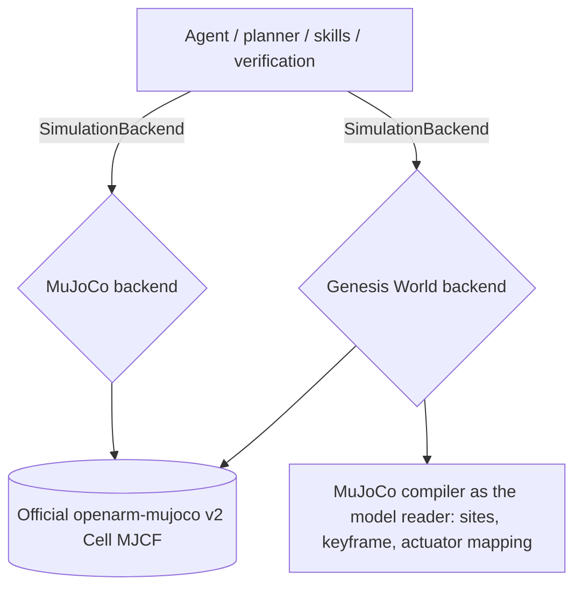

# Architecture

The backend is the authority for state. The planner sees only serialized simulation state and can choose from a fixed skill library. It cannot generate executable code. Each skill returns measured timing, error categories, and endpoint poses.

## Simulation engines

Two engines run the same task on the same robot. MuJoCo is the default and stays authoritative; Genesis World is an additional physics implementation, selected with `SIM_BACKEND=genesis` (see the engine section below).



The agent layers never import an engine. `backend/app/simulation/base.py` declares the contract
(`SimulationBackend`) that every engine implements; `backend/app/simulation/__init__.py` selects one.
`backend/app/control/motion.py`, `backend/app/skills/robot_skills.py` and
`backend/app/verification/goal_verification.py` read poses, Jacobians, contacts and grasp state only
through that contract, so one plan means the same thing on either engine and an engine difference
shows up as a physical difference, not as a different controller.

### Model description

`assets/scenes/openarm_v2_demo.xml` is authored with two path tokens and no machine-specific paths.
They are resolved at load time from the installed `openarm-mujoco` 2.3.0 package
(`backend/app/simulation/openarm_v2/scene.py`), so the same XML string is compiled on any machine.
The official model is attached through MuJoCo's `<model>`/`<attach>` mechanism and is never copied or
substituted. `backend/app/simulation/openarm_v2/definition.py` holds the joint, link, site, object,
zone and grasp-geometry names both engines share.

Genesis does not implement the MJCF site abstraction, so the Genesis backend reads the gripper
control point and the zone origins from the *same XML string* with MuJoCo's compiler
(`_OfficialModelMetadata`), as a parent link plus a local offset. The model has one reader; Genesis
supplies the physics.

### What each engine does differently

| | MuJoCo (authoritative) | Genesis World (alternative) |
|---|---|---|
| Scene | official Cell MJCF, MuJoCo physics and rendering | same resolved MJCF string, Genesis physics |
| Grasp | documented equality weld after gripper closure: `contact-assisted-weld` | **kinematic grasp hold**: the object's free-joint pose is prescribed from the gripper base link each step: `kinematic-grasp-hold` |
| Bias torque during a joint path | `qfrc_bias` feed-forward | no-op: the arm is held by the model's own PD gains |
| Rendering | MuJoCo renderer | Genesis rasterizer, resized to the requested size |
| Camera | MuJoCo free camera | same look-at/distance/azimuth/elevation convention |

Neither engine claims contact-only manipulation. `env.grasp_mode` is reported with every grasp result,
in `/api/health`, and in the dashboard badge.

### Genesis World engine: status

Verified by `backend/tests/test_engines.py` (run with `SIM_AGENT_TEST_GENESIS=1`):

- the official model loads with the same link and joint names, 19 robot degrees of freedom and the
  same timestep as MuJoCo;
- the initial state after `reset()` and after `reset(randomize=True)` matches MuJoCo to 1e-5;
- forward kinematics, the gripper control point pose, and the 3x7 linear and angular Jacobians the
  controller consumes match MuJoCo to 1e-6;
- the same inverse kinematics target produces the same solution and the same residual, and the
  documented unreachable target is rejected by both engines;
- the complete approach/grasp/lift/place/release/retreat sequence executes and reports its labelled
  grasp mode (`test_openarm.py`, parametrized over both engines).

**Known limitation (not verified):** the Genesis engine does not complete the pick-and-place task.
With the arm at the home pose the red cube is ejected within the first steps of a reset and then sits
against the arm, so the grasp closes on a displaced cube and the final placement misses the zone. The
divergence is a contact/impulse difference, not a kinematic one, and appears before any robot motion:
`red_cube` and `openarm_left_link5/6` report a 54 mm penetration ten steps after a reset, while
MuJoCo's reset reports only cube-to-table contacts. Reproduction:

```bash
SIM_AGENT_TEST_GENESIS=1 uv run pytest -q backend/tests/test_openarm.py -k pick_place
```

`test_complete_pick_place[genesis]` and `test_right_arm_blue_cube_place[genesis]` are marked `xfail`
with this reason until it is fixed.

## OpenArm v2

- Model: `openarm-mujoco` 2.3.0, v2 Cell, attached bimanual robot.
- Actuator mapping: 1 lifter, 7 left arm, 1 left gripper, 7 right arm, 1 right gripper.
- Active task arm: left.
- Controller: damped least-squares inverse kinematics on the gripper control point, executed as an
  interpolated joint path. The rotation algebra is NumPy (`backend/app/simulation/transform.py`) and is
  pinned against MuJoCo's `mju_*` functions by `backend/tests/test_transform.py`.

## Execution

- Pydantic plan validation rejects unknown skills, objects, targets, unsupported arms, empty or oversized plans.
- The executor serializes simulation control through one engine/task.
- Failure verification is independent of the AI plan.
- `reset(randomize=True)` uses one shared placement function for both engines, whose seed is documented
  in `backend/app/simulation/openarm_v2/scene.py`.

## Memory

- AuraDB uses parameterized Cypher and constraints.
- Experience is keyed by task, execution, object, skill, outcome, and failure.
- In fallback mode, a related successful execution changes the plan's approach offset from 55 mm to 60 mm and shows the decision in the dashboard.
- If AuraDB is unavailable, records go to `outputs/memory-fallback.json` and the UI reports `Fallback`.
