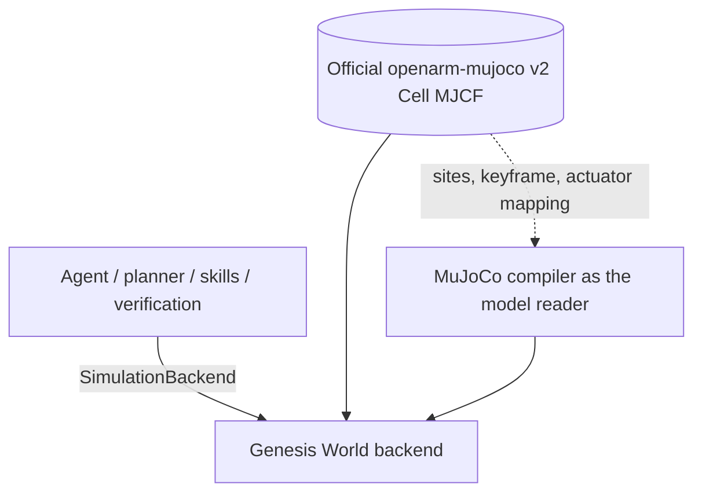

# Architecture

The backend is the authority for state. The planner sees only serialized simulation state and can choose from a fixed skill library. It cannot generate executable code. Each skill returns measured timing, error categories, and endpoint poses.

## Simulation engine

One engine runs the task: Genesis World, on the official OpenArm v2 Cell model.

The agent layers never import an engine. `backend/app/simulation/base.py` declares the contract
(`SimulationBackend`) that the engine implements, and `backend/app/simulation/__init__.py` is the one
place an engine is constructed. `backend/app/control/motion.py`, `backend/app/skills/robot_skills.py` and
`backend/app/verification/goal_verification.py` read poses, Jacobians, contacts and grasp state only
through that contract. The seam exists so an engine can be replaced or added without touching the agent,
and so every engine difference is declared where the agent can see it (`grasp_mode`) rather than hidden in
a controller branch.

### Model description

`assets/scenes/openarm_v2_demo.xml` is authored with two path tokens and no machine-specific paths. They
are resolved at load time from the installed `openarm-mujoco` 2.3.0 package
(`backend/app/simulation/openarm_v2/scene.py`), so the same XML string is compiled on any machine. The
official model is attached through MuJoCo's `<model>`/`<attach>` mechanism and is never copied or
substituted. `backend/app/simulation/openarm_v2/definition.py` holds the joint, link, site, object, zone
and grasp-geometry names the agent uses.

The description has one reader. Genesis does not implement the MJCF site abstraction, so the gripper
control point and the zone origins are read from the *same XML string* by MuJoCo's compiler
(`_OfficialModelMetadata`) as a parent link plus a local offset. Genesis supplies the physics; the
naming, the keyframe, the actuator mapping and the grasp geometry all come from the official asset.

### What the engine does differently

| | Genesis World |
|---|---|
| Scene | the resolved official MJCF string, Genesis physics and rasterizer |
| Grasp | **kinematic grasp hold**: the object's free-joint pose is prescribed from the gripper base link each step: `kinematic-grasp-hold` |
| Grasp offset | `GRASP_OFFSET` in world axes frozen into the gripper base link frame at grasp time, so the hold rule is one documented rule |
| Bias torque during a joint path | `apply_gravity_compensation()` writes the gravity torque into the constant term of the actuator model |
| Camera | one fixed dashboard camera aimed at the middle of the table |

`env.grasp_mode` is reported with every grasp result, in `/api/health`, and in the dashboard badge.
Contacts at the fingers are monitored and reported, but this engine does not claim contact-only
manipulation.

### Spawn pose

The request "spawn the joints at 90 degrees" has two readings.  The elbow (joint 4) already spawns at
90 degrees in the official model keyframe.  Setting *all seven* arm joints to 90 degrees makes the two
arms interpenetrate, so the project keeps the official keyframe as the single documented spawn pose.
`SPAWN_ARM_QPOS` in `backend/app/simulation/openarm_v2/definition.py` names that decision, and
`GenesisOpenArmV2Environment.reset()` builds the full qpos from it.

Measured on the compiled MJCF with `mj_kinematics` + `mj_collision` (both arms at the same pose):

| Pose | Joint values (deg) | left ee (m) | right ee (m) | height above table (m) | collision-free | worst penetration |
|---|---|---|---|---|---|---|
| official keyframe | [0, 0, 0, 90, 0, 0, 0] | (0.401, 0.153, 1.120) | (0.401, -0.153, 1.120) | 0.120 | **yes** | — |
| only joint4 = 90° | [0, 0, 0, 90, 0, 0, 0] | (0.401, 0.153, 1.120) | (0.401, -0.153, 1.120) | 0.120 | **yes** | — |
| all seven joints = 90° | [90, 90, 90, 90, 90, 90, 90] | (0.401, -0.067, 1.340) | (-0.031, -0.373, 1.340) | 0.340 | **no** | arm-arm -0.072 m |
| joints 2 and 4 = 90° | [0, 90, 0, 90, 0, 0, 0] | (0.401, -0.067, 1.340) | (0.401, -0.374, 1.340) | 0.340 | **no** | arm-arm -0.072 m |
| joint2 = 45°, joint4 = 90° | [0, 45, 0, 90, 0, 0, 0] | (0.401, -0.002, 1.184) | (0.401, -0.309, 1.184) | 0.184 | **no** | arm-arm -0.018 m |
| joint2 = -45°, joint4 = 90° | [0, -45, 0, 90, 0, 0, 0] | (0.401, 0.309, 1.184) | (0.401, 0.002, 1.184) | 0.184 | **no** | arm-arm -0.018 m |

Only the official keyframe (which is also "only joint4 = 90°") is collision-free.  The all-90° pose
produces 19 arm-arm contacts, the deepest being `openarm_lifter_link | openarm_left_link3` at -0.072 m
and `openarm_left_link3 | openarm_right_base_link` at -0.064 m.  No arm-cube or arm-table contacts
appear in any candidate.  `test_spawn_pose_is_the_official_model_keyframe` asserts the project constant
matches the model, and `test_starts_in_the_documented_scene` asserts a freshly constructed engine is in
that pose.

### Genesis World engine: status

Verified by `backend/tests/test_official_model_fidelity.py`, `backend/tests/test_openarm.py` and
`backend/tests/test_transform.py` (25 tests, `pytest -q`):

- the ground truth for structure is the model description, compiled by MuJoCo and evaluated with its own
  kinematics routines (`mj_kinematics`, `mj_comPos`, `mj_jac`) - pure kinematics, no solver, no stepping;
- the initial scene after construction *and* after `reset()` is the model's own keyframe plus the shared
  object placement, to 1e-5 (the server builds one backend at startup and never resets it, so a task that
  arrives first must not begin from the model's zero configuration);
- forward kinematics, the gripper control point pose and the 3x7 linear and angular Jacobians the
  controller consumes match the official model's own routines to 1e-5 and 1e-6, at the home pose and at an
  arbitrary configuration;
- an inverse kinematics solution is checked by the official model's forward kinematics, so a wrong
  convention cannot pass by agreeing with itself;
- the complete approach/grasp/lift/place/release/retreat sequence executes for both arms, reports its
  labelled grasp mode, and passes independent verification.

Four engine differences had to be handled explicitly, and each is covered by a test:

1. **Inactive equalities.** The scene declares its four grasp welds `active="false"` so they stay inert
   until a grasp is commanded. Genesis builds every equality it parses and reads no `active` flag, and it
   has no runtime enable/disable, so the welds would be permanent and would snap the cube to the gripper at
   reset (measured: 3.5 m/s in the first step, no contact reported). `genesis_scene_xml()` drops exactly
   the equalities MuJoCo reports as inactive (`eq_active0 == 0`) from the XML handed to Genesis.
   `test_genesis_builds_the_official_model` asserts Genesis built the two remaining equalities.
2. **Bias feed-forward.** A Genesis position controller holds a commanded pose `gravity_torque / kp` short
   of its target. Measured on this machine with the same commanded pose and the same control path: 10.16 mm
   of sag without compensation, 0.41 mm with it. `apply_gravity_compensation()` writes the arm's gravity
   torque into the constant term of Genesis's actuator model (`act_bias[0]`, the analogue of the model's
   `biasprm[0]`), which keeps the damping implicit in the solver and leaves the cubes their own gravity. An
   earlier attempt to feed the same torque through `control_dofs_force` diverged on long joint paths,
   because FORCE mode skips the implicit damping the solver folds into the mass matrix for POSITION mode.
3. **Kinematic hold and velocities.** While a hold is active the object's pose is written every step.
   `set_qpos(..., zero_velocity=True)` zeroes *all* of the entity's velocities, which also stopped the arm
   mid-path; only the held object's dofs have their velocity reset.
4. **Sites.** Genesis has no MJCF site, so the gripper control point and the zone origins come from the
   model description as a parent link plus a local offset (above).

Measured placement error of the red-cube task through the task API: 34.2 mm horizontally and 23 mm
vertically against a 40 mm / 50 mm tolerance (30.1 mm with the default 55 mm approach offset, without the
memory-remembered 60 mm). The residual is the difference between where the gripper finishes its joint path
and where the zone is, not a constraint failure: the object is held rigidly at the documented grasp offset
while the arm converges to within a few millimetres of its commanded pose.

## OpenArm v2

- Model: `openarm-mujoco` 2.3.0, v2 Cell, attached bimanual robot.
- Actuator mapping: 1 lifter, 7 left arm, 1 left gripper, 7 right arm, 1 right gripper.
- Active task arm: left.
- Controller: damped least-squares inverse kinematics on the gripper control point, executed as an
  interpolated joint path. The rotation algebra is NumPy (`backend/app/simulation/transform.py`) and is
  pinned against MuJoCo's `mju_*` functions by `backend/tests/test_transform.py`.

## Execution

- Pydantic plan validation rejects unknown skills, objects, targets, unsupported arms, empty or oversized plans.
- The executor serializes simulation control through one engine/task.
- Failure verification is independent of the AI plan.
- `reset(randomize=True)` uses one shared placement function for both engines, whose seed is documented
  in `backend/app/simulation/openarm_v2/scene.py`.

## Memory

- AuraDB uses parameterized Cypher and constraints.
- Experience is keyed by task, execution, object, skill, outcome, and failure.
- In fallback mode, a related successful execution changes the plan's approach offset from 55 mm to 60 mm and shows the decision in the dashboard.
- If AuraDB is unavailable, records go to `outputs/memory-fallback.json` and the UI reports `Fallback`.
