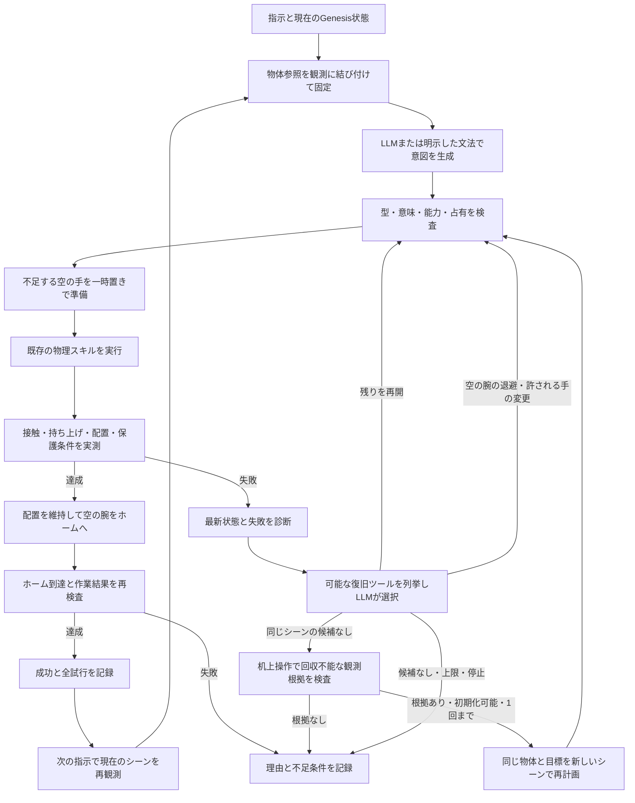

# 状況判断・準備・復旧をつなぐタスク実行

通常ランチャーの入口 `agent/task_agent.py` は、前のタスクが残した物体の状態から次のタスクを進める共通の実行ループである。
積み重ね専用の分岐ではなく、観測、参照解決、準備、計画、物理実行、完了時の退避、復旧を一つのタスクとして扱う。



## 言語解釈を弱めない境界

LLMの回答も定型文フォールバックも、同じ参照・関係検査を通って初めて実行候補になる。
モデルの回答を採用できなかったことは、検査で拒否したフォールバックを復活させる理由にならない。
物体を基準にした相対位置の参照先を解決できない場合、机の左右への配置で代用せず停止する。
指示中の代名詞は、先行する節に既知の物体が一つだけある場合に限ってその物体へ結び付ける。
曖昧さを物体の色、腕の名前、任意の距離で埋めない。

順序付き操作の途中で要求した関係と、完了後に保つ関係は別である。
前者は操作列に残っていることを検査し、後者は支持物だけでなく対象物も一致する成功判定を必要とする。
最終目標の検査は実際の位置・保持・接触で行い、別の場所への配置を元の指示の成功としない。
この検査は任意の自然言語の完全理解を保証するものではない。未解決の表現や未対応の物理操作を、
実行できる別作業へ置き換えないための境界である。保持した物体を相対配置の支持物に使う場合は、
最終保持や「持ったまま」などの条件と矛盾しない限り、既存の物理的な机上配置・空腕退避を
操作前提の準備として記録してから配置する。未検証の保持物体上への直接配置を許可するものではない。

## 目的契約と実行証拠

`planning/task_contract.py` は、最初に採用した型付き解釈を不変の契約として保持する。
契約ID・要求IDは、再計画で振り直されるaction indexとは別である。対象、明示した腕、数量、
支持物・関係、順序付き要求を変更する候補は動作前に拒否する。未指定の腕と投擲の設計パラメータは
目的そのものと区別し、許された変更を受け入れる。コンパイラが追加した一時置き先は要求に昇格させない。
契約は採用済み解釈の保全であり、原文全体の意味が正しいという独立した証明ではない。

`execution/contract_evidence.py` が、実行器から受け取ったイベントreceiptと操作の進捗を所有する。
最終状態はその時点のGenesisから再観測する。一方、投げ・命中・注ぎの過去の出来事は、同じタスク・
シーンepochのreceiptを使って検査する。再開でaction indexが変わっても対応を保ち、homingの後も
軌跡を消さない。命中対象の座標もイベント時の観測を記録し、後から移動した対象の座標で置き換えない。
測定欠落は `UNKNOWN`、実測による不成立は `UNSATISFIED` とし、どちらも成功にはしない。
成功した不可逆操作を検査のために再実行せず、イベントreceiptがある作業を自動初期化でやり直さない。

認識できる「持ったまま」「while holding」等のduring要求には、現在は連続保持を証明する観測がない。
最後の保持だけで代用せず、`CONTRACT_UNVERIFIABLE` で動作前に止める。これは限定された表現の検出であり、
任意の自然言語の時間条件・禁止条件を漏れなく抽出できるという主張ではない。
原因仮説、query、共通の探索予算の改善は[後続の計画](../specs/observation-driven-replanning/README.md)に分ける。

CPUだけのレビュー入口は次のとおり。`--input` は状態、元の計画、候補、試行receiptを持つローカルJSONを読む。
計画にはTaskProgramまたは保存したAgentPlanを渡せる。入力キーはスクリプトの `--help` と `demo_case` が示す。
外部モデル・live simulatorへは接続しない。出力は契約差分と保存済み測定の診断であり、新しい物理実行の証明ではない。
状態条件や注ぎの現在状態が必要なら、この入口ではUNKNOWNのままにする。

```bash
uv run python scripts/check_task_contract.py --demo measured-event
uv run python scripts/check_task_contract.py --demo changed-object
uv run python scripts/check_task_contract.py --demo missing-evidence
uv run python scripts/check_task_contract.py --input case.json
```

終了コードは、記録済みイベント成立が0、候補拒否・記録済みイベント不成立が1、証拠不足が2。
テストは `backend/tests/test_task_contract.py` と `backend/tests/test_task_agent.py` を物理シーンなしで実行できる。

## 失敗観測の共通receipt（S2）

失敗した実行器の結果は `execution/failure_evidence.py` が一回だけ正規化する。IDはタスク、
シーンepoch、試行、段階、操作・スキル位置に結び付ける。生の `evidence` と数値測定を分け、
計測されない距離や接触リンクを0や推測で埋めない。IK失敗だけから到達距離不足と断定せず、
明示的な距離の測定がある場合だけREACHABILITY、経路衝突のエラーはPATH_COLLISIONなど、
観測できる範囲の分類に限定する。プラン検証の事前拒否も構造化して保存する。
スキル内のIK/衝突エラーはスキル失敗として記録し、計画時拒否か動作中拒否かの区別が
実行器から報告されない場合、段階を捏造しない。

同じreceipt IDを `evidence_ledger`、試行、`agent_trace`、復旧判断への入力、再計画入力に渡す。
失敗スキルの実行直前状態があればそれをfingerprintに使い、位置・保持・可視の障害物と手先を含める。
説明文や時刻だけが変わっても同一値になる。ただしIK seed、連続した接触形状、関節制約などの
未取得入力もあるため、同じfingerprintは「同じ計画が必ず失敗する」証明ではない。
同じ失敗の再実行禁止、仮説・queryと統一budgetはS3の責務で、S2は自動復旧候補を変更しない。

保存済みTaskAgent結果の読み取り専用照合は `python scripts/replay_failure_evidence.py result.json`。
ID参照と保存した入力fingerprintを照合し、live Genesisやモデルを起動しない。
保存済み記録の整合性検査であり、センサー値の独立した物理的証明ではない。

## シーンを引き継ぐタスク境界

新しい指示の入口で必ず `executor.world_state()` を呼び、Genesisから現在の関節、物体の位置・姿勢、
接触、保持、支持関係を読み取る。初期化時や前のタスク開始時の配置を使って次の計画を作らない。
観測は `agent_trace` の `scene_observed`、計画の `planning_evidence.task_start_observation`、
結果の `initial_world_state` に残す。前の成功で残した積み重ね・配置・参照履歴を引き継ぐ。
キーワードから異なる種類のシーンが必要だと分かっても、作業履歴があるシーンを自動で破棄しない。

物体操作の成功後は、`TaskExecutor.home_empty_arms` が空の腕を退避する。
物体を保持する最終目標では、保持している腕と指はその要求を維持する。
手先移動・関節操作など最終姿勢そのものを要求した指示には、この自動退避を適用しない。
ホーム復帰と配置維持を確認してから成功を通知し、復帰に失敗しても完了済み操作を再実行しない。

`skills/homing.py` は現在の関節と物体姿勢から復帰経路を選ぶ。
標準ホームと必要な余裕が空いていればその関節姿勢へ戻し、現在の物体で塞がれていれば、標準ホーム付近の干渉しない待機姿勢を選ぶ。
公式OpenArmの標準姿勢は机に手を伸ばすため、作業後の物体が占める場合がある。
選んだ関節目標は `target_joint_positions`、調整理由は `home_adjustment_reason` に記録する。
OpenArmは公式モデルの私有FKデータに**現在**の両腕・指・物体姿勢を反映し、経路の衝突と物体からの30mmの余裕を幾何検査する。
作業直後の腕がその余裕の内側にいる場合は、既存の距離を縮めずに離れる経路を許し、退避先では30mmの余裕を要求する。
物理計算はGenesisだけが行う。動作中にも実接触、置いた物体の2mm超の変位、他方の保持喪失を検出すると停止する。
目標関節の最大残差25mrad以内、退避全体で未把持物体の変位6mm未満を確認し、作業の契約の状態条件を再測定し、イベント条件は同じepochのreceiptで再検査する。
幾何のサンプリングは連続経路に対する数学的な無衝突保証ではなく、実測監視と併用する。

`skills/approach.py` も、固定の机上高さを全配置へ流用せず、現在の物体位置から到達可能な接近高さ・関節解を探索する。
OpenArmでは実行する関節曲線を現在の配置で幾何検査する。これにより、前の作業で高い場所へ移った物体も同じ接近処理の対象になる。
受け渡しでも現在の物体回転を使い、キューブが前の操作で180度回転していれば、等価な面の座標系から対向する受け手の姿勢を選ぶ。
インポート機はその機種の接近実装と衝突プランナーを使う。任意機種の把持精度をこの変更だけで保証するものではない。

## 現在の状態と文章が食い違うとき

`agent/scene_reasoning.py` は、指や物体の観測から参照を解決する。
「右手のキューブ」には現在の右手の保持物体を使う。過去の会話に残るIDで空の手を埋めない。
手が空の場合は、明示された色の物体、またはその側にある未把持・机上のキューブが一意なら、
取得が必要な前提条件として説明してから対象を固定する。これは保持を観測したという主張ではない。
候補が複数・不在・明示された色と実保持が不一致なら、観測した状態・候補・必要条件を返す。
左右の物体参照にも現在のY座標を使い、同程度の位置なら色の指定を求める。

この参照解決には限定された表現と座標系の前提がある。任意の日本語を理解する証明ではない。
VLMの画像認識は未接続であり、状態はGenesisの登録済み物体・接触・座標から取得する。

## 手が塞がっている場合の準備

厳密な `compile_program` は、対象を取る手・受け取る手の占有を検査し、
必要な空の手を機械可読の `GroundingError.preparation` として返す。
受け渡し先の手が指定されず、利用可能なロボットの腕がちょうど2本なら、
現在の保持手と反対側を選び、その選択を仮定として記録する。
手が1本しかない場合や人への受け渡しを、この選択で代用しない。
`planning/preparation.py` が、別の保持キューブを空いた既知の机領域へ置き、
空の腕を `park_empty_arm` で退避する操作を挿入して再コンパイルする。
持ったままの支持物に別の物体を載せる物理能力はないが、要求が継続保持を指定しない場合、
その支持物を安全な既知の机上位置へ一時配置してから相対配置を行う。

### 保持したままの支持物へ載せる場合の測定済み境界（2026-11-07）

「右手で持っている状態を維持したまま、そのキューブの上に赤を重ねて」のように継続保持を明示した要求では、
計画は机上へ一時配置せず、保持したままの支持物の上へ直接載せる手順を生成する。
このとき実行層は、支持腕を両腕共通の作業点（x≈0.45, y≈-0.04, z≈1.06）へ寄せ、
置く腕は保持腕と同じ進入軸を避けた姿勢をIKで選択する。

このとき、載せる前に**保持腕の把持点を下方へ15 mmスライド**させる（`regrasp_object`）。
指パッドは把持中心より上下に張り出すため、中心把持のままでは支持物の上面が塞がる。
机の上では低い把持が取れない（パッドが机と干渉する）ので、空中へ上げた後に把持点だけを下げる。
手順は「顎を35%だけ緩める → 把持が残っていることを確認 → 15 mm降下 → 閉じる → 二指ピンチ・横ずれ10 mm以下・
3 cm保持追従を確認」。緩めた時点でピンチが外れれば**動かさずに** `REGRASP_LOST` で停止し、
横へ動いた場合は `REGRASP_MOVED`、閉じ直してピンチが無ければ `REGRASP_NO_PINCH` として失敗を報告する。

### 把持点下げの実測（2026-11-07）

- 緩め量35%固定では**ピンチが外れた**（`REGRASP_LOST`）。緩め量は物体依存なので、
  5/10/15/20/25% を小さい順に試し、把持が残る最大量を採用する。
- 支持物を共有中心（y≈-0.04）へ寄せると、**置く腕がそこへ到達できなかった**
  （左腕の移動が y=+0.09 で停止、回転残差0.11）。支持物は**置く腕の側**（左で置くなら y≈+0.04）へ寄せる。
- それでも、置いたキューブは支持物の上面から**5.9 mm 上**で止まり `support_contact=false`。
  保持腕の指パッドが依然として上面空間に残っており、この経路では積めていない。
- 配置が途中で失敗しても、準備（把持点下げ）の実測は `SkillError.evidence.support_regrasp` に残す。

したがって現時点でも、中心把持したキューブの上面へ載せる要求は未達である（成功とは報告しない）。

### 機序は形態だった（2026-11-07 実測）

`skills/pad_clearance.py` が、公式モデルの指ジオメトリから「支持物の上面の上に、保持腕の指が何 mm 残るか」を
**測って**答える。ライブの把持姿勢で測ると:

- 支持物 `blue_cube`（保持中、中心 z=1.0294、上面 z=1.0563）に対し、
  右手の指ジオメトリが上面から **40.5 mm 上**まで立っている（12 ジオメトリが該当）。
- したがって把持深さを変えても上面は空かない。載せようとしたキューブは上面 5.9 mm 上で止まり、
  `support_contact=false` になった実測と整合する。

結果として `move_to_object` は、支持物が保持されていて指が上面を覆っている場合、
**動作前に** `SUPPORT_FACE_BLOCKED`（例: `右手の指が blue_cube の上面から 40.5 mm 立ち上がっている`）で拒否し、
`clearance` の実測値を証拠に残す。把持点下げ（`regrasp_object`）は実装済みだが、
この形態制約を解けないことが測れたため既定では試行しない（`SUPPORT_REGRASP_ENABLED = False`）。
測定不能（ジオメトリ非公開のインポート機など）のときは拒否しない。**測っていないことを理由に止めない。**

### 定数を捨てて、身体に問い合わせる（2026-11-07）

`planning/capability_queries.py` と `planning/strategy_search.py` により、二本腕で積む手順は
**過去の測定値を定数として継承するのをやめ**、その場で身体に問い合わせて決める。

- 質問（読み取り専用・動作なし）: `reachable_pose`（その腕がその姿勢でその把持点に届くか）、
  `pad_blocks_support_face`（保持腕の指が支持物の上面の上に残るか）。
- 探索: 置く腕の側 → 中央 → 保持腕の側 の順にステージ地点を試し、各地点で置く腕の把持姿勢
  （0/90/180/270度）を試す。届いた最初の組を採用し、**却下した組とその測定値も残す**。
- 支持物の指が上面を覆っていれば、探索はその1回の質問で止まり
  `SUPPORT_FACE_BLOCKED`（`mechanism: HAND_GEOMETRY`）として実測値つきで拒否する。
  ステージ地点を変えても指は付いてくるので、探索する意味がない。
- 測れない場合（IKソルバ無し・ジオメトリ非公開のインポート機）は `UNMEASURED` を返し、
  呼び出し側は**従来の挙動へ戻る**。測っていないことを理由に拒否しない。

以前この経路に埋まっていた定数（staging=(0.45,-0.04,1.06)、15 mm の regrasp、yaw 270）は、
それぞれ1つの場面の測定値だった。実測では staging は左腕に届かず、regrasp は指を除けず、
yaw は測定した側でしか成立しなかった。定数を規則の代わりにしない、というのがこの分割の理由である。

この制約は計画や言語の問題ではなく、指の長さという機体の性質である。解くには
「保持したまま載せる」を諦めて机上配置へ切り替える（要求の変更になるので自動では行わない）、
指が干渉しない姿勢（縦把持など）を別途測る、または把持形態の異なる機体を使う、のいずれかになる。
2026-11-07の実測（タスク `ae5a73bf`）では、赤は青の上面から **7.15 mm 上**で止まり、
`support_contact=false`、右手の指先パッドとの接触が残った。
パッドは把持中心より上下に張り出すため、中心把持のままでは支持物の上面空間を塞ぐ。
検証器はこの状態を成功にしなかった（`released=false` / `support_contact=false`）。
把持点を下方へ15 mmずらす案は、机上で静止したキューブに対してはパッドが机と干渉し、
把持前の接近（`APPROACH_PATH_UNAVAILABLE`）が成立しないことを確認した。
したがって現時点で、机上のキューブを中心把持したまま別のキューブを載せる要求は、
机上配置の準備へ切り替えるか、把持後に把持点を下げ直す操作（未実装）が必要である。
この境界は「できた」と報告しないための記録であり、机上配置へ切り替えた場合は最終保持の要求を満たさない。
準備で選んだ机上位置をユーザーの最終目的に昇格させず、最終の支持関係は保持する。
明示した保護条件はその後の独立した意味検査でも適用する。
先行操作で机上領域やゾーンへ配置された物体の座標は、コンパイル中にも仮想投影として更新される。
これにより、右側へ移動した支持物に対して同じ右側にある物体を載せる場合など、
同一の腕で安全に到達できる相対配置では不要な対向アームへのハンドオーバーを自動挿入せず、
把持した手で直接配置する。
最終保持の目標だけが与えられた場合も、受け手の保持物体が目標の対象外で、保護されていなければ、
理由を明示した一時置きの副目標を追加して探索できる。厳密な `compile_program` 自体の占有検査は維持する。

このとき、準備で扱う赤が「それ」の新しい対象にならないよう、
失敗した要求操作の物体IDを準備の挿入前に確定する。
準備の理由と対象は `planning_evidence.preparations`、元の要求は `requested_program` に残る。
一時置きの候補は物体寸法と既知の位置から選ぶ。連続軌道の可否や実把持は実行時に別途検査する。

## ヘッドレス運用（2026-11-09）

`GENESIS_SHOW_VIEWER=0` で起動すると、ネイティブの Genesis ウィンドウを開かずに同じ所有者として動く。
API と Web UI（`/simple`）はそのまま使え、`/api/scene` の状態・計画・実行トレース・検証結果は
ウィンドウ無しでも取得できる（3D 表示だけが無い）。

実測（このホスト）:

- ヘッドレス起動は **約35秒**で `viewer_online: true`（`Ready: local_ollama; arm motion 6x`）
- 指示「赤いキューブを左手で左において」→ **SUCCEEDED**、`placement red_cube` / `undisturbed blue_cube` とも真、
  赤は `[0.46, 0.299, 1.031]`
- `GET /simple` は 200 で配信される（ブラウザからは従来どおり操作可能）

一方、**ネイティブウィンドウ付き起動は同じ位置で停止する**（プロセス生存・RSS 2.4GB・VRAM 1.04GB 確保後、
全スレッド futex 待ち・CPU 0・`viewer_starting: true` のまま）。切り分け:

- `import genesis` 3.3 s、`gs.init` 1.1 s、`create_backend()` 31.7 s、`env.step(10)` 成功 → **エンジンは健全**
- したがって停止は**表示（EGL/Xwayland）経路**にある。発生は 4時間の実行上限で GUI が SIGTERM された直後から
- 復旧には Xwayland / デスクトップセッションの再起動が必要（ユーザー操作の領域）

ウィンドウ無しでも計画・実行・検証・記録はすべて動くので、表示が要らない作業はこの形で続けられる。

## モデル比較と学習の判定（2026-11-07 実測）

`scripts/compare_planners.py` で、同じ12ケースの指示バッテリー（今日失敗した種類を含む）を
同じシーン・同じ検証で複数モデルに通し、結果を測る。GPU は AMD RX 7800 XT 16GB で、
Ollama は `100% GPU` で動いている（`rocm-smi` / `ollama ps` を report に保存）。

実測（capability mode・モデルに必ず判断させる条件）:

| モデル | 計画できた | 検証通過 | 拒否 | 中央値 | 実際にモデルの計画が採用されたケース |
|---|---|---|---|---|---|
| qwen2.5:3b | 11/12 | 11 | 1（未対応指示） | 5.7 s | hand_reference, relative_move, throw |
| lfm2.5 | 11/12 | 11 | 1（未対応指示） | 5.1 s | two_placements, relative_move, pour |

読み方:

- 「計画できた／検証通過」は両モデルで同じ。差は**どのケースでモデルの計画が採用されたか**に出る。
- 今日の難所（`stack_on_held` / `contrastive_pair` / `handover_then_stack`）は**両モデルとも文法の解釈**が採用され、
  モデルの提案は採用されていない。つまりこの難所はモデル交換では動かなかった。
- `two_placements` では lfm2.5 の計画が採用され、6 ステップの不要な受け渡しを含んでいた（検証は通る）。
  検証を通ることと意図に合うことは別、という既知の境界がそのまま現れている。
- したがってこの測定では**モデル変更を採用する根拠がない**。根拠になるのは「文法が解けない指示でモデルが解く」
  ケースが増えることだが、バッテリー上それは観測されていない。

`scripts/train_mechanism_predictor.py` は、保存済み実行記録から（実行前に分かる特徴 → 観測された機序）を
学習し、leave-one-out で多数クラス基線と比較する。`scripts/collect_traces.py` で
**GUI が Genesis を所有したまま API 経由**で記録を集められる（40 試行で約 17 分）。

実測の推移:

| 例数 | accuracy | baseline | gain | 判定 |
|---|---|---|---|---|
| 10 | 0.600 | 0.600 | 0.000 | NOT_ADOPTED（例数不足・基線同等） |
| 14 | 0.643 | 0.500 | +0.143 | NOT_ADOPTED（例数 14 < 40） |
| 46 | 0.543 | 0.283 | +0.261 | NOT_ADOPTED（下記） |

46 例では「gain > 0 かつ 40 例以上」という当初の規則を通って **adopted: true** になったが、内訳を見ると
**`APPROACH_CONTACT` を一度も予測していない（0/7）**、しかも**確信度が当たり 0.54 / 外れ 0.55 で情報がない**。
全体精度が易しいクラスで上がっただけであり、採用条件が弱すぎた。

そこで採用条件を強化した（現在の規則）:

1. 例数 ≥ 40（保留評価が意味を持つ下限）
2. 多数クラス基線を上回る
3. **支持 3 例以上のクラスは recall ≥ 0.5**（検出できない機序を盲点として残さない）
4. **正解時の確信度 > 不正解時の確信度 + 0.05**（確率が判断材料になっている）

この規則では 46 例でも **NOT_ADOPTED**（理由に「APPROACH_CONTACT 0/7」「0.54 vs 0.55」が出る）。

### 195 例まで増やした結果（2026-11-08 実測）

`planning/preflight.py` を追加し、**動作前に**相対配置の幾何（保持腕の指が上面を覆うか、置く腕が4姿勢のうち
何姿勢で届くか）を計画証拠として保存するようにした。実行前に分かる情報だけで接触機序を区別するためである。
195 例（うち preflight を含むのは一部）での leave-one-out:

| クラス | recall |
|---|---|
| PLANNING | 0.74 (25/34) |
| UNKNOWN | 0.75 (27/36) |
| APPROACH_CONTACT | 0.39 (19/49) |
| NONE | 0.40 (21/53) |
| TRACKING | **0.00 (0/23)** |

accuracy 0.47 / baseline 0.27 だが、**TRACKING を一度も当てない**ため NOT_ADOPTED。
計画の形だけでは「サーボが追従できず止まる」を区別できず、`preflight` もまだ少数例にしか入っていない
（収集の途中で GUI を再起動するまで新経路が動いておらず、その記録には preflight が無い）。
preflight つきの記録を 56 例含む **279 例**まで増やした再評価（2026-11-08）:

| クラス | recall |
|---|---|
| PLANNING | 0.71 (42/59) |
| UNKNOWN | 0.70 (30/43) |
| APPROACH_CONTACT | 0.48 (33/69) |
| NONE | 0.39 (29/74) |
| **TRACKING** | **0.00 (0/34)** |

accuracy 0.48 / baseline 0.27、確信度 0.49 vs 0.48 → **依然 NOT_ADOPTED**。
幾何 preflight で `APPROACH_CONTACT` は 0.39→0.48 に改善したが、`TRACKING`
（サーボが指令に追従できず止まる）は**一度も当たらない**。この機序は計画形状でも配置の到達性でもなく、
軌道追従の実測でしか分からないため、実行前特徴量では原理的に届かない領域である。
したがって予測器の適用範囲は「計画形状から言える範囲」に限られ、`TRACKING` の予測は当面あきらめるのが正しい。

**次に必要なのは preflight つきの記録を 150 例規模で集めること**であり、モデルや学習率の調整ではない。

### 収集で踏んだ2つの事故（どちらも修正・テスト済み）

1. **新経路が一度も走っていなかった**: preflight 追加前に起動した GUI へ収集器が接続していたため、
   141 件すべてが `preflight` 無しだった。変更後は**その記録に新しい項目があるか**を最初に確認する。
2. **`inf` が記録を壊した**: 指が面上に無い場合に `clearance_m = inf` を返し、証拠の JSON 直列化で
   **24 件中 11 件のタスクが落ちた**。現在は「面上に指が無い」を `clearance_m = None` +
   `no pad geometry over the support face` として返し、`preflight` 側でも非有限値を `None` に落とす
   （1つの測定不良が実行を落とさない）。

## 学習ポリシーの受け口（提案のみ・検証は既存層）

`planning/policy_provider.py` は、LeRobot 系の学習ポリシー（例: 2026-11-03 に発表された Galaxea G0.5 は
サブタスク＋物体BBoxを出してから行動チャンクを生成する）を**提案者としてだけ**受け入れる継ぎ目である。

- 受け取れるのは `TaskProgram`（記号サブタスク）だけ。関節トルクや行動チャンクは**検証不能**として
  `POLICY_OUTPUT_NOT_VERIFIABLE` で拒否する。このリポジトリには7次元チャンクを契約と突き合わせる手段がない。
- 提案は文法解釈（fallback）と同じ接地・関係検査・義務検査・`validate_plan` を通る。加えて、
  fallback が解けた指示では**対象集合と action/hand の署名が一致**しなければ拒否する。
  学習側が別の作業に置き換える経路は存在しない。
- 既定では無効（`OPENARM_POLICY_BACKEND` が空なら呼ばれない）。重みは自分で取得しない
  （`OPENARM_POLICY_MODEL_PATH` 未設定なら `POLICY_WEIGHTS_ABSENT`）。
- 却下された提案は `planning_evidence.policy_backend` に理由つきで残り、通常の計画経路が続く。
- 成功判定は Genesis の実測のみ。ポリシーが「成功した」と言うことは証拠ではない。

## 実行ログを注釈データとして書き出す

`scripts/export_lerobot_annotations.py` は、保存済みの実行記録から、方策学習で使う形の注釈
（指示・サブタスク・対象物体・その時点の物体姿勢・結果）を JSONL で書き出す。学習は行わない。

```bash
uv run python scripts/export_lerobot_annotations.py \
  --input <実行記録.json または ディレクトリ> --out annotations.jsonl --with-mechanisms
```

記録するものと、しないもの:

- `subtask` は計画の語彙（`pick` / `hand_over` / `place` …）＋対象＋行き先。実行された step の
  `before_world_state` / `world_state` から、各サブタスクの開始・終了時の物体位置・回転・AABB を取る。
- `box_space` は `world_aabb`、`image_boxes` は **常に `null`**。実行記録にカメラ画像が含まれないため、
  画像座標の箱を作れば捏造になる。3D の世界座標箱だけを書く。
- `entity_grounding` はその物体について記録された接地決定（`planning_evidence.scene_bindings`）。
  決定は**指示中の言及**を解決するもので、どの step がその決定で生まれたかは記録に無い。
  そのため「この step を決めた決定」とは書かず、同じ物体についての決定を並べる。
- 失敗は `evidence_ledger` の `mechanism` / `mechanism_reason` を `--with-mechanisms` で添付する。
- step が1つも無い記録、読めないファイルは空の注釈を作らず、理由を stderr に出す。

## 接地は1か所で決め、記録し、検証する

`planning/grounding.py` が、指示中の参照表現（「右手にあるキューブ」「もう一方の手」
「掴んでいる状態のキューブの上」「もう一つのキューブ」）を解決する**唯一の所有者**である。

以前はこの解決が2モジュールにまたがる文字列置換で、span も根拠も残さず、しかも
`TaskAgent` と `AgentPlanner` の両方で適用されていた。2026-11-07 には
「右手でblue_cube」という二重主語を作って `Multiple acting hands in one clause` を起こし、
その書き換えは計画証拠からは見えなかった。

現在の契約:

- パスは `scene_hands` → `relative_pronouns` の固定順。各置換は**段（step）単位**で記録する。
- `ground()` は各段について、記録された置換だけから入力を作り直し（`_replay`）、実際の出力と一致することを
  **証明**する。一致しなければ `UNGROUNDED_EDIT` で計画出力を拒否する。記録だけして実際に
  置換していない場合も同じく拒否する。
- 各決定は `rule` / `step` / `kind` / `basis`（なぜその物体を選べたか）/ `span` / `surface` /
  `replacement` / `resolved`（実際に書いた物体・腕）/ `candidates` / `alternatives` / `explanation` を持つ。
- `observed` に、判断が読んでよかった観測（手の保持、物体位置、利用可能な腕、sim時刻）を残す。
  読み手は同じ観測から決定を再導出できる。
- 決定は `planning_evidence.grounding`（original / instruction / steps / observed）と
  `planning_evidence.scene_bindings` に残り、`agent_trace` にも `basis` 付きで出る。
- 置換は1回だけ適用する（解決済み文を再度 `ground()` しても決定は0件になることをテストで固定）。
- 曖昧な場面（同側に同高の候補が2つ等）は従来どおり `SceneReferenceError` で止める。当て推量をしない。

この層は「どの層で壊れたか」を言えるようにするためのものであり、任意の自然言語の理解を保証しない。
学習モデルを後段に置く場合も、この決定集合が提案と検証の境界になる。

## シーンを選べるようにした（2026-11-10）

`simulation/scenes.py` が**シーンの一覧をデータで持つ**（`cubes` / `wine` / `mixed`）。追加は「id・含む物体・
必要な部品・流体の有無」を書くだけで、環境の検証・API・UI が同じ一覧を見る。

- `GET /api/scenes` → 一覧（`objects` / `zones` / `fluid` / **`selectable`** / `active`）
- `POST /api/scenes/select?scene=<id>` → 所有者に再構築を依頼（把持中は拒否）
- 指示文からも選ばれる（`scene_for_instruction`: ワイン語と キューブ語が両方出れば `mixed`）

**「登録されているが構築できない」を選べなくする**。主張（この scene は作れる）は
`scripts/check_scenes.py` で**実際に構築して確かめる**。API は未検証の scene を 409 で断り、UI も選択不可。

### `mixed` が構築できなかった原因と解決（2026-11-10 実測）

スタックダンプで特定: **流体と剛体の結合用 SDF 生成**（`genesis/.../rigid_geom._compute_sd` →
`T_mesh_to_sdf`）で止まっていた。原因は `wine.py` の `sdf_cell_size=.0004`（0.4 mm）／`sdf_max_res=512`。
キャッシュが **1 形状あたり 696 MB**、構築は 15 分でも終わらない。

- 解像度を**測定可能な設定**にした（`OPENARM_WINE_SDF_CELL_MM` / `_MIN_RES` / `_MAX_RES`、
  scene ごとに `sdf` を宣言できる）
- `mixed` は **1.0 mm / 160** で **221.6 秒**（全4物体入り）→ `verified: true`、API で切替成功
- `wine` は公式の 0.4 mm のまま**未検証**（15分で終わらない）。粗くするなら計測してから

**代償も実測**: `mixed` は流体の時間刻み（`WINE_DT`）のため**操作が約50倍遅い** — 単純な配置が10分で
終わらず停止した（`cubes` では約12秒）。だから `mixed` は「警告付きで選択可」としてある。

**明示選択は指示より優先**: 人が `mixed` を選んだ後にキューブ指示を出しても、その scene が要求物体を
含むなら再構築しない（`scenes.hosts`）。実測で一度これが起き、選択した場が黙って壊されたため。

なお `~/Downloads/assets.zip` は**リポジトリの現行アセットと完全一致**（シーンXML・wine メッシュ同一）だった
ので、重複登録はせず、その素材で組める `mixed` を登録した。ライブ確認: 一覧・拒否（409）・
`cubes` への切り替え（SUCCEEDED）・通常タスク（SUCCEEDED、`placement`/`undisturbed` とも真）。

## 身体の契約（2026-11-09）

`simulation/conformance.py` が「skills が駆動する前に身体が答えるべき操作」を宣言し、検査する。実機に
載せ替えるときの受け入れ基準がこれになる（`scripts/check_body_conformance.py --describe` で一覧）。

見ているのは形だけではない:

- 読み取り専用の操作は計画から何度でも呼ばれる（シーンを動かさない前提）。
- `step` が**実際に時間を進めるか**。進めないバックエンドは「動いた」と報告できてしまう。
- `arm_kinematics.evaluate(q)` が姿勢を返すか、`home_arm_qpos` が `arm_qpos` と同じ長さか。

Genesis セルは起動時に自分を検査して結果を `/tmp/sim-agent-conformance.json` に残す。実測（`5d64ec8`）:
**16 操作 / 0 問題**。

## アノテーションは身体とスキルに依存しない（2026-11-09）

`scripts/export_lerobot_annotations.py` の出力を `schema: sim-agent.annotation/2` にした。方針は
「**記録が無いものは推測しない**」:

- `capability`（grasp / reach / carry / place / hand_over / throw / pour / home / actuate_* / navigate）を
  サブタスクとスキルの両方に付ける。未知の op は `capability: null` + `capability_unmapped: true`。
- `measurements` は「測定値 + 出所スキル」。欠測は 0 にせず**不在**のまま。
- `body` は `{id, source}`。不明なら `{id: null, source: 'unrecorded'}`。**sim と real を推測で混ぜない。**
- `episode` はサブタスク外の記録（後片付けの `home_mode` / 必要余裕 / 観測誤差 / retry / status）。

実測: 既存 387 レコード中 145 に測定値が入る（旧出力では 0）。`capability` 内訳は
`place 279 / grasp 38 / home 35 / hand_over 35`。

## タスクを足すのをデータ編集にする（2026-11-09）

「いろいろなタスク」をやるのに邪魔だったのは、**語彙が5箇所に散っていた**こと:
参照解決の正規表現、日本語フォールバックの語彙、モデルへのプロンプト文、初期配置の割り当て、Web UI のラベル。
物体を1つ足すたびに全部を直す必要があり、実質「コード変更」だった。

`assets/catalog/scene_catalog.json` を**唯一の語彙**にした。1エントリは:

```json
{"id": "green_block", "kind": "cube", "size_m": 0.05, "spawn_arm": "right",
 "aliases": {"ja": ["緑のブロック", "みどり"], "en": ["green block"]},
 "label": {"ja": "緑のブロック", "en": "green block"}}
```

読む側: `planning/references.py`（参照解決）、`planning/language_fallback.py`（ゾーン語彙）、
`planning/agent_planner.py`（モデルに渡す語彙 — 文面は従来と同一に組み立てる）、
`robots/spawn.py`（どちらの手に湧かせるか）、`GET /api/catalog` と Web UI ラベル。

- 手書きの正規表現（`red` が "red wine" に当たらない等）はカタログより**優先**する。境界規則はデータでは
  表現できないため。
- カタログが壊れていても組み込みの語彙で動く（`source: builtin`）。
- 受け入れ: `backend/tests/test_catalog.py` — 新しい物体を書くと、パーサもプロンプト語彙も初期配置も
  追従し、**シーンに無いときは参照されない**ことも固定している。

**測ったこと**: プロンプトの文面を変えると、生きたローカルモデル（`llama-server`）の答えが変わり、
`test_plan_ledger` の「モデルが違う答えを返したら決定論的フォールバックを使う」検証が落ちた。
文面を従来と同一に組み立て直して解決（498 passed）。プロンプトは挙動なので、語彙の一般化と
文面の変更を同時にやらない。

全体の計画は `specs/general-tasks/README.md`（S1 語彙=実装済み / S2 タスク定義 / S3 実機バックエンド /
S4 データ取りの汎用化）。

## 受け渡しの会議点も測る（2026-11-09）

`handover.py` は会議点を**固定の箱**に落としていた:

```python
desired_x = clip(cube_x, 0.40, 0.52); desired_y = 0.0; desired_z = clip(cube_z, 1.10, 1.18)
```

`y = 0.0` を含め、これは「一度うまくいった値」であって測定ではなかった。いまは候補
（立方体の位置、立方体±3cm、+2cm 上、そして**旧来の箱**）ごとに**結合解を実際に解き**、
残差が最小の点を採る。旧来の箱も候補として残すので、それが勝つなら「測った結果そうなった」になる。

実測（ライブ、`a400458`）:

| 候補 | 残差 | 衝突棄却 |
|---|---|---|
| `legacy_clip`（旧固定箱） | **3.06e-6** | 0 |
| offset (0,-3cm,0) | 5.87e-6 | 0 |
| offset (0,+3cm,0) | 9.98e-6 | 0 |
| cube 位置そのもの | 2.08e-5 | 0 |
| offset (0,0,+2cm) | 3.11e-5 | 0 |

この身体では**旧固定箱が最良**だった。ただし今は「試した5候補のうち最良」であり、根拠が証拠
（`meeting.chosen` / `residual` / `evaluations`）として残る。タスクは SUCCEEDED。

### 試して捨てた案

1. **両腕の到達性で会議点を採点**（各腕の IK 誤差の悪い方を最大化）。全候補で受信側が
   `None` を返し続けた。理由: 実際の受け渡しでは**ドナーも姿勢を変える**（結合解が立方体を
   受信側へ動かす）ので、「今の姿勢のまま両腕が届くか」は会議点の問いではなかった。
2. 候補に旧箱を入れずに到達性で測る版 → 常に UNMEASURED に落ち、旧箱へフォールバックしていた
   （＝測っていないのに測った顔になる）。廃止。

## まだ定数なもの（棚卸し、2026-11-09）

「決定」に効く定数のうち、測って置き換え済みのもの:

| 決定 | いまの決め方 |
|---|---|
| ステージ地点・y オフセット | 両腕 IK 余裕を最大化（`refine_staging_y`） |
| 置く腕の yaw | 配置姿勢の IK 余裕を最大化 |
| 接近 yaw / tilt / overfly | 経路クリアランスを最大化（`refine_grasp_*`） |
| 持っている物の上の積載可否 | パッド高さの実測で拒否（`SUPPORT_FACE_BLOCKED`） |
| 支持物の置き直し（regrasp）緩め量 | 5/10/15/20/25% を実際に試す |
| 手渡しの会議点 | 候補ごとの結合残差（上記） |
| 生成モデル/LLM の選択 | 比較実測（plan 数・検証数） |

**まだ定数のもの**（正直に、理由付き）:

- **安全しきい値**（`NONCONTACT_CLEARANCE_M=0.020`, `TARGET_BODY_CLEARANCE_M=0.003`,
  `CLEARANCE_CEILING_M=.05`）: 過去の実測失敗（248 mm ドリフト、15.8 mm 変位）から決めた*方針*。
  場面ごとの測定値ではない。ここを動かすと安全側が変わるので、勝手に測って置き換えない。
- **探索の種**（`CUBE_GRASP_YAWS_DEG` 14値、`TILTS_DEGREES` 5値、`AZIMUTHS_DEGREES` 4値）:
  リファインの初期点。無くても回るが、初期点が多いほど当たりやすい。
- **較正値**（グリッパ開閉 ±0.7854 / ±0.02、`SPAWN_ARM_QPOS_DEG`、
  `FINGERTIP_MIDPOINT`）: ハードの性質。
- **手順の刻み**（`APPROACH_STANDOFF=0.06`、`STAGING_ALTITUDE=1.24`、regrasp の 15 mm、
  挿入 13 サンプル、pregrasp 12 cm）: 「接近してから入る」という手順の分割。
  身体に問える量（速さ・距離の上限）ではあるが、いまは測っていない。
- **`receiver_bias = clip(.03 + pad_bias, .015, .025)`**: `pad_bias` は実測、`.03` と上下限は定数。
- **`HIT_TOLERANCE_M` / `OFFICIAL_WINDUP`**（打撃・投擲の原始スキル）、
  **base_placement の距離・方位・yaw 候補**: 同上の段階。

### 「skill が無くても受け渡しできるのでは」について

skill は*手順*ではなく、**検証可能な原始操作**として置いてある（把持は接触＋追従の証拠が揃わないと
成功にならない、等）。skill を消しても決定は消えず、**チェックポイントだけが消える**。
この一連の作業で変えたのは「skill の中の定数で決めていた部分」を身体への問い（`capability_queries`
/ `strategy_search` / `angle_search` / 結合残差）に置き換えること。残っている定数のうち、
動かしてよいのは「探索の種」と「手順の刻み」で、**安全しきい値と較正値は測定ではなく方針**なので
測定で置き換える対象ではない。

## 角度を「選ぶ」から「測って導く」へ（2026-11-09）

監査した時点の状態: 角度はすべて**固定の候補リスト**から選ぶだけだった
（配置姿勢 0/90/180/270、接近 yaw 14値、傾き5値、ステージ地点3点×高さ2点）。
リストに無い角度が正解の場面では、近くを探さず拒否していた。

`planning/angle_search.py` を追加し、**粗い走査 → 最良点まわりの半減リファイン**で連続値を導く。
目的関数は計測コールバック（IK 残差・余裕）で、測れない値は `None` として飛ばし 0 点にしない。
評価列（どの値を試し、いくつだったか）はすべて記録する。

適用した2箇所（`planning/strategy_search.py`）:

1. **ステージ地点の y オフセット** — 両腕のうち悪い方の IK 余裕を最大化（±2 cm を 1 cm 刻み → 半減）。
2. **置く腕の把持 yaw** — 配置姿勢での IK 余裕を最大化（±20° を 5° 刻み → 半減）。

実測（合成した身体で検証）: 候補リストに無い最適値 `y = 21 mm` / `yaw = 18°` を持つ身体に対し、
検索は `y ≈ 21 mm` / `yaw ≈ 18°` を**自分で導いた**（`test_angle_search.py`）。
記録は `evaluations` に `refine_staging_y` / `refine_placer_yaw` として残り、採用値と一致することを検証している。

限界（正直に）:

- 導けるのは**測れる量**だけ。把持の「成功しやすさ」のように実行するまで分からない価値は最適化できない。
### 傾き（tilt）も同じ検索に載せた（同日、追加）

`pinch_frames.grasp_rotation(tilt, azimuth)` を**唯一の姿勢合成**にし、`approach.frame_at` も
これを使うようにした（任意の tilt / yaw が実フレームになる）。接近計画のリファインは3軸:

1. `refine_grasp_yaw`
2. `refine_grasp_tilt`（同じ ±15° / 5° 刻み、同じクリアランス尺度）
3. `refine_overfly`

各リファインは **`accepted` と `rejected_by`** を記録する（`UNMEASURED` /
`NOT_BETTER_THAN_ACCEPTED` / `IK_FAILURE` / `COLLISION_PATH`）。これは実測で必要になった:
スタック実シーンでは tilt -12.5° が物体クリアランスを 0.0177→0.0214 m に改善したが、
**テーブル**がその経路を拒否した（スカラーは物体しか見ていない）。以前は最有効値をそのまま
「採用された傾き」のように記録していたが、いまは `accepted: False, rejected_by: COLLISION_PATH` と出る。

実測（同 fixture、右腕）: 計画時間 **0.71 s → 1.61 s**（+0.9 s、3軸で約35回の経路評価）。
この場面で採用されたのは overfly のみ（0.10→0.05）。ライブでは yaw が採用された実績がある
（クリアランス 26.4 mm ≥ 20 mm でスクリーンも通過）。

**試して捨てた案**: 障害物を物体だけでなく全ジオメトリに広げた `path_clearance_margin` 版。
アーム根元とテーブルの固定ペアが定数で -0.49 m を返し（姿勢を変えても不変）、
コストも 1.6 s → 4.5 s に増えたため削除した。「スクリーンと同じ量で順位付けする」という発想自体は
正しいが、実装は動く身体で検証できていない。

### 経路クリアランスのスカラー化（同日、追加）

`kinematics.path_minimum_clearance(waypoints, objects, ceiling=.05)` が**経路全体の最小ギャップ**を
数値で返す。bool のスクリーンは合否しか言えないため、候補同士を順位付けできなかった。

- 返り値: 最小 `mj_geomDistance`（`ceiling` で飽和）。負なら内部に入っている。
- シーンに相手物体が無い場合のみ `None`（不確かさは「クリア」ではなく不明として扱う）。
- `ceiling` 半径内に何も無い場合は **`ceiling` を返す**（「十分離れている」と「5cm 空いている」は
  順位付けには同じ答え。`None` にすると遠い経路が“測定不能”として不当に負ける）。

これを接近計画（`skills/approach.py`）の**受入後のリファイン**に配線:

1. `refine_overfly` — 受入れた overfly 高さのまわり（スパン rise/2、刻み rise/4）を最大化
2. `refine_grasp_yaw` — 受入れた把持 yaw のまわり ±15° / 5° 刻みを最大化（任意角度は `frame_at` で実フレーム化）

受理条件は「測定値が厳密に改善」＋「その経路が衝突スクリーンを再度通過」。到達できない値は `None`
として負けるので、探索が到達不能な角度へ流れることはない。`refinements` に全評価を記録する。

実測（スタックの実シーン fixture、右腕で blue を把持）:

| | yaw | overfly | 実測クリアランス | 計画時間 |
|---|---|---|---|---|
| スカラー無し（従来） | -60.0 | 0.100 | — | 0.71 s |
| スカラー有り（今回） | **-65.0** | **0.050** | 0.0177 m | 1.31 s |

クリアランスの改善は 0.1 mm 程度（この場面では候補値が既にほぼ最適）で、**コストは +0.6 s**。
つまり「より良い角度を選べるようになった」のであって「この場面が劇的に良くなった」わけではない。

## 接近速度・把持姿勢の探索・復旧の第二意見

アーカイブ（2026-10-28 の統合ブランチ）にしか無かった3つを、現在の構成へ再実装した。

- **接近の走行速度**（`control/motion.py` の `trajectory_speed`）: 軌道の速さとサーボ応答は別のつまみで、
  効くのは軌道側だけ（応答を緩めると進入量は 1.54 mm → 3.76 mm に悪化、同じ経路を 0.5 で走らせると
  10.18 / 15.01 mm の余裕）。`APPROACH_TRAJECTORY_SPEED = 0.5` を接近の移動だけに渡し、
  サーボ応答は設定どおりに保つ。代償は接近が約12倍長くなること。
- **把持姿勢の2軸探索**（`skills/pinch_frames.py`）: 垂直面内の傾き × 方位を候補にする
  （把持は指先中点が物体中心に載るという不変条件を保つ）。既存レイアウトの測定を変えないよう、
  まず従来の4方位探索を試し、**通路が見つからないときだけ**傾き探索へ落ちる。証拠に
  `grasp_tilt_deg` と `search: two_axis` を残す。
- **復旧の第二意見**（`agent/recovery_policy.py::admit_reset`, `verification/failure_attribution.py::cross_check`）:
  取り消せない操作は場面の初期化だけなので、そこにだけ第二意見を置く。判定は**片方向**で、
  不一致なら初期化を候補から外すだけで、候補の追加も拒否の成功化もできない。
  失敗ごとに `mechanism`（規則）と `reviewer_mechanism`（第二意見）を両方記録し、
  `reset_decisions` に採否と理由を残す。reviewer が例外・不正な返り値・無言なら挙動は変わらない。

3つとも、記録に残った実測（`APPROACH_COLLISION` の進入量、`IK_FAILURE` の姿勢、初期化の不可逆性）を
根拠にしており、モデルや確率に判断を委ねない。第二意見だけは外部の判断を許すが、**差し止める権限だけ**与える。

## 失敗の機序を測定値から名付ける

`verification/failure_attribution.py` は、失敗したスキルの `SkillError.evidence` とコードから
**機序**（`GEOMETRY` / `APPROACH_CONTACT` / `CARRY_CONTACT` / `GRASP_CONTACT` / `GRASP_FRAME` /
`TRACKING` / `PLANNING` / `LANGUAGE` / `UNKNOWN`）と、その根拠文を返す。
同じコードが別の層を指すため、コードだけを読むと次の試行が誤った層へ向かう。

- `MOTION_BLOCKED` は「届かない」ではなく、指令した姿勢に届かず止まったサーボ（`TRACKING`）でありうる。
  回転残差が大きい場合は「到達不能または進入路が塞がれている」可能性を根拠文に明記し、断定しない。
- `APPROACH_COLLISION` / `CARRY_COLLISION` の変位は接触（`APPROACH_CONTACT` / `CARRY_CONTACT`）であり、
  把持の不成立ではない。運搬中に別の物体を動かした場合は、運んでいる物体名も根拠文に入る。
- 把持系は、指の接触が記録されていれば `GRASP_CONTACT`（力・面の問題）、接触ゼロなら `GRASP_FRAME`
  （指の枠が対象に届いていない）として区別する。
- 投擲は「実際に出た速度」と「必要だった速度」の2値で判定し、届いていなければサーボ側（`TRACKING`）とする。

判定は**記録された測定値だけで**行い、コード単独から機序を作らない。
`displacement_m` が無い、または 0 の場合は接触と断定せず `UNKNOWN` を返す。
残差が「その記録が申告した許容値」の内側なら、サーボ起因とも言わず `UNKNOWN` とする。
許容値は `control/motion.py` の既定値と同じ値を初期値に持ち、記録が `position_tolerance_m` /
`rotation_tolerance_m` を持つ場合はそちらを優先する（分類はするが、検査は緩めない）。

機序は `failure_evidence.failure_observation` の receipt に `mechanism` / `mechanism_reason` として入り、
`TaskAgent` の `agent_trace`（`execution_failed`）にも同じ値が載る。
`classification`（`PATH_COLLISION` などの粗い分類）は従来どおり別に保持し、
接近・運搬中の接触は `PATH_COLLISION` として扱う。

## 失敗した後の判断

実行結果と最新の接触・保持・位置を読み、既存の操作だけで復旧できる候補を作る。
LLMに任意のPython、関節軌道、物体の位置書換えを生成させない。

- `resume`: 全スキルが実際に完了した操作だけを除き、未完了の手順を現在の状態から再コンパイルする。
  接近が成功しただけの取得、途中の受け渡しは完了操作として扱わない。
- `recover_in_place`: 空のグリッパーの接触解消と退避を行い、同じ物体配置から残りを再計画する。保持中の腕を開放しない。
- `alternate_arm`: 手の指定を省略した単一取得に限り、同じ物体を別の利用可能な手で取得する。明示された手の役割は変更しない。
- `replan`: 失敗が**測定値**を伴うとき（例: 投げが「取れたストローク 2 cm・離床 0.42 m/s」と報告した）に限り候補になる。
  残りの手順を同じ計画で再開すると同じ失敗を繰り返すため、`AgentPlanner` に**新しい計画**を書かせる。
  失敗の数値は `recent_experience` として渡す。既存の `move` は退避を表現できるが、S1の契約検査は
  未宣言の操作挿入を自動承認しない。観測を根拠に操作を追加する採否手順は後続スライスで扱う。
  常時候補にしない理由: 常に候補があると「同じシーン内で使える手段が尽きたら停止する」という契約が成立しなくなる。
- `reset_and_retry`: 同じシーン内の候補がなくなり、`agent/recovery_policy.py` の観測根拠がある場合の最後の候補。
  対象の物理状態の欠落・非有限値、または対象が机より10cm以上下へ落下し、実装済みの机上スキルでは回収できない場合に限る。
  通常のIK・経路・把持失敗を理由に初期化しない。保持中の物体があれば候補にしない。
  初期化した場合は失敗を保存し、同じ物体IDと明示された役割を保って新しいシーンで再計画する。

測定された機序は候補の採否にも効く。`APPROACH_CONTACT` / `CARRY_CONTACT` / `GEOMETRY` のとき、
失敗前後の関連状態fingerprintが同一（接触の原因になった物体も腕も動いていない）なら `resume` を候補から外し、
`resume_withheld` として理由と機序をtraceに残す。同じ条件で同じ接触を繰り返させないためであり、
関連状態が変化していれば従来どおり `resume` を候補に戻す。この判定は候補を減らすだけで、失敗を成功に変えない。

`AgentPlanner.assess_failure` は指示、失敗、最新観測、合法な候補を受け取り、選択と理由を返す。
モデルの理由は診断であり、物理状態の証拠ではない。選択はコード側でも候補集合と照合する。
モデルを利用できない場合は `deterministic_fallback` として、再開を優先する規則へ戻る。

最大4試行、初期化は最大1回。元の配置での失敗は消さない。
位置保持の明示、剛体キューブ以外の操作、関節操作は自動初期化の対象外。
イベント実行receiptがある場合も自動初期化を許さない。投げの離脱前の速度不足は既存の同一シーン内の復旧対象だが、
成功済みの投げを最終検査のために繰り返さない。相対距離の移動は途中まで進んだ量を
契約で累積検証できないため、失敗後に同じ距離を自動で繰り返さず停止する。
初期化しても元の指示を実行可能にできない場合や、候補がない場合は理由付きで止まる。
停止要求はモデル待ち・復旧の前後でも確認する。

同じシーン内で再開した場合は、最初の物体位置と全体の最終条件を独立して再検査する。
初期化した場合は新しいシーンの開始位置を比較基準にする。
これは元のランダム配置の問題を解決した証拠ではなく、別の初期状態からの再試行である。

## 記録と検証

Webには「状況判断と復旧」を表示する。APIの次の項目から詳細を追える。

- `agent_trace`: 対象の決め方、不足条件、準備、失敗、LLMの復旧判断とプロバイダー。
- `agent_attempts`: 失敗を含む各計画・スキル・実測結果。
- `agent_recoveries`: 選んだ復旧、退避の結果、復旧前後の観測。
- `post_task_homing`: 完了後の空の腕の退避、選択した関節目標、物体変位。
- `verification.scene_resets`: シーンを初期化した回数。
- `verification.all_agent_attempts_succeeded`: 最終成功でも途中失敗があれば `false`。
- `verification.agent_final_postconditions`: 再開後にも全体の最終条件を検査した結果。

```bash
uv run pytest -q
# 一つの物理シーン内で複数の指示を継続する検査。実行中のビューアーを閉じてから行う。
uv run python scripts/verify_persistent_scene.py --json outputs/persistent-scene.json
uv run python scripts/verify_task_agent.py --json outputs/task-agent-physics.json
# 以下の言語検査が読む、実測した机上・保持・積み重ねの状態を先に作る
uv run python scripts/verify_goal_planning.py --json outputs/goal-planning-verified.json
uv run python scripts/verify_language_challenge.py --json outputs/language-challenge-verified.json
uv run python scripts/verify_language_challenge.py --suite holdout --json outputs/language-holdout.json
```

現在の回帰は `uv run pytest -q` で230件成功、29.26秒。
`outputs/persistent-scene.json` では、一つのGenesisシーン・一つの実行器に3指示を続けて送り、
取得・受け渡し・積み重ね、積んだ青の取得・逆向きの受け渡し・机への配置、再取得・受け渡し・再積み重ねを確認した。
初期化0回、各指示の外側の再試行0回、指示ごとのホーム復帰と配置の継承が成功した。
左は標準ホームの余裕を物体が占めるため周辺の待機姿勢、右は標準ホームを選んだ。
ホーム目標との最大関節残差は約0.000061rad、退避中の物体変位はこの記録では0mであった。
この検査は明示した決定的な文法経路を使い、LLMの自由文精度やVLM、全機種への一般化の検査とは分けている。

`outputs/task-agent-persistent-policy.json` では、空の手の取得・受け渡し、塞がった受け手の準備、型付き最終保持目標の3ケースが成功した。
保持を要求した腕は保持を維持し、空の腕だけが退避する。一方、難しいランダム配置 seed `20261023` の取得は3試行後も未成功で、初期化0回のまま状態と理由を残して停止した。
この4ケース全体の検証は終了コード1であり、ランダム配置の物理成功率が解決したという記録ではない。

通常ランチャーとWebの実行ボタンを通した取得・受け渡し・積み重ね・退避も約14.73秒で成功した。
`outputs/native-persistent-scene.json` に結果を保存し、Webの完了表示と正しい3操作の解釈を確認した。
続いて異なる種類のシーンを要求する指示を送ると `SCENE_CHANGE_REQUIRED` で停止し、既存の積み重ねを維持した。
その前後の実測を `outputs/native-scene-preservation-policy.json` に保存した。

以下は以前の `8864ad0` の検証記録であり、現在の初期化条件と区別する。
2026-10-24の実Genesis検査では、右手が空の取得・受け渡し、左手の赤を一時置きして青を受け取る動作を確認した。
受け手準備の確定版は `outputs/task-agent-occupied-verified.json` に保存した。
以前失敗したシード `20261023` では、実際に `MOTION_BLOCKED` が再現し、1回の初期化後に同じ青の取得が成功した。
`outputs/task-agent-local-recovery.json` には、実Ollamaによる `reset_and_retry` の選択と、失敗・成功の2試行を保存した。
その通常のIK・把持失敗からの初期化は、現在のポリシーでは許可しない。
接触・保持のモックや、把持したことにする物体の位置書換えは使っていない。
最終保持だけを与えた受け手準備も、`outputs/task-agent-goal-receiver.json` で約4.24秒・再試行なしの成功を確認した。
このケースは型付き目標からの物理試験で、自然文の意味解釈は別に検査する。

言語の検査は、記録済みのGenesis状態に対する意味・引数・順序・拒否の検査である。
32件の初期診断では20件しか期待と一致しなかった。物理成功率でも、未知の指示全般の精度でもない。
追加の8件は初回5件成功で、その失敗も調べて回帰検査へ加えた。未見の評価セットとしては扱わない。
最終記録は32/32（`outputs/language-challenge-current.json`）、追加8/8（`outputs/language-additional-current.json`）。
32文の内訳はモデル採用10件、定型文16件、期待した拒否6件である。全体回帰は221件成功。
この実装は実行可能な既存操作を使うエージェントであり、新しい接触技能や研究上の新規性・最先端への優越を実証してはいない。


## 計画の来歴（どの成分が決めたか）

`AgentPlan` は1リクエストごとに次を持つ。`provider` だけでは「モデルが同意した」と「モデルを呼んでいない」を区別できないため。

- `model_called` / `skipped_because`: モデルを呼んだか、呼んでいないならその理由
  （`provider_not_configured` / `exact_grammar_fast_path` / `single_direct_command`）
- `fallback_verdict` / `model_verdict` / `agree`: 決定論の判定、モデル自身の判定、両者の一致
- `capability_mode` / `shadow`: 能力モード（文法が通ってもモデルに聞く）と、影実行（決定論が答えた後で記録だけ）

`/api/config/status` は `capability_mode`・`shadow_mode`・`fast_language` を公開し、
`roles` で system1（監視＝型付き判定）/ system2（計画）/ physics を区別して示す。

## 物理量の基盤（`backend/app/physics`）

式と単位と前提を1か所に持ち、名前で問い合わせる。計画側は算術をせず、skill は私有の定数を持たない。

- `GET /api/physics`: 使える関係の一覧（名前・単位・引数・前提）
- `POST /api/physics/evaluate`: 1つを評価（未知の名前・引数不足は例外。黙って0を返さない）
- 例: `release_speed_for_rise`（3 cm の上昇に必要な離床速度 0.767 m/s）、`friction_speed_bound`
  （摩擦が接触時間内に与えられる速度差。短く速いストロークで投げられない理由）、`launch_for_target`
  （指定した飛翔時間で目標点を通る初速）、`closing_reserve`（注ぎ終いの流出量）

## 診断

- `POST /api/diagnostics/pinch?object=red_cube&observer=true`: viewer プロセスの**中で**把持→持上げを実行し、
  判定ではなく数値を返す（`gripper_position`・`pinch_established`・パッドのリンク・生の接触）。
  API プロセスからは Genesis 世界に触れないため、この経路が無いと「アプリの世界が違うのか、経路が違うのか」を分離できない。

## 判定モデルの画像入力（実測 2026-10-27）

`d1-omni-600M` は画像を状態の一部として受け取れる（`scripts/d1_decision_server.py` の `images` に base64 PNG/JPEG）。
CPU で1リクエスト 0.8 秒。合成画像での実測:

- 「いくつ写っているか」= **two (0.97)** ✓ 内容は読めている
- 「赤は左か」= 左右を入れ替えても**答えが反転しない** ✗（choice/noul どちらも）
  合成画像（平坦な矩形）が学習分布から遠い可能性が高い

⇒ 画像を **system1 の入力にできる** ✓ が、**空間関係の質問は実写/レンダ画像とラベル付き検証を通すまで信頼しない** ✗。
Genesis で RGB-D をレンダし、真値をラベルにして「遮蔽・積み重なり・左右」の質問を校正するのが次の段階。

## 判定モデルの起動と、実測で分かっていること（2026-10-27）

```
scripts/serve_models.sh all        # d1 :11435 / SAM 3.1 :11436（どちらも任意）
OPENARM_DECISION_URL=http://127.0.0.1:11435 ./run_genesis_gui.sh --headless
```
- 重みは **`/data/hf-cache`**（`HF_HOME`）。`~/.cache/huggingface` には置かない。
- どちらも**無くても動く**。無い場合 `monitor` フィールドが出ないだけで、判定は決定論の側に残る。
- **`noul` は P(YES)**（実測: 「空は青いか」0.92 ✓／「腕にジョイントはあるか」0.97 ✓／「立方体は自力で飛べるか」0.13 ✗）。
  逆向きに読むと**一致を不一致として記録**してしまう（初版がそうだった）。
- **CPU の実測は 3.8 秒/判定**。System1 の「反射」としては遅いので、ステップ毎の監視は
  **測定した所要時間が 3 秒を超えたら以後 `skipped_because=measured_latency_too_high` として省く**。
  失敗時の復旧判定（1回だけ・15秒）はこの制限の外。
- 保持が**終わる**ステップ（`release_object`/`throw_object`）は、ステップ毎の「保持しているか」質問の
  対象外。文面が矛盾するため。
- テキストだけの判定なら `OPENARM_DECISION_MODEL` で **より大きい d1** を指せる（既定は omni-600M）。
  600M は実測で「片腕ロボットに `alternate_arm` を確信度 0.80 で選ぶ」ので、**合法手フィルタが生命線**。

## 判定モデルの校正（2026-10-27 実測）

`scripts/calibrate_decision_model.py` は**真値が状態から分かる**ケースだけを使い、実際に使う質問を採点する
（`overall 5/11`）。結果はコードにも `trusted`/`measured` として記録し、番人テストで
「測っていない質問を trusted にしない」ことを固定している。

| 質問 | 正解 | 所見 |
|---|---|---|
| `outcome_achieved` | **3/6** | 偶然と同じ。**計画に使わない**（記録のみ） |
| `next_step_blocked` | **2/3** | 僅かに上回るが件数不足。**まだ使わない** |
| `reference_ambiguous` | **0/2** | 両方向に間違い。**使わない** |
| 復旧手の選択（`assess_failure`） | 実運用で妥当 | **合法手フィルタ必須**（違法手を 0.80 で選んだ実測あり） |
| 内容の質問（`count` など） | **0.97** | 画像の内容把握は使える |

⇒ 600M は「幾何でも意味判断でもない、**内容の把握**」と「**合法手からの選択**」に限定して使う。
意味判断を本気で使うなら、**同じラベルでより大きい d1（`OPENARM_DECISION_MODEL`）を測ってから**にする。

### モデルを変えて同じラベルで測った（2026-10-27）

`--inline LiquidAI/d1-3B`（bf16 5GB・CPU）で同じ11ケースを採点: **9/11**（omni-600M は 5/11）。

| 質問 | omni-600M | d1-3B | 採用 |
|---|---|---|---|
| `next_step_blocked` | 2/3 | **3/3**（信頼度 0.96–0.98） | **trusted** |
| `reference_ambiguous` | 0/2 | **2/2**（0.92） | **trusted** |
| `outcome_achieved` | 3/6 | **4/6**（"stacked" と "hands empty" を誤り） | **使わない**（記録のみ） |

既定の判定モデルは `LiquidAI/d1-3B`（`OPENARM_DECISION_MODEL` で変更可）、`scripts/serve_models.sh` は
bf16 の 5GB に合わせて `MemoryMax=12G`。**3件/2件という標本の小ささ**は明記しておく: 状況の**説明**には使えるが、
それを唯一の根拠に行動は決めない。

### 関係を「文章」で渡すと score が上がる（2026-10-27）

`fact_packet` に **`statements`**（導出した関係の短文: 「blue_cube is above red_cube」）を足し、判定モデルには
**言語の照合**だけをさせる形にした。同じ12ケースで `outcome_achieved` は **7/12 → 9/12**。
残る外しは「積み」「右」で、**座標推論を要求しない形にしても空間関係は苦手**という結果は変わらない。
したがって `trusted` は据え置き（`next_step_blocked` 3/3・`reference_ambiguous` 2/2 のみ）。

## 投げの設計と弧の選び方（2026-10-27 実測）

投げは**物理式から設計**し、**engine が実測**して判定する。失敗は必ず数値で返る。

| レバー | 範囲 | 意味 |
|---|---|---|
| `stroke_cm` | 2–30 | 離すまでの腕の移動量 |
| `release_speed_m_s` | 0.2–3.0 | 要求する離床速度（既定は `√(2gh)` を実測伝達率 0.81 で割った値） |
| `flight_time_s` | 0.10–1.00 | **狙い**の飛翔時間（短い＝低く速い弧、長い＝高い弧） |
| `back_off_cm` | 0–20 | ストローク前の余裕 |

- **狙い投げ**では、振り上げ後に**到達可能な最も低い弧**を skill が選ぶ（計画のみ・キューブを失わない）。
  実測（近接キューブ）: 0.30–0.26 は**ストロークが届かず**、0.22 は届くが**116mm 外す**、**0.18/0.16 は命中**（66.7mm/57.4mm、許容 70mm）。
- **再現性の実測**: 近接キューブの狙い投げを既定要求（0.30 s）で5回 → **5/5 成功**、最接近は毎回 57.1mm、ramp 0.257 s（同一）＝in-process では決定論的。
- 成功判定は**engine 実測**のみ: 命中（最接近 ≤ 70mm）＋**解放が観測できること**（狙い投げは `upward_min=0`、
  低い弧では上向き速度が 0.1 m/s を超えないため）。旧「自由飛行 20ms 以上」は実測（6–9ms の命中）を誤って棄却した。
- **飛翔時間のラダーは不可**（失敗でキューブが手を離れる）、**計画だけの事前スキャンも不可**（振り上げ後の EE を予測できない）。

## 実装上の単一 owner（レビューで整理）

- **ピンチの再確立**は `ImportedRobotSkills._regrasp(arm, obj, bias)` のみ。開く → 顎を置き直す → 測定で有効なバイアスで
  閉じる → 物理接触で検証、を1箇所に置き、把持の再試行・持上げの再試行・投げの入口がこれを使う（以前は3箇所に
  同じ4行があった）。
- **配置オフセット**は `_approach_planned` の `aim = before + shift` に一本化。`before` は物体の実姿勢（変位検査用）、
  `aim` は顎を向ける先（計画用）。レビューで「配線だけして無視していた」ことが判明したため、計画座標が実際に `aim` を使う。
- **投げの弧**は振り上げ後に1回だけ選ぶ（`_throw_once`）。ラダーや事前スキャンは実測で否定済み（前節）。

## 汎用化の残件: 流体（ワイン注ぎ）を imported 機体でも使えるようにする（2026-10-27 実測）

現状は**シーン生成の入口で拒否**される:
```
create_backend('wine', robot_id='open_manipulator_x-…')
  -> ValueError: Wine manipulation needs a calibrated physical gripper profile
```
理由は**能力不足ではなく配置**にある（実測）:

- `WineWorld(scene, gs, *, fixed_bottle=False, async_surface=True)` は **`scene` と `gs` だけ**を受け取り、
  OpenArm に依存しない（ボトル・グラス・SPH 液体・表面レンダラを作るだけ）。
- ただし**配線が公式 env にしかない**: `generic_environment.py` には `fluid`/`wine` の記述が **0 件**、
  `environment.py` 側に `WineWorld(...)` と `fluid_state()` がある。
- `pour_liquid` スキル・計画の `pour` op・物理基盤（`pour_time_for_volume` / `closing_reserve`）は**すでに汎用**。

**実装済み（2026-10-27）**: `GenericURDFEnvironment` が `scene_profile='wine'` を構築できるようになり、
imported 機体で **液体状態が読める** ことを実測:
```
objects: wine_bottle [0.44,0.29,1.091], wine_glass [0.62,0.06,1.006]
fluid  : SPH / 8 particles / 51.2 mL / glass 0 / spilled 0
```
`create_backend` の**無条件拒否**は条件付きに置換（gripper があり `grasp_calibrated` で、口径 ≥ 50mm）。

**配置も実装済み（2026-10-27）**: ボトル/グラスを**その機体のテーブル上・可達域内**に置けるようにした
（`WineWorld(..., bottle_position=, glass_position=)`）。imported 4自由度機体で実測:
```
wine_bottle [-0.05, 0.04, 0.845]  (テーブル 0.755 + ボトル高)
wine_glass  [-0.05, -0.07, 0.761]
fluid       SPH / 8 particles / 51.2 mL / glass 0 / spilled 0
```
残る阻害は**高さ**（実測）: ボトルの注ぎ口は z=0.97 で、4自由度機体はその把持姿勢に **MOTION_BLOCKED**
（`Cannot reach [-0.06, 0.04, 0.978]`）。選択肢は ①機体を高く据える ②低いボトル形状 ③**6自由度機体（UR5e）**で行う。
流体側は問題なし（状態は読めている）。

元の手順（参考）:
1. `GenericURDFEnvironment` に `scene_profile == 'wine'` の分岐を足し、`WineWorld(scene, gs, …)` を生成。
2. ボトル/グラスを `_objects` に登録し、`fluid_state()`・`fluid` フレーム・`object_contacts` を公式 env と同じ形で公開。
3. `create_backend` の `robot_id != 'openarm_v2' and profile == 'wine'` の**無条件拒否**を、
   「グリッパが物理検証済み（`grasp_calibrated`）で、口径がボトルを掴める」場合に許可する条件に置き換える。
4. 受入: imported 機体で `approach → grasp → lift → pour_liquid(20 mL)` が通り、`spilled_ml` と
   `poured_ml` が engine から出る（公式セルと同じ検証経路）。

**d1 も VLM もこの作業には不要**（判断ではなく配線だから）。モデルは `pour` op を計画し、engine が量を測る。

## d1 を「反射」に使えるか — 実測（2026-10-27）

注ぎの状況を型付きで問うた結果（`d1-3B`、CPU）:

| 状況 | 「今止めるべきか」 | 「次に何をするか」 | 所要 |
|---|---|---|---|
| こぼれ 2.4 mL 上昇中 | **p=0.549** ✗（ほぼ五分） | **continue** ✗（0.58） | **3.8 s** |
| こぼれ 0.0 mL | p=0.075 ✓ | continue ✓ | 1.6 s |

読み取れること:

- **反射には使えない** ✗。3.8 秒は注ぎの 1 滴（~0.1 秒）より桁違いに遅く、しかも「こぼれている」状況で
  **止める**を選ばなかった。安全側の判断をモデルの確率に委ねるのは危険。
- **反射は engine の閾値で行う** ✓（`spilled_ml > 0` → 即 upright ✓・物理 1 ティック ✓）。実際 `pour_liquid` は
  `MAX_SPILL_ML` と `closing_reserve` で既にこの形。
- **d1 の居場所は遅いループ** ✓: 事象の**後**に「何が起きたか／どう解釈するか／合法な復旧はどれか」を型付きで答える
  （復旧選択は 3/3 ✓・曖昧さ 2/2 ✓ と実測済み）。判断は**非同期・advisory**で、制御ループには入れない。
- 三層の分担: **engine 閾値（~ms）→ d1（~2-4 s、事象ごと）→ qwen（計画、~2 s/プラン）**。

### UR5e で注ぐ場合の現状（2026-10-27 実測）

- wine シーンは UR5e でも**構築可能**だが、入口のゲートが止める:
  `grippers=True grasp_calibrated=False`（＝物理ピンチ未検証）。
- UR5e の把持を cubes シーンで試すと **`COLLISION_PATH`** で失敗し、校正は付かない。内訳（実測）:
  **`corridor_none: 24` / `seed_in_collision: 2`（26 通り、rotations 1）** —— **IK はほぼ通っている**のに
  **挿入経路が全滅**している。対象は基部の直近（cube z=0.80、腕の初期関節は `[-0.66,-0.52,-1.56,1.42,-1.90,0.10]`）
  なので、**机上を腕が掃く**経路になっている可能性が高い（既知の `forearm_link ↔ desk` 系）。
  **接近高度は原因ではない**（実測）: `OPENARM_APPROACH_HEIGHTS=0.20,0.14,0.10,0.06` でも
  `corridor_none: 24` は**まったく同じ**。したがって失敗は「高い所からの降下」ではなく、**挿入の直線区間で
  把持姿勢を保てない**こと（`_plan_corridor` の各 waypoint で `solve_ik` が落ちる）。次は挿入点ごとの
  IK 誤差と関節限界を記録して、どの点で・なぜ落ちるかを見る。
  **実測（2026-10-27）**: 内訳はすべて **`edge_blocked`**（`stopped: edge_blocked, height 0.084,
  target [-0.215, 0.0018, 0.886]`）。つまり挿入 IK でも退避点の IK でもなく、**退避点→把持姿勢の直線が塞がれている**。
  中間高度を1点挟む案は試したが `corridor_none: 24` は**変わらず**撤回（次の一手は、塞いでいるリンクを
  名指しすること: `edge_clear` が False のときの衝突ペアを記録する）。
  **さらに実測（2026-10-27）**: 経路計画は `edge_clear` だけで判定していたが、`collision_queries` には**RRT-connect
  (`path()`) が既にある**。迂回を繋いだところ、UR5e では `route=None`（**迂回も見つからない**）→ 塞がりは
  1本の辺ではなく**空間全体**。`path()` の2つのゲートを計測した結果:
  **`goal_pose_clear: true` / `rrt: searched_and_failed`** —— 把持姿勢そのものは衝突していない ✓ のに
  コネクタが繋げない ✗。探索範囲（`spread`, 既定 1.2 rad）を **2.0 / 2.8 rad** に広げても
  `corridor_none: 24` は**まったく同じ**（否定）。次は**反復予算**と `edge_clear` の分解能（.06 rad）を疑う。
**測定（2026-10-27）**: 分解能 0.06→0.02、予算 80→400、探索範囲 1.2→2.0 のいずれでも
`corridor_none: 24` は**同じ**（すべて否定 ✗）。ただし `edge_clear` は環境変数で切り替わるが、
`OPENARM_RRT_ITERS` は**内側の connect ループ**に当てており、探索全体の反復数は別（`for iteration in range(...)`）。
さらに、始点の姿勢は clear で、始点から ±0.01/0.05/0.15/0.4 rad の辺は**すべて通る**（＝始点由来の閉塞ではない）。
**外側の反復数**を可変化して測った（500 と 3000）が **`corridor_none: 24` は同じ**（否定 ✗）。
ここまでの否定を並べると: 降下高度 ✗・探索範囲 ✗・辺の分解能 ✗・内側 connect ✗・外側反復 ✗・始点の健全性 ✗。
一方で **start も goal も clear** で **±0.4 rad の近傍辺は通る** ✓ → 残る説明は**狭い通路**（折れた姿勢から机上を
越えて把持姿勢へ抜ける細い回廊）で、500〜3000 回の RRT では通れない、というもの。次の一手は
**別の把持姿勢（rotations を増やす）**か、**強いプランナ**（狭所向けの RRT* / ショートカット付き）の導入。

**把持姿勢を増やす案は試して撤回（2026-10-27）**: 立方体の対称性を使い、名目フレームを接近軸まわりに
90/180/270° 回した候補を足すと、候補は **1 → 4** に増え、`corridor_none: 48` ＋ **`seed_in_collision: 56`**
（＝回すと机に当たる）で**成功は増えない**。さらに `test_pinch_frame.py` の2つの契約
（許容外のフレームを出さない／到達不能時は名目のみ）を破ったため撤回した。**狭所向けの探索バイアスも試して否定（2026-10-27）**: start→goal の線に沿ってサンプルする bridge バイアス
（25% goal バイアス／50% 線形補間＋σ=0.15／25% 一様）を入れても `corridor_none: 24` は**変わらない**。
ここまでの全否定（高度・範囲・分解能・内外予算・姿勢追加・探索バイアス）と「両端と近傍辺は clear」を合わせると、
結論は**探索の弱さではなく経路が存在しない**（＝把持姿勢が別のホモトピーにあり、机を貫かないと繋がらない）。
したがって正解はプランナではなく**セットアップ**（対象を腕が入れられる位置に置く＝4自由度で効いたのと同じ処方）。
bridge バイアスは効果が測れなかったため撤回（コードに沈積させない）。
- したがって順序は: ①UR5e の接近経路を通す（`COLLISION_PATH` の内訳を読む）→ ②把持成功で `grasp_calibrated` が付く
  → ③wine シーンが許可され、ボトルは既に可達域配置。流体側は準備済み。

### UR5e: 置き場所を変えると失敗の型が変わる（2026-10-27 実測）

probe 内で赤キューブの姿勢を直接置き換えて接近を試した（engine の `set_qpos` + 120 step）:

| 配置 | 結果 |
|---|---|
| 既定（x=−0.16） | `corridor_none: 24` ✗（既知） |
| x=−0.05 / 0.05 / 0.10、および 10cm 嵩上げ | **`ik_no_goal: 26`** ✗ |

読み取れること: **失敗の型が変わる**（＝置き場所は結果に効く ✓）。ただし置き換えた場合は IK 側で落ちるため、
UR5e の把持姿勢は**自分の spawn 位置を前提**に解かれている可能性がある（`admitted_grasp_arm` と spawn 検証の由来）。
次の一手は、置き換えではなく **`scene.json` の spawn を UR5e 用に作り直す**（アームが入れられる位置をサンプラに
選ばせる）ことで、そのとき `corridor_none` が消えるかを見る。

## 次の実装単位（設計判断が要るもの）

**spawn の検証に「接近の回廊」を含める。** 現状 `ReachableDeskSpawns` は「把持姿勢に IK が解けるか」までを検証し、
そこから把持姿勢へ**入れる経路**は検証しない。UR5e で観測したのはまさにその隙間で、spawn は「到達可能」と
判定した位置（x=−0.16）に対し、実際の接近は `corridor_none: 24` で全滅する。掟は「skill が必要とする条件を
spawn が検証する」なので、次は spawn 検証に **`_approach_rotations` と同じ候補姿勢での corridor 判定**を1つ足す。
そうなればサンプラはこの位置を棄却し、腕が入れる位置を選ぶ（＝4自由度で効いた処方と同じ）。

代償: spawn 生成が遅くなる（候補ごとに経路判定）。既定の公式セルと、既に通っている機体では
**その位置で corridor が通るので結果は変わらない**（棄却されない）。したがって「落ちる位置だけを落とす」変更になる。

### 実装済み: spawn 検証に回廊を含めた（2026-10-27 実測）

`ReachableDeskSpawns._validated_pose` は、把持姿勢の IK と衝突までは見ていたが「**セットアップ姿勢から
その把持姿勢へ入れるか**」を見ていなかった。直線の関節経路（`edge_clear`）を検証に足した。

- 公式セル・OMX: **spawn は変わらず**、339 テスト緑（＝通る位置は棄却されない）
- **UR5e の再取り込み**: spawn が変化 ✓
  - 旧: `red_cube [-0.16, 0.0, 0.80]`（接近が **corridor_none 24** で全滅）
  - 新: `red_cube [-0.25, -0.512, 0.804]`、`blue_cube [-0.015, -0.566, 0.804]`、**omitted なし** ✓
  - 接近の失敗が **`corridor_none` → `MOTION_BLOCKED`** に変化 ✓
  ⇒ 「腕が入れない位置をサンプラが選ばない」ようになった ✓（次の壁は**制御側**＝運動の実行）

### UR5e の次の壁 = 実行（MOTION_BLOCKED）の中身（2026-10-27 実測）

spawn を回廊検証つきで作り直した後、接近の失敗は **`MOTION_BLOCKED`** に変わった。中身は:

```
target      [-0.305, -0.512, 0.802]
final       [-0.309, -0.514, 0.849]   ← z が 4.7 cm 高い
position_error 0.047 m / rotation_error 0.139 rad (8 deg)
```

＝ **計画は通り、モーターが届かない**（下向きのピンチ姿勢で 8° 足りず、4.7 cm 上で止まる）。
`motion.py` の定義どおり「IK が解けたことはモーターが届いた証拠ではない」。次は**関節ごとの残差**と
**関節限界への到達**を記録して、限界か干渉かを分ける（4自由度で効いたのと同じ切り分け）。

### UR5e の最後の壁の正体（2026-10-27 実測・決定打）

`MOTION_BLOCKED` の内訳を追い切った結果:

1. **関節限界ではない** ✓ —— 6関節すべて余裕あり（最小マージン **1.62 rad**）。
2. 失敗時の接触は **`left_inner_finger_pad|red_cube`** ✓ —— 腕は**キューブに到達**しており、
   **指がキューブに当たって**それ以上進めない。
3. 目標 `z=0.802` に対し実測 `0.849`（4.7 cm 上）・姿勢 8° 不足は、**指がキューブに突き当たった**ことの結果。

⇒ 原因は **ピンチ目標が深すぎる**こと（＝指先のオフセット＝`pinch_offset`／`tool_offset` の解釈）。
計画・経路・関節・机のいずれでもない。4自由度で効いたのと同じ「**把持点の定義**」の族で、
次は 2F-85 の `pinch_offset` が 0 でないことを確認し、`_pinch_site_target` が**立方体の表面**を狙うようにする。

### UR5e + 2F-85 の最後の壁は「寸法の余裕」（2026-10-27 実測）

- `pinch_offset` は **実質 0**（1e-34）＝目標は物体中心で正しい ✓
- 生成された立方体は **84.0 mm** ✗、2F-85 の開口は **86.0 mm** ✓ ⇒ **片側 1 mm** ✗
- そのため開いた顎で挿入する時点で**パッドが立方体に触れる** ✓（失敗時の接触 `left_inner_finger_pad|red_cube` ✓）

⇒ 計画・経路・関節・把持点の定義ではなく、**寸法の余裕**（スポーン時に「腕が降りられる高さ」まで
立方体を大きくした結果、**顎の上限**に達している）。選択肢は ①立方体を小さくする（ただし 84mm は
「2個とも置ける」ための実測値なので再測定が要る ✗）②開口の大きいグリッパ ③挿入前に顎を最大に開き、
**接触を許す力制御**で入れる。次は①の再測定（74–80mm で両プロップが置けるか）。

### 決着: UR5e + 2F-85 の窓は重ならない（2026-10-27 実測・両側から）

`OPENARM_SPAWN_CUBE_MARGIN_M=0.012`（＝上限 74 mm）で再取り込みすると:
```
cube_size_mm: 33.6   ← 推定値へフォールバック
omitted: red_cube / blue_cube とも 'No desk position reachable ...'
objects: {}          ← 何も置けない
```
- **84 mm が唯一「2個とも置ける」大きさ** ✓（既存の実測 ✓）
- その 84 mm は **開口 86 mm に対して片側 1 mm** ✗（＝挿入時にパッドが触れる ✓）

⇒ **「置ける」ための下限（把持高さ）＞「入れる」ための上限（開口）** —— **窓が重ならない** ✓
これはバグではなく **機体とグリッパの幾何学的な不成立** ✓（両側から測って確定 ✓）。

**したがって UR5e + 2F-85 でこの机の立方体を掴む道は閉じている。** 選べるのは:
①**開口の広いグリッパ**に替える（2F-85 は 86 mm ✓ → 100 mm 級 ✓）
②**机を高く／対象を小さく**して「置ける下限」を下げる ✓
③**4自由度（OMX）で通す** ✓ —— 既に把持・注ぎの実測があり、**wine はこちらで開く** ✓
