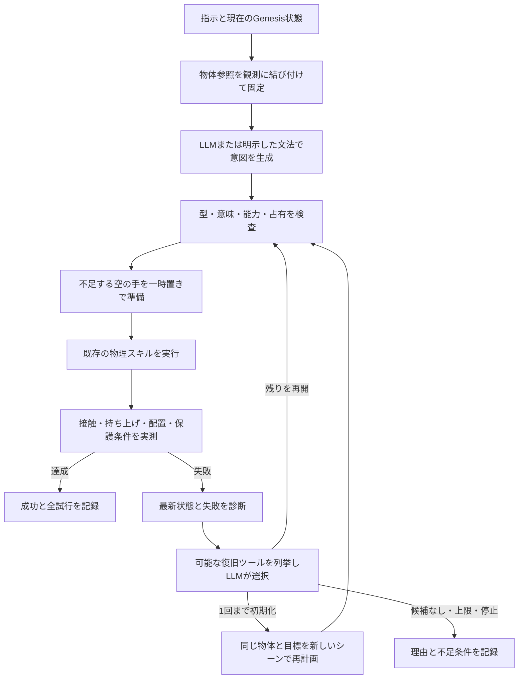

# 状況判断・準備・復旧をつなぐタスク実行

従来は、翻訳した計画を一度実行し、局所的な把持の再試行で解決しなければ終了していた。
通常ランチャーの入口に `agent/task_agent.py` を追加し、以下を一つのタスクとして扱う。



## 現在の状態と文章が食い違うとき

`agent/scene_reasoning.py` は、指や物体の観測から参照を解決する。
「右手のキューブ」には現在の右手の保持物体を使う。過去の会話に残るIDで空の手を埋めない。
手が空の場合は、明示された色の物体、またはその側にある未把持・机上のキューブが一意なら、
取得が必要な前提条件として説明してから対象を固定する。これは保持を観測したという主張ではない。
候補が複数・不在・明示された色と実保持が不一致なら、観測した状態・候補・必要条件を返す。
左右の物体参照にも現在のY座標を使い、同程度の位置なら色の指定を求める。

この参照解決には限定された表現と座標系の前提がある。任意の日本語を理解する証明ではない。
VLMの画像認識は未接続であり、状態はGenesisの登録済み物体・接触・座標から取得する。

## 手が塞がっている場合の準備

厳密な `compile_program` は、対象を取る手・受け取る手の占有を検査し、
必要な空の手を機械可読の `GroundingError.preparation` として返す。
`planning/preparation.py` が、別の保持キューブを空いた既知の机領域へ置き、
空の腕を `park_empty_arm` で退避する操作を挿入して再コンパイルする。
明示した保護条件はその後の独立した意味検査でも適用する。
最終保持の目標だけが与えられた場合も、受け手の保持物体が目標の対象外で、保護されていなければ、
理由を明示した一時置きの副目標を追加して探索できる。厳密な `compile_program` 自体の占有検査は維持する。

このとき、準備で扱う赤が「それ」の新しい対象にならないよう、
失敗した要求操作の物体IDを準備の挿入前に確定する。
準備の理由と対象は `planning_evidence.preparations`、元の要求は `requested_program` に残る。
一時置きの候補は物体寸法と既知の位置から選ぶ。連続軌道の可否や実把持は実行時に別途検査する。

## 失敗した後の判断

実行結果と最新の接触・保持・位置を読み、既存の操作だけで復旧できる候補を作る。
LLMに任意のPython、関節軌道、物体の位置書換えを生成させない。

- `resume`: 全スキルが実際に完了した操作だけを除き、未完了の手順を現在の状態から再コンパイルする。
  接近が成功しただけの取得、途中の受け渡しは完了操作として扱わない。
- `reset_and_retry`: 失敗を保存してシーンを初期化し、同じ物体IDと要求された役割で再試行する。
  手を省略した取得は、新しい配置・IKの入場検査から手を再選択できる。
  古い占有を解消するための一時置きも再計算し、不要になった準備を繰り返さない。

`AgentPlanner.assess_failure` は指示、失敗、最新観測、合法な候補を受け取り、選択と理由を返す。
モデルの理由は診断であり、物理状態の証拠ではない。選択はコード側でも候補集合と照合する。
モデルを利用できない場合は `deterministic_fallback` として、再開を優先する規則へ戻る。

最大3試行、初期化は最大1回。元の配置での失敗は消さない。
位置保持の明示、ワイン、投げ上げ、相対移動、関節操作は自動初期化・再実行の対象外。
初期化しても元の指示を実行可能にできない場合や、候補がない場合は理由付きで止まる。
停止要求はモデル待ち・復旧の前後でも確認する。

同じシーン内で再開した場合は、最初の物体位置と全体の最終条件を独立して再検査する。
初期化した場合は新しいシーンの開始位置を比較基準にする。
これは元のランダム配置の問題を解決した証拠ではなく、別の初期状態からの再試行である。

## 記録と検証

Webには「状況判断と復旧」を表示する。APIの次の項目から詳細を追える。

- `agent_trace`: 対象の決め方、不足条件、準備、失敗、LLMの復旧判断とプロバイダー。
- `agent_attempts`: 失敗を含む各計画・スキル・実測結果。
- `verification.scene_resets`: シーンを初期化した回数。
- `verification.all_agent_attempts_succeeded`: 最終成功でも途中失敗があれば `false`。
- `verification.agent_final_postconditions`: 再開後にも全体の最終条件を検査した結果。

```bash
uv run pytest -q
uv run python scripts/verify_task_agent.py --json outputs/task-agent-physics.json
uv run python scripts/verify_task_agent.py --case failed_layout --local-reasoning --json outputs/task-agent-local-recovery.json
# 以下の言語検査が読む、実測した机上・保持・積み重ねの状態を先に作る
uv run python scripts/verify_goal_planning.py --json outputs/goal-planning-verified.json
uv run python scripts/verify_language_challenge.py --json outputs/language-challenge-verified.json
uv run python scripts/verify_language_challenge.py --suite holdout --json outputs/language-holdout.json
```

2026-10-24の実Genesis検査では、右手が空の取得・受け渡し、左手の赤を一時置きして青を受け取る動作を確認した。
受け手準備の確定版は `outputs/task-agent-occupied-verified.json` に保存した。
以前失敗したシード `20261023` では、実際に `MOTION_BLOCKED` が再現し、1回の初期化後に同じ青の取得が成功した。
`outputs/task-agent-local-recovery.json` には、実Ollamaによる `reset_and_retry` の選択と、失敗・成功の2試行を保存した。
接触・保持のモックや、把持したことにする物体の位置書換えは使っていない。
最終保持だけを与えた受け手準備も、`outputs/task-agent-goal-receiver.json` で約4.24秒・再試行なしの成功を確認した。
このケースは型付き目標からの物理試験で、自然文の意味解釈は別に検査する。

言語の検査は、記録済みのGenesis状態に対する意味・引数・順序・拒否の検査である。
32件の初期診断では20件しか期待と一致しなかった。物理成功率でも、未知の指示全般の精度でもない。
追加の8件は初回5件成功で、その失敗も調べて回帰検査へ加えた。未見の評価セットとしては扱わない。
最終記録は32/32（`outputs/language-challenge-current.json`）、追加8/8（`outputs/language-additional-current.json`）。
32文の内訳はモデル採用10件、定型文16件、期待した拒否6件である。全体回帰は221件成功。
この実装は実行可能な既存操作を使うエージェントであり、新しい接触技能や研究上の新規性・最先端への優越を実証してはいない。
