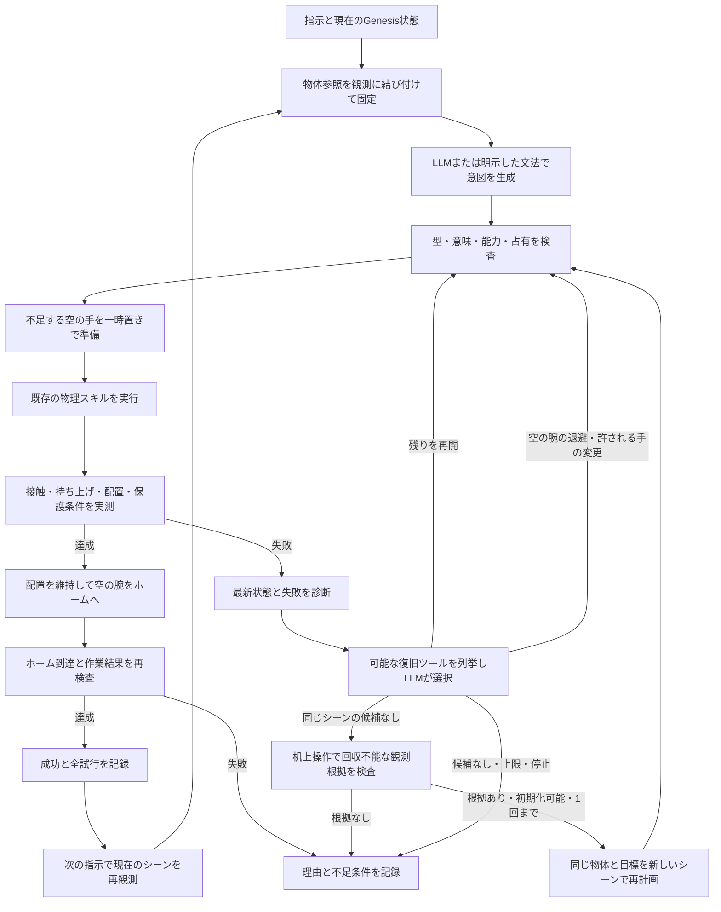

# 状況判断・準備・復旧をつなぐタスク実行

通常ランチャーの入口 `agent/task_agent.py` は、前のタスクが残した物体の状態から次のタスクを進める共通の実行ループである。
積み重ね専用の分岐ではなく、観測、参照解決、準備、計画、物理実行、完了時の退避、復旧を一つのタスクとして扱う。



## シーンを引き継ぐタスク境界

新しい指示の入口で必ず `executor.world_state()` を呼び、Genesisから現在の関節、物体の位置・姿勢、
接触、保持、支持関係を読み取る。初期化時や前のタスク開始時の配置を使って次の計画を作らない。
観測は `agent_trace` の `scene_observed`、計画の `planning_evidence.task_start_observation`、
結果の `initial_world_state` に残す。前の成功で残した積み重ね・配置・参照履歴を引き継ぐ。
キーワードから異なる種類のシーンが必要だと分かっても、作業履歴があるシーンを自動で破棄しない。

物体操作の成功後は、`TaskExecutor.home_empty_arms` が空の腕を退避する。
物体を保持する最終目標では、保持している腕と指はその要求を維持する。
手先移動・関節操作など最終姿勢そのものを要求した指示には、この自動退避を適用しない。
ホーム復帰と配置維持を確認してから成功を通知し、復帰に失敗しても完了済み操作を再実行しない。

`skills/homing.py` は現在の関節と物体姿勢から復帰経路を選ぶ。
標準ホームと必要な余裕が空いていればその関節姿勢へ戻し、現在の物体で塞がれていれば、標準ホーム付近の干渉しない待機姿勢を選ぶ。
公式OpenArmの標準姿勢は机に手を伸ばすため、作業後の物体が占める場合がある。
選んだ関節目標は `target_joint_positions`、調整理由は `home_adjustment_reason` に記録する。
OpenArmは公式モデルの私有FKデータに**現在**の両腕・指・物体姿勢を反映し、経路の衝突と物体からの30mmの余裕を幾何検査する。
作業直後の腕がその余裕の内側にいる場合は、既存の距離を縮めずに離れる経路を許し、退避先では30mmの余裕を要求する。
物理計算はGenesisだけが行う。動作中にも実接触、置いた物体の2mm超の変位、他方の保持喪失を検出すると停止する。
目標関節の最大残差25mrad以内、退避全体で未把持物体の変位6mm未満を確認し、剛体タスクは元の全最終条件も再測定する。
幾何のサンプリングは連続経路に対する数学的な無衝突保証ではなく、実測監視と併用する。

`skills/approach.py` も、固定の机上高さを全配置へ流用せず、現在の物体位置から到達可能な接近高さ・関節解を探索する。
OpenArmでは実行する関節曲線を現在の配置で幾何検査する。これにより、前の作業で高い場所へ移った物体も同じ接近処理の対象になる。
受け渡しでも現在の物体回転を使い、キューブが前の操作で180度回転していれば、等価な面の座標系から対向する受け手の姿勢を選ぶ。
インポート機はその機種の接近実装と衝突プランナーを使う。任意機種の把持精度をこの変更だけで保証するものではない。

## 現在の状態と文章が食い違うとき

`agent/scene_reasoning.py` は、指や物体の観測から参照を解決する。
「右手のキューブ」には現在の右手の保持物体を使う。過去の会話に残るIDで空の手を埋めない。
手が空の場合は、明示された色の物体、またはその側にある未把持・机上のキューブが一意なら、
取得が必要な前提条件として説明してから対象を固定する。これは保持を観測したという主張ではない。
候補が複数・不在・明示された色と実保持が不一致なら、観測した状態・候補・必要条件を返す。
左右の物体参照にも現在のY座標を使い、同程度の位置なら色の指定を求める。

この参照解決には限定された表現と座標系の前提がある。任意の日本語を理解する証明ではない。
VLMの画像認識は未接続であり、状態はGenesisの登録済み物体・接触・座標から取得する。

## 手が塞がっている場合の準備

厳密な `compile_program` は、対象を取る手・受け取る手の占有を検査し、
必要な空の手を機械可読の `GroundingError.preparation` として返す。
`planning/preparation.py` が、別の保持キューブを空いた既知の机領域へ置き、
空の腕を `park_empty_arm` で退避する操作を挿入して再コンパイルする。
明示した保護条件はその後の独立した意味検査でも適用する。
最終保持の目標だけが与えられた場合も、受け手の保持物体が目標の対象外で、保護されていなければ、
理由を明示した一時置きの副目標を追加して探索できる。厳密な `compile_program` 自体の占有検査は維持する。

このとき、準備で扱う赤が「それ」の新しい対象にならないよう、
失敗した要求操作の物体IDを準備の挿入前に確定する。
準備の理由と対象は `planning_evidence.preparations`、元の要求は `requested_program` に残る。
一時置きの候補は物体寸法と既知の位置から選ぶ。連続軌道の可否や実把持は実行時に別途検査する。

## 失敗した後の判断

実行結果と最新の接触・保持・位置を読み、既存の操作だけで復旧できる候補を作る。
LLMに任意のPython、関節軌道、物体の位置書換えを生成させない。

- `resume`: 全スキルが実際に完了した操作だけを除き、未完了の手順を現在の状態から再コンパイルする。
  接近が成功しただけの取得、途中の受け渡しは完了操作として扱わない。
- `recover_in_place`: 空のグリッパーの接触解消と退避を行い、同じ物体配置から残りを再計画する。保持中の腕を開放しない。
- `alternate_arm`: 手の指定を省略した単一取得に限り、同じ物体を別の利用可能な手で取得する。明示された手の役割は変更しない。
- `replan`: 失敗が**測定値**を伴うとき（例: 投げが「取れたストローク 2 cm・離床 0.42 m/s」と報告した）に限り候補になる。
  残りの手順を同じ計画で再開すると同じ失敗を繰り返すため、`AgentPlanner` に**新しい計画**を書かせる。
  失敗の数値は `recent_experience` として渡す。「下がってから投げる」は既存の `move` で表現できる。
  常時候補にしない理由: 常に候補があると「同じシーン内で使える手段が尽きたら停止する」という契約が成立しなくなる。
- `reset_and_retry`: 同じシーン内の候補がなくなり、`agent/recovery_policy.py` の観測根拠がある場合の最後の候補。
  対象の物理状態の欠落・非有限値、または対象が机より10cm以上下へ落下し、実装済みの机上スキルでは回収できない場合に限る。
  通常のIK・経路・把持失敗を理由に初期化しない。保持中の物体があれば候補にしない。
  初期化した場合は失敗を保存し、同じ物体IDと明示された役割を保って新しいシーンで再計画する。

`AgentPlanner.assess_failure` は指示、失敗、最新観測、合法な候補を受け取り、選択と理由を返す。
モデルの理由は診断であり、物理状態の証拠ではない。選択はコード側でも候補集合と照合する。
モデルを利用できない場合は `deterministic_fallback` として、再開を優先する規則へ戻る。

最大4試行、初期化は最大1回。元の配置での失敗は消さない。
位置保持の明示、ワイン、投げ上げ、相対移動、関節操作は自動初期化・再実行の対象外。
初期化しても元の指示を実行可能にできない場合や、候補がない場合は理由付きで止まる。
停止要求はモデル待ち・復旧の前後でも確認する。

同じシーン内で再開した場合は、最初の物体位置と全体の最終条件を独立して再検査する。
初期化した場合は新しいシーンの開始位置を比較基準にする。
これは元のランダム配置の問題を解決した証拠ではなく、別の初期状態からの再試行である。

## 記録と検証

Webには「状況判断と復旧」を表示する。APIの次の項目から詳細を追える。

- `agent_trace`: 対象の決め方、不足条件、準備、失敗、LLMの復旧判断とプロバイダー。
- `agent_attempts`: 失敗を含む各計画・スキル・実測結果。
- `agent_recoveries`: 選んだ復旧、退避の結果、復旧前後の観測。
- `post_task_homing`: 完了後の空の腕の退避、選択した関節目標、物体変位。
- `verification.scene_resets`: シーンを初期化した回数。
- `verification.all_agent_attempts_succeeded`: 最終成功でも途中失敗があれば `false`。
- `verification.agent_final_postconditions`: 再開後にも全体の最終条件を検査した結果。

```bash
uv run pytest -q
# 一つの物理シーン内で複数の指示を継続する検査。実行中のビューアーを閉じてから行う。
uv run python scripts/verify_persistent_scene.py --json outputs/persistent-scene.json
uv run python scripts/verify_task_agent.py --json outputs/task-agent-physics.json
# 以下の言語検査が読む、実測した机上・保持・積み重ねの状態を先に作る
uv run python scripts/verify_goal_planning.py --json outputs/goal-planning-verified.json
uv run python scripts/verify_language_challenge.py --json outputs/language-challenge-verified.json
uv run python scripts/verify_language_challenge.py --suite holdout --json outputs/language-holdout.json
```

現在の回帰は `uv run pytest -q` で230件成功、29.26秒。
`outputs/persistent-scene.json` では、一つのGenesisシーン・一つの実行器に3指示を続けて送り、
取得・受け渡し・積み重ね、積んだ青の取得・逆向きの受け渡し・机への配置、再取得・受け渡し・再積み重ねを確認した。
初期化0回、各指示の外側の再試行0回、指示ごとのホーム復帰と配置の継承が成功した。
左は標準ホームの余裕を物体が占めるため周辺の待機姿勢、右は標準ホームを選んだ。
ホーム目標との最大関節残差は約0.000061rad、退避中の物体変位はこの記録では0mであった。
この検査は明示した決定的な文法経路を使い、LLMの自由文精度やVLM、全機種への一般化の検査とは分けている。

`outputs/task-agent-persistent-policy.json` では、空の手の取得・受け渡し、塞がった受け手の準備、型付き最終保持目標の3ケースが成功した。
保持を要求した腕は保持を維持し、空の腕だけが退避する。一方、難しいランダム配置 seed `20261023` の取得は3試行後も未成功で、初期化0回のまま状態と理由を残して停止した。
この4ケース全体の検証は終了コード1であり、ランダム配置の物理成功率が解決したという記録ではない。

通常ランチャーとWebの実行ボタンを通した取得・受け渡し・積み重ね・退避も約14.73秒で成功した。
`outputs/native-persistent-scene.json` に結果を保存し、Webの完了表示と正しい3操作の解釈を確認した。
続いて異なる種類のシーンを要求する指示を送ると `SCENE_CHANGE_REQUIRED` で停止し、既存の積み重ねを維持した。
その前後の実測を `outputs/native-scene-preservation-policy.json` に保存した。

以下は以前の `8864ad0` の検証記録であり、現在の初期化条件と区別する。
2026-10-24の実Genesis検査では、右手が空の取得・受け渡し、左手の赤を一時置きして青を受け取る動作を確認した。
受け手準備の確定版は `outputs/task-agent-occupied-verified.json` に保存した。
以前失敗したシード `20261023` では、実際に `MOTION_BLOCKED` が再現し、1回の初期化後に同じ青の取得が成功した。
`outputs/task-agent-local-recovery.json` には、実Ollamaによる `reset_and_retry` の選択と、失敗・成功の2試行を保存した。
その通常のIK・把持失敗からの初期化は、現在のポリシーでは許可しない。
接触・保持のモックや、把持したことにする物体の位置書換えは使っていない。
最終保持だけを与えた受け手準備も、`outputs/task-agent-goal-receiver.json` で約4.24秒・再試行なしの成功を確認した。
このケースは型付き目標からの物理試験で、自然文の意味解釈は別に検査する。

言語の検査は、記録済みのGenesis状態に対する意味・引数・順序・拒否の検査である。
32件の初期診断では20件しか期待と一致しなかった。物理成功率でも、未知の指示全般の精度でもない。
追加の8件は初回5件成功で、その失敗も調べて回帰検査へ加えた。未見の評価セットとしては扱わない。
最終記録は32/32（`outputs/language-challenge-current.json`）、追加8/8（`outputs/language-additional-current.json`）。
32文の内訳はモデル採用10件、定型文16件、期待した拒否6件である。全体回帰は221件成功。
この実装は実行可能な既存操作を使うエージェントであり、新しい接触技能や研究上の新規性・最先端への優越を実証してはいない。


## 計画の来歴（どの成分が決めたか）

`AgentPlan` は1リクエストごとに次を持つ。`provider` だけでは「モデルが同意した」と「モデルを呼んでいない」を区別できないため。

- `model_called` / `skipped_because`: モデルを呼んだか、呼んでいないならその理由
  （`provider_not_configured` / `exact_grammar_fast_path` / `single_direct_command`）
- `fallback_verdict` / `model_verdict` / `agree`: 決定論の判定、モデル自身の判定、両者の一致
- `capability_mode` / `shadow`: 能力モード（文法が通ってもモデルに聞く）と、影実行（決定論が答えた後で記録だけ）

`/api/config/status` は `capability_mode`・`shadow_mode`・`fast_language` を公開し、
`roles` で system1（監視＝型付き判定）/ system2（計画）/ physics を区別して示す。

## 物理量の基盤（`backend/app/physics`）

式と単位と前提を1か所に持ち、名前で問い合わせる。計画側は算術をせず、skill は私有の定数を持たない。

- `GET /api/physics`: 使える関係の一覧（名前・単位・引数・前提）
- `POST /api/physics/evaluate`: 1つを評価（未知の名前・引数不足は例外。黙って0を返さない）
- 例: `release_speed_for_rise`（3 cm の上昇に必要な離床速度 0.767 m/s）、`friction_speed_bound`
  （摩擦が接触時間内に与えられる速度差。短く速いストロークで投げられない理由）、`launch_for_target`
  （指定した飛翔時間で目標点を通る初速）、`closing_reserve`（注ぎ終いの流出量）

## 診断

- `POST /api/diagnostics/pinch?object=red_cube&observer=true`: viewer プロセスの**中で**把持→持上げを実行し、
  判定ではなく数値を返す（`gripper_position`・`pinch_established`・パッドのリンク・生の接触）。
  API プロセスからは Genesis 世界に触れないため、この経路が無いと「アプリの世界が違うのか、経路が違うのか」を分離できない。

## 判定モデルの画像入力（実測 2026-10-27）

`d1-omni-600M` は画像を状態の一部として受け取れる（`scripts/d1_decision_server.py` の `images` に base64 PNG/JPEG）。
CPU で1リクエスト 0.8 秒。合成画像での実測:

- 「いくつ写っているか」= **two (0.97)** ✓ 内容は読めている
- 「赤は左か」= 左右を入れ替えても**答えが反転しない** ✗（choice/noul どちらも）
  合成画像（平坦な矩形）が学習分布から遠い可能性が高い

⇒ 画像を **system1 の入力にできる** ✓ が、**空間関係の質問は実写/レンダ画像とラベル付き検証を通すまで信頼しない** ✗。
Genesis で RGB-D をレンダし、真値をラベルにして「遮蔽・積み重なり・左右」の質問を校正するのが次の段階。

## 判定モデルの起動と、実測で分かっていること（2026-10-27）

```
scripts/serve_models.sh all        # d1 :11435 / SAM 3.1 :11436（どちらも任意）
OPENARM_DECISION_URL=http://127.0.0.1:11435 ./run_genesis_gui.sh --headless
```
- 重みは **`/data/hf-cache`**（`HF_HOME`）。`~/.cache/huggingface` には置かない。
- どちらも**無くても動く**。無い場合 `monitor` フィールドが出ないだけで、判定は決定論の側に残る。
- **`noul` は P(YES)**（実測: 「空は青いか」0.92 ✓／「腕にジョイントはあるか」0.97 ✓／「立方体は自力で飛べるか」0.13 ✗）。
  逆向きに読むと**一致を不一致として記録**してしまう（初版がそうだった）。
- **CPU の実測は 3.8 秒/判定**。System1 の「反射」としては遅いので、ステップ毎の監視は
  **測定した所要時間が 3 秒を超えたら以後 `skipped_because=measured_latency_too_high` として省く**。
  失敗時の復旧判定（1回だけ・15秒）はこの制限の外。
- 保持が**終わる**ステップ（`release_object`/`throw_object`）は、ステップ毎の「保持しているか」質問の
  対象外。文面が矛盾するため。
- テキストだけの判定なら `OPENARM_DECISION_MODEL` で **より大きい d1** を指せる（既定は omni-600M）。
  600M は実測で「片腕ロボットに `alternate_arm` を確信度 0.80 で選ぶ」ので、**合法手フィルタが生命線**。

## 判定モデルの校正（2026-10-27 実測）

`scripts/calibrate_decision_model.py` は**真値が状態から分かる**ケースだけを使い、実際に使う質問を採点する
（`overall 5/11`）。結果はコードにも `trusted`/`measured` として記録し、番人テストで
「測っていない質問を trusted にしない」ことを固定している。

| 質問 | 正解 | 所見 |
|---|---|---|
| `outcome_achieved` | **3/6** | 偶然と同じ。**計画に使わない**（記録のみ） |
| `next_step_blocked` | **2/3** | 僅かに上回るが件数不足。**まだ使わない** |
| `reference_ambiguous` | **0/2** | 両方向に間違い。**使わない** |
| 復旧手の選択（`assess_failure`） | 実運用で妥当 | **合法手フィルタ必須**（違法手を 0.80 で選んだ実測あり） |
| 内容の質問（`count` など） | **0.97** | 画像の内容把握は使える |

⇒ 600M は「幾何でも意味判断でもない、**内容の把握**」と「**合法手からの選択**」に限定して使う。
意味判断を本気で使うなら、**同じラベルでより大きい d1（`OPENARM_DECISION_MODEL`）を測ってから**にする。

### モデルを変えて同じラベルで測った（2026-10-27）

`--inline LiquidAI/d1-3B`（bf16 5GB・CPU）で同じ11ケースを採点: **9/11**（omni-600M は 5/11）。

| 質問 | omni-600M | d1-3B | 採用 |
|---|---|---|---|
| `next_step_blocked` | 2/3 | **3/3**（信頼度 0.96–0.98） | **trusted** |
| `reference_ambiguous` | 0/2 | **2/2**（0.92） | **trusted** |
| `outcome_achieved` | 3/6 | **4/6**（"stacked" と "hands empty" を誤り） | **使わない**（記録のみ） |

既定の判定モデルは `LiquidAI/d1-3B`（`OPENARM_DECISION_MODEL` で変更可）、`scripts/serve_models.sh` は
bf16 の 5GB に合わせて `MemoryMax=12G`。**3件/2件という標本の小ささ**は明記しておく: 状況の**説明**には使えるが、
それを唯一の根拠に行動は決めない。

### 関係を「文章」で渡すと score が上がる（2026-10-27）

`fact_packet` に **`statements`**（導出した関係の短文: 「blue_cube is above red_cube」）を足し、判定モデルには
**言語の照合**だけをさせる形にした。同じ12ケースで `outcome_achieved` は **7/12 → 9/12**。
残る外しは「積み」「右」で、**座標推論を要求しない形にしても空間関係は苦手**という結果は変わらない。
したがって `trusted` は据え置き（`next_step_blocked` 3/3・`reference_ambiguous` 2/2 のみ）。

## 投げの設計と弧の選び方（2026-10-27 実測）

投げは**物理式から設計**し、**engine が実測**して判定する。失敗は必ず数値で返る。

| レバー | 範囲 | 意味 |
|---|---|---|
| `stroke_cm` | 2–30 | 離すまでの腕の移動量 |
| `release_speed_m_s` | 0.2–3.0 | 要求する離床速度（既定は `√(2gh)` を実測伝達率 0.81 で割った値） |
| `flight_time_s` | 0.10–1.00 | **狙い**の飛翔時間（短い＝低く速い弧、長い＝高い弧） |
| `back_off_cm` | 0–20 | ストローク前の余裕 |

- **狙い投げ**では、振り上げ後に**到達可能な最も低い弧**を skill が選ぶ（計画のみ・キューブを失わない）。
  実測（近接キューブ）: 0.30–0.26 は**ストロークが届かず**、0.22 は届くが**116mm 外す**、**0.18/0.16 は命中**（66.7mm/57.4mm、許容 70mm）。
- **再現性の実測**: 近接キューブの狙い投げを既定要求（0.30 s）で5回 → **5/5 成功**、最接近は毎回 57.1mm、ramp 0.257 s（同一）＝in-process では決定論的。
- 成功判定は**engine 実測**のみ: 命中（最接近 ≤ 70mm）＋**解放が観測できること**（狙い投げは `upward_min=0`、
  低い弧では上向き速度が 0.1 m/s を超えないため）。旧「自由飛行 20ms 以上」は実測（6–9ms の命中）を誤って棄却した。
- **飛翔時間のラダーは不可**（失敗でキューブが手を離れる）、**計画だけの事前スキャンも不可**（振り上げ後の EE を予測できない）。

## 実装上の単一 owner（レビューで整理）

- **ピンチの再確立**は `ImportedRobotSkills._regrasp(arm, obj, bias)` のみ。開く → 顎を置き直す → 測定で有効なバイアスで
  閉じる → 物理接触で検証、を1箇所に置き、把持の再試行・持上げの再試行・投げの入口がこれを使う（以前は3箇所に
  同じ4行があった）。
- **配置オフセット**は `_approach_planned` の `aim = before + shift` に一本化。`before` は物体の実姿勢（変位検査用）、
  `aim` は顎を向ける先（計画用）。レビューで「配線だけして無視していた」ことが判明したため、計画座標が実際に `aim` を使う。
- **投げの弧**は振り上げ後に1回だけ選ぶ（`_throw_once`）。ラダーや事前スキャンは実測で否定済み（前節）。

## 汎用化の残件: 流体（ワイン注ぎ）を imported 機体でも使えるようにする（2026-10-27 実測）

現状は**シーン生成の入口で拒否**される:
```
create_backend('wine', robot_id='open_manipulator_x-…')
  -> ValueError: Wine manipulation needs a calibrated physical gripper profile
```
理由は**能力不足ではなく配置**にある（実測）:

- `WineWorld(scene, gs, *, fixed_bottle=False, async_surface=True)` は **`scene` と `gs` だけ**を受け取り、
  OpenArm に依存しない（ボトル・グラス・SPH 液体・表面レンダラを作るだけ）。
- ただし**配線が公式 env にしかない**: `generic_environment.py` には `fluid`/`wine` の記述が **0 件**、
  `environment.py` 側に `WineWorld(...)` と `fluid_state()` がある。
- `pour_liquid` スキル・計画の `pour` op・物理基盤（`pour_time_for_volume` / `closing_reserve`）は**すでに汎用**。

**実装済み（2026-10-27）**: `GenericURDFEnvironment` が `scene_profile='wine'` を構築できるようになり、
imported 機体で **液体状態が読める** ことを実測:
```
objects: wine_bottle [0.44,0.29,1.091], wine_glass [0.62,0.06,1.006]
fluid  : SPH / 8 particles / 51.2 mL / glass 0 / spilled 0
```
`create_backend` の**無条件拒否**は条件付きに置換（gripper があり `grasp_calibrated` で、口径 ≥ 50mm）。

**配置も実装済み（2026-10-27）**: ボトル/グラスを**その機体のテーブル上・可達域内**に置けるようにした
（`WineWorld(..., bottle_position=, glass_position=)`）。imported 4自由度機体で実測:
```
wine_bottle [-0.05, 0.04, 0.845]  (テーブル 0.755 + ボトル高)
wine_glass  [-0.05, -0.07, 0.761]
fluid       SPH / 8 particles / 51.2 mL / glass 0 / spilled 0
```
残る阻害は**高さ**（実測）: ボトルの注ぎ口は z=0.97 で、4自由度機体はその把持姿勢に **MOTION_BLOCKED**
（`Cannot reach [-0.06, 0.04, 0.978]`）。選択肢は ①機体を高く据える ②低いボトル形状 ③**6自由度機体（UR5e）**で行う。
流体側は問題なし（状態は読めている）。

元の手順（参考）:
1. `GenericURDFEnvironment` に `scene_profile == 'wine'` の分岐を足し、`WineWorld(scene, gs, …)` を生成。
2. ボトル/グラスを `_objects` に登録し、`fluid_state()`・`fluid` フレーム・`object_contacts` を公式 env と同じ形で公開。
3. `create_backend` の `robot_id != 'openarm_v2' and profile == 'wine'` の**無条件拒否**を、
   「グリッパが物理検証済み（`grasp_calibrated`）で、口径がボトルを掴める」場合に許可する条件に置き換える。
4. 受入: imported 機体で `approach → grasp → lift → pour_liquid(20 mL)` が通り、`spilled_ml` と
   `poured_ml` が engine から出る（公式セルと同じ検証経路）。

**d1 も VLM もこの作業には不要**（判断ではなく配線だから）。モデルは `pour` op を計画し、engine が量を測る。

## d1 を「反射」に使えるか — 実測（2026-10-27）

注ぎの状況を型付きで問うた結果（`d1-3B`、CPU）:

| 状況 | 「今止めるべきか」 | 「次に何をするか」 | 所要 |
|---|---|---|---|
| こぼれ 2.4 mL 上昇中 | **p=0.549** ✗（ほぼ五分） | **continue** ✗（0.58） | **3.8 s** |
| こぼれ 0.0 mL | p=0.075 ✓ | continue ✓ | 1.6 s |

読み取れること:

- **反射には使えない** ✗。3.8 秒は注ぎの 1 滴（~0.1 秒）より桁違いに遅く、しかも「こぼれている」状況で
  **止める**を選ばなかった。安全側の判断をモデルの確率に委ねるのは危険。
- **反射は engine の閾値で行う** ✓（`spilled_ml > 0` → 即 upright ✓・物理 1 ティック ✓）。実際 `pour_liquid` は
  `MAX_SPILL_ML` と `closing_reserve` で既にこの形。
- **d1 の居場所は遅いループ** ✓: 事象の**後**に「何が起きたか／どう解釈するか／合法な復旧はどれか」を型付きで答える
  （復旧選択は 3/3 ✓・曖昧さ 2/2 ✓ と実測済み）。判断は**非同期・advisory**で、制御ループには入れない。
- 三層の分担: **engine 閾値（~ms）→ d1（~2-4 s、事象ごと）→ qwen（計画、~2 s/プラン）**。

### UR5e で注ぐ場合の現状（2026-10-27 実測）

- wine シーンは UR5e でも**構築可能**だが、入口のゲートが止める:
  `grippers=True grasp_calibrated=False`（＝物理ピンチ未検証）。
- UR5e の把持を cubes シーンで試すと **`COLLISION_PATH`** で失敗し、校正は付かない。内訳（実測）:
  **`corridor_none: 24` / `seed_in_collision: 2`（26 通り、rotations 1）** —— **IK はほぼ通っている**のに
  **挿入経路が全滅**している。対象は基部の直近（cube z=0.80、腕の初期関節は `[-0.66,-0.52,-1.56,1.42,-1.90,0.10]`）
  なので、**机上を腕が掃く**経路になっている可能性が高い（既知の `forearm_link ↔ desk` 系）。
  **接近高度は原因ではない**（実測）: `OPENARM_APPROACH_HEIGHTS=0.20,0.14,0.10,0.06` でも
  `corridor_none: 24` は**まったく同じ**。したがって失敗は「高い所からの降下」ではなく、**挿入の直線区間で
  把持姿勢を保てない**こと（`_plan_corridor` の各 waypoint で `solve_ik` が落ちる）。次は挿入点ごとの
  IK 誤差と関節限界を記録して、どの点で・なぜ落ちるかを見る。
- したがって順序は: ①UR5e の接近経路を通す（`COLLISION_PATH` の内訳を読む）→ ②把持成功で `grasp_calibrated` が付く
  → ③wine シーンが許可され、ボトルは既に可達域配置。流体側は準備済み。
